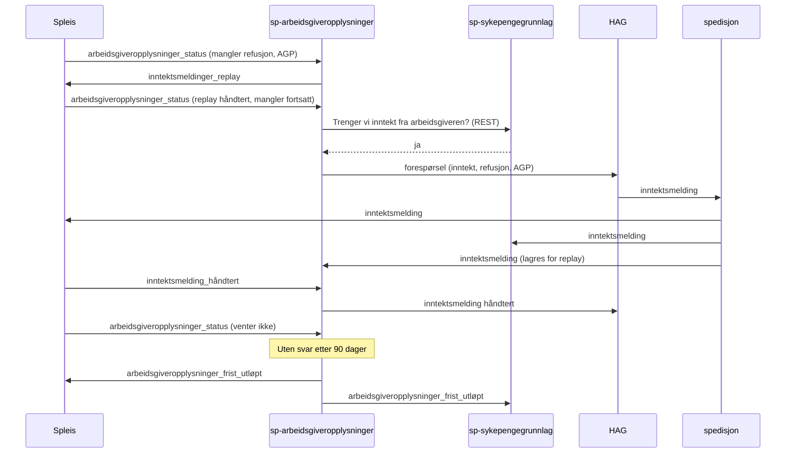

# Forespørsel til arbeidsgiver utenfor Spleis

Dette dokumentet beskriver hva som skal til for å flytte protokollen for å be arbeidsgiveren om opplysninger ut av Spleis. I [domenetjenesten for inntekt og sykepengegrunnlag](sykepengegrunnlag-domenetjeneste.md#forespørsel-om-og-mottak-av-inntektsmelding) blir protokollen i Spleis. Her ser vi på alternativet, der en egen tjeneste eier den.

Arbeidsnavnet i dokumentet er `sp-arbeidsgiveropplysninger`. Tjenesten kan ligge i sp-sykepengegrunnlag, men vi anbefaler en egen tjeneste fordi forespørselen også gjelder refusjon og arbeidsgiverperiode, som ikke hører til sykepengegrunnlaget.

## Sammendrag

- Spleis slutter å snakke med HAG og spill-av-im. I stedet publiserer Spleis hvilke opplysninger hver vedtaksperiode mangler, sammen med periodene arbeidsgiveren trenger for å svare.
- Tjenesten eier replay, forespørsel, oppdatert forespørsel, tilbaketrekking, regelen om at HAG ikke kan spørre om inntekt uten refusjon, 90-dagersfristen og meldingene til HAG.
- Eieren av en opplysning avgjør om den mangler. Spleis avgjør det for refusjon og arbeidsgiverperiode, sp-sykepengegrunnlag for inntekt. Tjenesten slår behovene sammen til én forespørsel, fordi HAG har ett skjema per vedtaksperiode.
- Svaret går som i dag. Inntektsmeldingen kommer fra spedisjon til Spleis, og senere også til sp-sykepengegrunnlag. Tjenesten står ikke mellom arbeidsgiveren og Spleis når svaret kommer.
- Spleis venter fortsatt i `AvventerInntektsmelding` og avgjør selv når den har nok. Tidsavbruddet på 90 dager i Spleis byttes ut med en hendelse fra tjenesten.
- Vi bygger tjenesten videre fra spill-av-im og tar inn sparkel-arbeidsgiver. Begge ligger allerede på grensen mot HAG.
- Vi migrerer i sju trinn. Bare trinn 5 (inntektsbehovet) krever at sp-sykepengegrunnlag er kommet til sitt trinn 4. Resten kan gjøres uavhengig.

## Hvorfor flytte

Tilstandsmaskinen i Spleis blander i dag domeneavgjørelser med detaljer om hvordan HAG virker:

- `opplysningerViTrenger` legger til refusjon når vi spør om inntekt, fordi skjemaet hos HAG ikke støtter inntekt alene.
- `AvventerInntektsmelding` sender replay før forespørselen, og bruker påminnelsesflaggene `trengerReplay` og `ønskerInntektFraAOrdningen` fra Spock.
- Spleis trekker tilbake forespørsler når en periode kommer ut av rekkefølge, og lager begrensede forespørsler når en periode forkastes til Infotrygd.

Endrer HAG skjemaet eller flyten, må vi endre Spleis. Når sp-sykepengegrunnlag eier inntekten, må Spleis i tillegg spørre om inntekt ut fra et lagret resultat fra en annen tjeneste. Det er utfordringen [Forespørsel ut fra et gammelt resultat](sykepengegrunnlag-domenetjeneste.md#forespørsel-ut-fra-et-gammelt-resultat). Med en egen tjeneste kan inntektseieren svare direkte.

Prisen er en tjeneste og en kontrakt til, og en ny måte saker kan bli liggende på: Spleis venter på et svar tjenesten ikke vet at noen venter på. Se [utfordringer](#utfordringer).

## Slik er det i dag

### I Spleis

| Del av protokollen | Hvor | Hva den bygger på i Spleis-modellen |
|---|---|---|
| Replay når perioden går inn i tilstanden | `AvventerInntektsmelding.entering`, `trengerInntektsmeldingReplay`, påminnelse med flagget `trengerReplay` | `opplysningerViTrenger`, og arbeidsgiverperiode for perioder innenfor arbeidsgiverperioden |
| Forespørsel etter replay | `replayUtført` og `håndterPåminnelse` kaller `sendTrengerArbeidsgiveropplysninger` | Sykmeldings- og egenmeldingsperioder i arbeidsgiverperioden, første fraværsdag for alle arbeidsgivere på skjæringstidspunktet |
| Hva vi spør om | `opplysningerViTrenger`, `skalEtterspørreInntekt` | Om perioden skal til Speil, om en tidligere periode med samme første fraværsdag allerede spør, inntekt på skjæringstidspunktet, refusjonstidslinjen, dager Nav overtar ansvar for, arbeidsgiverperioden |
| Oppdatert forespørsel etter overstyring | `Vedtaksperiode.igangsettOverstyringEndreTilstand` | Samme som over |
| Tilbaketrekking ved periode ut av rekkefølge | `sendTrengerArbeidsgiveropplysninger` sender `trenger_ikke_opplysninger_fra_arbeidsgiver` for neste periode med samme første fraværsdag | Periodene til arbeidsgiveren |
| Begrenset forespørsel ved forkasting | `VedtaksperiodeForkastetEventBuilder`, `ForkastetVedtaksperiode.trengerArbeidsgiveropplysninger` setter et flagg på `vedtaksperiode_forkastet` | Aktive og forkastede perioder og arbeidsgiverperioden |
| 90-dagersfristen | `Timeout.Etter(90 dager, Flagg("ønskerInntektFraAOrdningen"))`, regnet fra når perioden gikk inn i tilstanden | Refusjon 0 kr, varsel `RV_IV_10`, `Revurderingseventyr.inntektsmeldingSomAldriKom` |
| Når perioden kan gå videre | `vurderOmKanGåVidere`, `harInntektOgRefusjon` | Refusjonstidslinjen, vilkårsgrunnlaget, inntekt på perioder med samme skjæringstidspunkt |
| Status ut | `inntektsmelding_håndtert`, `vedtaksperiode_forkastet` | Hvilken periode som brukte inntektsmeldingen |

### Utenfor Spleis

- **sparkel-arbeidsgiver** har ingen tilstand. Fem rivers oversetter meldinger fra Spleis og skriver dem til `tbd.arbeidsgiveropplysninger` med meldingstypene `TRENGER_OPPLYSNINGER_FRA_ARBEIDSGIVER_KOMPLETT`, `_BEGRENSET`, `TRENGER_IKKE_OPPLYSNINGER_FRA_ARBEIDSGIVER`, `INNTEKTSMELDING_HÅNDTERT` og `VEDTAKSPERIODE_FORKASTET`. For `inntektsmelding_håndtert` henter den `eksternDokumentId` fra spedisjon.
- **spill-av-im** lagrer alle inntektsmeldinger, hvilke perioder som har håndtert dem, og alle replay-forespørsler (`V01__initial.sql`). Den finner inntektsmeldinger som passer en forespørsel (`matching/Forespørsel.kt`) og svarer med `inntektsmeldinger_replay`.
- **HAG** (helsearbeidsgiver-bro-sykepenger) bruker `vedtaksperiodeId` som nøkkel for forespørselen. Inntektsmeldingen fra HAG har den samme `vedtaksperiodeId`, og `NavNo*InntektsmeldingerRiver` i Spleis krever feltet.

## Målbilde



### Skillet

Eieren av en opplysning avgjør om den mangler. Tjenesten avgjør hvordan og når vi spør arbeidsgiveren.

Det betyr at Spleis fortsatt regner ut hva den mangler av refusjon og arbeidsgiverperiode, og hvilke sykmeldings- og egenmeldingsperioder arbeidsgiveren må se. Det krever arbeidsgiverperioden og periodene til arbeidsgiveren, og den kunnskapen bør ikke kopieres. Det Spleis slutter med, er alt som handler om HAG og om å vente på arbeidsgiveren.

### Ansvar

| Del | I dag | Målbilde |
|---|---|---|
| Mangler vi refusjon eller arbeidsgiverperiode | Spleis | Spleis |
| Hvilke perioder arbeidsgiveren skal se | Spleis | Spleis |
| Om en tidligere periode med samme første fraværsdag spør for oss | Spleis | Spleis. Perioden sender da tom `mangler` |
| Mangler vi inntekt (`skalEtterspørreInntekt`) | Spleis | sp-sykepengegrunnlag, fra trinn 5 |
| Inntekt krever refusjon i skjemaet | Spleis | Tjenesten |
| Replay før forespørsel | Spleis og spill-av-im | Tjenesten |
| Sende, oppdatere og trekke tilbake forespørsel | Spleis og sparkel-arbeidsgiver | Tjenesten, ut fra endringer i status |
| Begrenset forespørsel ved forkasting | Spleis setter flagg, sparkel-arbeidsgiver sender | Spleis setter flagg, tjenesten sender |
| 90-dagersfristen | Spleis (Spock-påminnelse) | Tjenesten |
| Hva som skjer når fristen går ut | Spleis | Spleis for refusjon, sp-sykepengegrunnlag for inntekt |
| Når perioden kan gå videre | Spleis | Spleis |
| Lagre inntektsmeldinger og håndtering for replay | spill-av-im | Tjenesten |
| Status til HAG | sparkel-arbeidsgiver | Tjenesten |
| `inntektsmelding_ikke_håndtert` og `_før_søknad` til spre-oppgaver | Spleis | Spleis. Dette er ikke en del av protokollen mot HAG |
| `skatteinntekter_lagt_til_grunn` | Spleis | Som i hoveddokumentet |

### Kontrakten fra Spleis

Spleis sender `arbeidsgiveropplysninger_status` for en vedtaksperiode når den går inn i, endres i eller går ut av `AvventerInntektsmelding`. Det er de samme stedene som i dag sender replay, forespørsel eller tilbaketrekking. Meldingen beskriver hele tilstanden, ikke en endring:

```json
{
  "@event_name": "arbeidsgiveropplysninger_status",
  "fødselsnummer": "...",
  "organisasjonsnummer": "...",
  "vedtaksperiodeId": "...",
  "behandlingId": "...",
  "venter": true,
  "venterSiden": "2026-09-03T10:15:00",
  "protokolleier": "Spleis",
  "håndtertReplay": "...",
  "skalBehandlesISpeil": true,
  "skjæringstidspunkt": "2026-09-01",
  "førsteFraværsdager": [{ "organisasjonsnummer": "...", "førsteFraværsdag": "2026-09-01" }],
  "sykmeldingsperioder": [{ "fom": "2026-09-01", "tom": "2026-09-20" }],
  "egenmeldingsperioder": [],
  "mangler": ["Inntekt", "Refusjon", "Arbeidsgiverperiode"],
  "harInntektFraArbeidsgiverPåSkjæringstidspunktet": false
}
```

- `venter` er sann så lenge perioden er i `AvventerInntektsmelding`. `venterSiden` er tidspunktet perioden gikk inn i tilstanden, det samme Spleis i dag regner fristen fra.
- `mangler` er tom når en tidligere periode med samme første fraværsdag spør for oss, eller når Spleis har det den trenger. Tjenesten trekker da tilbake en åpen forespørsel. Tilbaketrekking ved perioder ut av rekkefølge følger av dette: Spleis sender ny status for den senere perioden med tom `mangler`.
- `protokolleier` er `Spleis` eller `Tjenesten`. Det er bare i bruk i overgangen, se trinn 4.
- `håndtertReplay` er ID-en til den siste `inntektsmeldinger_replay` Spleis har håndtert for perioden. Tjenesten bruker den til å vite at replay er ferdig før forespørselen går ut.
- `Inntekt` står i `mangler` fram til trinn 5. Etter det avgjør sp-sykepengegrunnlag om inntekt mangler, og Spleis sender bare `harInntektFraArbeidsgiverPåSkjæringstidspunktet` (det som `kanAvklareInntekt` svarer i dag). Feltet kan fjernes når valget av inntektsmelding (`besteInntekt`) er flyttet til sp-sykepengegrunnlag.
- For perioder innenfor arbeidsgiverperioden er `skalBehandlesISpeil` usann. Tjenesten gjør replay med arbeidsgiverperiode for dem, men sender ingen forespørsel, slik Spleis gjør i dag.

`vedtaksperiode_forkastet` med flagget `trengerArbeidsgiveropplysninger` beholdes. Tjenesten leser den i stedet for sparkel-arbeidsgiver.

Spleis tar imot to meldinger fra tjenesten:

- `inntektsmeldinger_replay` som i dag. `InntektsmeldingerReplayRiver` endres ikke.
- `arbeidsgiveropplysninger_frist_utløpt` med `vedtaksperiodeId`. Spleis gjør det tidsavbruddet gjør i dag: setter refusjon til 0 kr der den mangler, lager `RV_IV_10` og går videre. Spleis ignorerer meldingen hvis perioden ikke lenger venter.

### Kontrakten mot sp-sykepengegrunnlag

Fra trinn 5 spør tjenesten sp-sykepengegrunnlag om inntekt mangler før den sender forespørselen. Vi bruker REST, ikke rapiden, fordi forespørselen skal gå ut én gang med riktig innhold. Et asynkront svar ville gitt en forespørsel uten inntekt som må oppdateres, og arbeidsgiveren kan ha åpnet skjemaet i mellomtiden.

```
POST /api/inntektsbehov
{ "fødselsnummer", "organisasjonsnummer", "skjæringstidspunkt", "førsteFraværsdag",
  "harInntektFraArbeidsgiverPåSkjæringstidspunktet" }
-> { "trengerInntekt": true, "årsak": "IkkeVilkårsprøvd" }
```

Reglene fra `skalEtterspørreInntekt` flytter til sp-sykepengegrunnlag:

- Har vi inntekt fra arbeidsgiveren på skjæringstidspunktet, spør vi ikke.
- Er første fraværsdag i en annen måned enn skjæringstidspunktet, spør vi ikke, fordi A-ordningen uansett vinner (§ 8-28 tredje ledd).
- Er skjæringstidspunktet ikke vilkårsprøvd, spør vi.
- Bygger grunnlaget på A-ordningen for arbeidsgiveren, spør vi.

Tjenesten lytter også på `endret_sykepengegrunnlag`. Har den åpne forespørsler på samme skjæringstidspunkt, spør den sp-sykepengegrunnlag på nytt og oppdaterer forespørselen hvis svaret er endret.

Når fristen går ut, leser sp-sykepengegrunnlag `arbeidsgiveropplysninger_frist_utløpt` og bruker A-ordningen. Da trenger ikke Spleis å sende fristen i behovet `Sykepengegrunnlag`, slik hoveddokumentet beskriver for trinn 4.

### Kontrakten mot HAG

Kontrakten mot HAG endres ikke. Tjenesten skriver de samme meldingstypene til `tbd.arbeidsgiveropplysninger` som sparkel-arbeidsgiver gjør i dag, med fødselsnummer som nøkkel.

`vedtaksperiodeId` er fortsatt nøkkelen for forespørselen. Svaret fra HAG har samme ID, og Spleis bruker den til å finne perioden. En egen `forespørselId` ville gjort tjenesten friere til å velge hvilken periode som spør, men det krever endringer hos HAG, i spedisjon og i `NavNo*InntektsmeldingerRiver`. Vi venter med det.

### Hvor tjenesten skal bo

| Alternativ | Fordeler | Ulemper |
|---|---|---|
| Bygge videre fra spill-av-im og ta inn sparkel-arbeidsgiver | Har allerede database med inntektsmeldinger, håndtering og replay-forespørsler, og matchingen i `Forespørsel.kt`. Én app mindre å drifte | Navnet passer ikke lenger. Appen får mer ansvar enn i dag |
| Ny app | Ren start med mønsteret fra sp-vilkarsproving (outbox, `PersonAvstemmingService`) | Må flytte data fra spill-av-im eller kalle den |
| Del av sp-sykepengegrunnlag | Inntektsbehovet blir et kall i samme prosess | Tjenesten får ansvar for refusjon og arbeidsgiverperiode, som ikke hører til grunnlaget |

Vi anbefaler det første alternativet, og at vi gir appen nytt navn når protokollen er flyttet.

## Trinnvis plan

Hvert trinn kan rulles ut og rulles tilbake for seg. Spleis har én toggle per trinn og miljø.

### Trinn 1: Spleis sender status

- Spleis sender `arbeidsgiveropplysninger_status` i tillegg til dagens meldinger. Ingen endring i oppførsel.
- `opplysningerViTrenger` deles i to: det Spleis mangler (`mangler`) og regelen om at inntekt krever refusjon. Bare den første delen går i statusen.

Ferdig når: statusen kommer for alle perioder som går inn i `AvventerInntektsmelding` i prod.

### Trinn 2: Skyggeprotokoll

- Tjenesten (spill-av-im) leser statusen og regner ut hva den ville sendt: replay, forespørsel med innhold, oppdatering, tilbaketrekking og frist.
- Tjenesten sammenligner med `trenger_inntektsmelding_replay`, `trenger_opplysninger_fra_arbeidsgiver` og `trenger_ikke_opplysninger_fra_arbeidsgiver` fra Spleis, og lagrer avvik med årsak.

Ferdig når: over en avtalt periode er alle avvik forklart og rettet.

### Trinn 3: Tjenesten eier replay

- Spleis slutter å sende `trenger_inntektsmelding_replay` når toggelen er på. Tjenesten gjør replay når den får første status for en periode, og når statusen viser at perioden har gått inn i tilstanden på nytt.
- Spock slutter å sette flagget `trengerReplay`. Tjenesten gjør replay på nytt selv hvis den ikke har fått `håndtertReplay` innen en gitt tid.

Ferdig når: replay går via tjenesten i prod, og antallet replayer per dag er det samme som før.

### Trinn 4: Tjenesten eier forespørselen

- Tjenesten tar inn rivers og produsent fra sparkel-arbeidsgiver og skriver til `tbd.arbeidsgiveropplysninger`.
- Spleis slutter å sende `trenger_opplysninger_fra_arbeidsgiver` og `trenger_ikke_opplysninger_fra_arbeidsgiver`. Tjenesten sender ut fra endringer i statusen.
- Spleis setter feltet `protokolleier` i statusen ut fra toggelen. Tjenesten sender bare når feltet sier at den eier protokollen. Da bytter vi eier i samme melding, og vi unngår at begge eller ingen sender i overgangen.
- `inntektsmelding_håndtert`, `vedtaksperiode_forkastet` og begrenset forespørsel går til HAG fra tjenesten.
- Vi slår av sparkel-arbeidsgiver.

Ferdig når: alle forespørsler i prod går fra tjenesten, og antallet forespørsler, oppdateringer og tilbaketrekkinger per dag er det samme som før.

### Trinn 5: sp-sykepengegrunnlag eier inntektsbehovet

Forutsetter at sp-sykepengegrunnlag har kommet til [sitt trinn 4](sykepengegrunnlag-domenetjeneste.md#trinn-4-tjenesten-eier-arbeidstaker-uten-skjønn).

- sp-sykepengegrunnlag lager `POST /api/inntektsbehov` med reglene fra `skalEtterspørreInntekt`.
- Tjenesten kaller endepunktet i skygge og sammenligner med `Inntekt` i `mangler` fra Spleis.
- Når sammenligningen er lik, slutter Spleis å sende `Inntekt` i `mangler`, og tjenesten bruker svaret fra sp-sykepengegrunnlag.
- Tjenesten lytter på `endret_sykepengegrunnlag` og oppdaterer åpne forespørsler.

Ferdig når: antallet forespørsler med inntekt per dag er det samme som før, og `skalEtterspørreInntekt` er fjernet fra Spleis.

### Trinn 6: Tjenesten eier fristen

- Tjenesten starter fristen fra `venterSiden`. For perioder som allerede venter når trinnet rulles ut, har statusen fra trinn 1 riktig tidspunkt.
- Tjenesten sender `arbeidsgiveropplysninger_frist_utløpt`. Spleis får en river for meldingen og fjerner `timeout()` fra `AvventerInntektsmelding`.
- Saksbehandlere og utviklere kan i dag tvinge fram fristen med flagget `ønskerInntektFraAOrdningen`. Tjenesten må ha et tilsvarende endepunkt eller verktøy.
- sp-sykepengegrunnlag leser meldingen og bruker A-ordningen, hvis den eier valget mellom inntektsmelding og A-ordningen. Før det gjør Spleis valget som i dag.

Ferdig når: ingen perioder i prod går videre på Spleis' eget tidsavbrudd, og antallet perioder som går videre uten inntektsmelding per dag er det samme som før.

### Trinn 7: Rydd opp

- Fjern `trengerInntektsmeldingReplay`, `sendTrengerArbeidsgiveropplysninger`, HAG-regelen i `opplysningerViTrenger` og hendelsene `inntektsmeldingReplay`, `trengerArbeidsgiveropplysninger` og `trengerIkkeArbeidsgiveropplysninger` fra Spleis.
- Skriv om testene i Spleis som sjekker forespørsler. Rundt 135 steder i `sykepenger-model` bruker `trengerArbeidsgiveropplysningerVedtaksperioder`, og 21 bruker `ønskerInntektFraAOrdningen`. De skal sjekke `mangler` i statusen i stedet.
- Fjern flaggene `trengerReplay` og `ønskerInntektFraAOrdningen` fra Spock.
- Gi spill-av-im nytt navn hvis vi har valgt å bygge videre fra den.

## Utfordringer

### Spleis venter på noe tjenesten ikke vet om

Spleis står i `AvventerInntektsmelding` til den har refusjon og inntekt, eller fristen går ut. Har tjenesten mistet statusen, eller avvist den, går det aldri ut en forespørsel, og fristen starter aldri. Saken blir liggende i 90 dager eller mer uten at noen merker det.

Tiltak: En avstemmingsjobb sammenligner perioder som venter i Spleis (fra `vedtaksperiode_venter` eller Spleis' API) med åpne forespørsler i tjenesten. Vi har alarm på perioder som venter uten åpen forespørsel og uten tom `mangler`.

### Rekkefølgen mellom replay og forespørsel

I dag sender Spleis forespørselen i samme hendelse som den håndterer replay. Med tjenesten går det to runder over rapiden. Kommer en inntektsmelding inn mellom replay og forespørsel, kan arbeidsgiveren få en forespørsel de nettopp har svart på.

Tiltak: Tjenesten sender forespørselen først når statusen har `håndtertReplay` for siste replay, og den sjekker egne inntektsmeldinger på nytt rett før den sender. HAG bruker `vedtaksperiodeId` som nøkkel, så en dobbel forespørsel gir ikke to skjemaer.

### Statusen må komme når tilstanden endres

Tilbaketrekking og oppdatering bygger på at Spleis sender ny status når `mangler` eller periodene endres. Glemmer Spleis et sted, blir forespørselen stående med gammelt innhold. I dag er det samme problemet skjult i hvert sted som kaller `sendTrengerArbeidsgiveropplysninger`.

Tiltak: Spleis regner ut statusen for alle perioder hos arbeidsgiveren som venter, etter hver hendelse som kan endre perioder, refusjon eller skjæringstidspunkt, og sender den hvis den er endret. Skyggeprotokollen i trinn 2 avslører steder vi har glemt.

### Fristen har samme startpunkt som før

Spleis regner i dag fristen fra når perioden sist gikk inn i `AvventerInntektsmelding`. Går perioden ut og inn igjen, starter fristen på nytt. Regner tjenesten fra første forespørsel, endrer vi når folk får utbetalt uten inntektsmelding.

Tiltak: Tjenesten bruker `venterSiden` fra statusen og starter fristen på nytt når feltet endres. Vi sammenligner tidspunktene i trinn 2.

### To tjenester skal være enige om inntekt

Fra trinn 5 avgjør sp-sykepengegrunnlag om inntekt mangler, mens Spleis avgjør om perioden kan gå videre (`harEksisterendeInntekt`). Svarer sp-sykepengegrunnlag at vi ikke trenger inntekt, mens Spleis mener den mangler, venter Spleis til fristen går ut uten at noen har spurt.

Tiltak: Spleis bruker samme svar. Når Spleis avgjør om perioden kan gå videre, leser den inntektsbehovet fra sp-sykepengegrunnlag, eller statusen fra tjenesten, i stedet for å regne selv. Avstemmingsjobben over fanger resten.

### sp-sykepengegrunnlag er nede

Fra trinn 5 trenger tjenesten svar fra sp-sykepengegrunnlag før forespørselen går ut.

Tiltak: Tjenesten prøver på nytt og sender forespørselen når den får svar. Spleis stopper ikke, fordi den uansett venter på arbeidsgiveren. Vi har alarm på forespørsler som har ventet på inntektsbehovet lenger enn en time.

### Hvilken periode som spør

Regelen om at en tidligere periode med samme første fraværsdag spør for oss, blir i Spleis. Det betyr at tjenesten ikke kan endre hvilken periode som eier forespørselen uten Spleis. Det er greit så lenge `vedtaksperiodeId` er nøkkelen hos HAG.

Tiltak: Ingen nå. Vil vi flytte regelen senere, må Spleis sende periodene og arbeidsgiverperioden i statusen, og vi bør innføre en egen `forespørselId` mot HAG samtidig.

### Personvern og tilgang

Tjenesten lagrer inntektsmeldinger, som spill-av-im gjør i dag, og forespørsler med sykmeldingsperioder.

Tiltak: Behandlingsoversikten for spill-av-im oppdateres med det nye formålet. Sikker logg for personopplysninger og sletting med `SlettPersonRiver` som i dag.

## Åpne spørsmål

- Skal tjenesten bygges videre fra spill-av-im, eller være en ny app? Se [Hvor tjenesten skal bo](#hvor-tjenesten-skal-bo).
- Skal tjenesten sende `skatteinntekter_lagt_til_grunn`, siden det er den som vet at fristen gikk ut? Meldingen trenger `behandlingId` og skatteinntektene fra sp-sykepengegrunnlag.
- Skal Spleis lese inntektsbehovet fra sp-sykepengegrunnlag direkte når den avgjør om perioden kan gå videre, eller få det fra tjenesten?
- Vil HAG ha en egen `forespørselId` på sikt, slik at forespørselen ikke er låst til én vedtaksperiode?

## Referanser i koden

- Spleis: `sykepenger-model/.../tilstandsmaskin/AvventerInntektsmelding.kt` (`opplysningerViTrenger`, `skalEtterspørreInntekt`, `sendTrengerArbeidsgiveropplysninger`, `trengerInntektsmeldingReplay`, `timeout`), `tilstandsmaskin/Timeout.kt`, `person/Vedtaksperiode.kt` (`harInntektOgRefusjon`, `kanAvklareInntekt`, `igangsettOverstyringEndreTilstand`, `VedtaksperiodeForkastetEventBuilder`), `person/ForkastetVedtaksperiode.kt` (`trengerArbeidsgiveropplysninger`), `sykepenger-mediators/.../meldinger/InntektsmeldingerReplayRiver.kt`, `meldinger/NavNoInntektsmeldingerRiver.kt`, `utboks/EventBusOversetter.kt`
- sparkel-arbeidsgiver: `sparkelapper/arbeidsgiver/.../App.kt`, `arbeidsgiveropplysninger/TrengerArbeidsgiveropplysningerRiver.kt`, `TrengerIkkeArbeidsgiveropplysningerRiver.kt`, `TrengerArbeidsgiveropplysningerBegrensetRiver.kt`, `inntektsmelding_håndtert/InntektsmeldingHåndertRiver.kt`, `vedtaksperiode_forkastet/VedtaksperiodeForkastetRiver.kt`, `Utils.kt` (`Meldingstype`)
- spill-av-im: `TrengerInntektsmeldingReplay.kt`, `InntektsmeldingHåndtertRiver.kt`, `InntektsmeldingRegistrertRiver.kt`, `InntektsmeldingDao.kt`, `matching/.../Forespørsel.kt`, `db/migration/V01__initial.sql`
