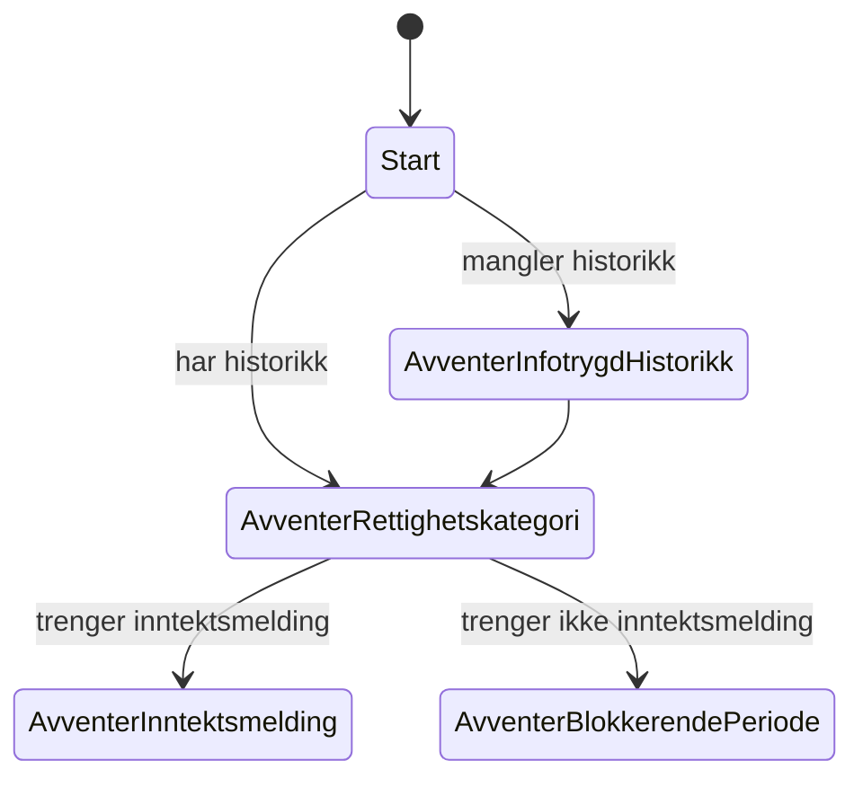

# Avklare rettighetskategori i Spleis

Dette dokumentet er planen for en ny tilstand i Spleis, `AvventerRettighetskategori`, som avklarer rettighetskategorien for sykefraværstilfellet. Tilstanden kommer i den felles tilstandsmaskinen for arbeidstakere og selvstendig næringsdrivende, etter at Selvstendig-tilstandene er slått sammen med arbeidstakertilstandene. Sammenslåingen er beskrevet i [forenkle-tilstandsmaskin.md](forenkle-tilstandsmaskin.md).

Dokumentet bygger på abstraksjonen [Rettighetskategori](abstraksjoner-kap8.md#rettighetskategori) og på rekkefølgen i [rekkefolge-kap8.md](rekkefolge-kap8.md).

## Sammendrag

- `AvventerRettighetskategori` kommer etter `AvventerInfotrygdHistorikk`. Den sender behovet `Rettighetskategori` og venter på løsningen. Den første løseren er et skall av en ekstern domenetjeneste, og den svarer ut fra hva brukeren har søkt som.
- Vi avklarer én gang per skjæringstidspunkt og gjenbruker svaret. Når en førstegangssøknad for en ny yrkesaktivitet treffer skjæringstidspunktet, avklarer vi på nytt.
- Behovet tar med `vedtaksperiodeId`, `behandlingId`, skjæringstidspunktet og søknadsidene til alle vedtaksperioder som hører til skjæringstidspunktet. Svaret finner veien tilbake til riktig vedtaksperiode.
- Løsningen har nøyaktig én rettighetskategori. I dag er den enten `ARBEIDSTAKER` eller `SELVSTENDIG_NARINGSDRIVENDE`.
- Spleis lagrer bare `rettighetskategoriId`, ikke selve kategorien. Den som trenger kategorien, slår den opp i domenetjenesten. Spleis sender for eksempel ID-en til `sp-vilkarsproving` i behovet `Opptjeningsvurdering` i stedet for `arbeidssituasjon`.

## Beslutninger

| # | Beslutning |
|---|---|
| B1 | `AvventerRettighetskategori` sender et ekte behov fra første dag. Løseren er et skall av en ekstern domenetjeneste, med arbeidsnavnet `sp-rettighetskategori`. I starten svarer den ut fra hva brukeren har søkt som. |
| B2 | Overstyring fra saksbehandler og regler i domenetjenesten er en senere fase. Vi bygger ingenting for det nå. |
| B3 | Rettighetskategori er ikke det samme som yrkesaktivitetstype. Yrkesaktivitetstypen styrer fortsatt inntektsmelding, arbeidsgiverperiode/ventetid og refusjon per yrkesaktivitet. Vedtaksperioden flytter ikke til en annen yrkesaktivitet ut fra svaret. |
| B4 | Vi avklarer per skjæringstidspunkt og gjenbruker avklaringen. En førstegangssøknad for en ny yrkesaktivitet på skjæringstidspunktet gir ny avklaring. |
| B5 | Venteårsaken for `AvventerRettighetskategori` er `AVVENTER_RETTIGHETSKATEGORI`. |
| B6 | En avklaring gir nøyaktig én rettighetskategori, ikke en liste. Verdiene er foreløpig `ARBEIDSTAKER` og `SELVSTENDIG_NARINGSDRIVENDE`. |
| B7 | Spleis lagrer bare `rettighetskategoriId` som referanse. Tjenester som trenger kategorien, slår den opp i domenetjenesten med ID-en. |

## Slik er det i dag

### Behov og ruting tilbake

Tilstandene kaller funksjoner som `trengerYtelser` og `trengerSimulering`. Aktivitetsloggen har vedtaksperioden som kontekst, så behovet får `vedtaksperiodeId` automatisk. Rivene for løsningene krever `vedtaksperiodeId`, og `HendelseMediator` ruter hendelsen via `Person` til riktig vedtaksperiode. Det nye behovet bruker samme mekanisme.

## Målbilde



Figuren viser bare starten av den felles flyten. Resten er som i [målbildet for den felles tilstandsmaskinen](forenkle-tilstandsmaskin.md#målbilde).

## Den nye tilstanden `AvventerRettighetskategori`

### Plassering

Tilstanden kommer etter `AvventerInfotrygdHistorikk`. Skjæringstidspunktet kan flytte seg når Infotrygd-historikken kommer, og avklaringen gjelder for skjæringstidspunktet. Når historikken allerede finnes, går `Start` rett hit.

### Gjenbruk og ny avklaring

Rettighetskategorien avgjøres per sykefraværstilfelle. Vi avklarer derfor én gang per skjæringstidspunkt.

Når en vedtaksperiode kommer til `AvventerRettighetskategori`, gjør Spleis dette:

1. Finnes det ingen avklaring for skjæringstidspunktet, sender Spleis behovet.
2. Er perioden fra en førstegangssøknad for en ny yrkesaktivitet på skjæringstidspunktet, sender Spleis behovet på nytt. Det gjelder den første søknaden for en yrkesaktivitet eller arbeidsgiver der `fom`–`tom` overlapper skjæringstidspunktet.
3. Ellers gjenbruker Spleis avklaringen og går rett videre.

Spleis lagrer bare `rettighetskategoriId` på behandlingen til hver vedtaksperiode som bruker avklaringen. Gjenbruk betyr at perioden kopierer ID-en fra en annen periode på samme skjæringstidspunkt.

Ved ny avklaring sender Spleis med `forrigeRettighetskategoriId`. Domenetjenesten svarer om kategorien er endret. Spleis trenger da ikke å lagre kategorien for å vite om noe har endret seg.

- Kategorien er den samme: Spleis gir alle periodene på skjæringstidspunktet den nye ID-en og fortsetter. Ingen revurdering.
- Kategorien er endret: Spleis gir alle periodene på skjæringstidspunktet den nye ID-en og starter et revurderingseventyr fra skjæringstidspunktet.

### Behovet

Behovet heter `Rettighetskategori` og sendes i `entering()` og ved påminnelse.

| Felt | Innhold | Hvorfor |
|---|---|---|
| `vedtaksperiodeId` | Kommer fra konteksten | Rivet ruter løsningen tilbake til riktig vedtaksperiode. |
| `behandlingId` | Den åpne behandlingen | Vi kan forkaste et svar som gjelder en eldre behandling. |
| `skjæringstidspunkt` | Skjæringstidspunktet til perioden | Rettighetskategorien avgjøres per sykefraværstilfelle. |
| `periode` | `fom` og `tom` | Den som avklarer, ser hvilken periode det gjelder. |
| `forrigeRettighetskategoriId` | ID-en fra forrige avklaring på skjæringstidspunktet, eller tom | Domenetjenesten kan si om kategorien er endret. |
| `søknader` | Liste med `søknadId`, `vedtaksperiodeId`, `yrkesaktivitetstype`, `organisasjonsnummer` og `arbeidssituasjon` for alle vedtaksperioder som hører til samme skjæringstidspunkt, på tvers av yrkesaktiviteter | Domenetjenesten avklarer ut fra alt brukeren har søkt om for sykefraværstilfellet, ikke bare den ene søknaden. |

Søknadsidene finnes i dokumentsporingen på behandlingene. `arbeidssituasjon` er den som er lagret på behandlingen (`ARBEIDSTAKER`, `SELVSTENDIG_NÆRINGSDRIVENDE`, `JORDBRUKER` og så videre).

### Løsningen

```json
{
  "@behov": ["Rettighetskategori"],
  "vedtaksperiodeId": "…",
  "behandlingId": "…",
  "@løsning": {
    "Rettighetskategori": {
      "rettighetskategoriId": "…",
      "rettighetskategori": "SELVSTENDIG_NARINGSDRIVENDE",
      "endretFraForrige": false
    }
  }
}
```

- Hver avklaring har en egen `rettighetskategoriId` og endres aldri, etter mønsteret fra `opptjeningsvurderingId` og [sykepengegrunnlag-domenetjeneste.md](sykepengegrunnlag-domenetjeneste.md). En ny avklaring gir ny ID.
- `rettighetskategori` er én verdi. Spleis bruker den bare til å sjekke svaret og lagrer den ikke.
- `endretFraForrige` er `true` når kategorien er en annen enn i `forrigeRettighetskategoriId`. Uten forrige avklaring er den `false`.

### Hva Spleis gjør med svaret

1. Svaret gjelder en annen behandling enn den åpne: Spleis logger og ignorerer det. Påminnelsen sender behovet på nytt.
2. Kategorien passer med yrkesaktiviteten til perioden: Spleis lagrer `rettighetskategoriId` og går videre til `AvventerInntektsmelding` eller `AvventerBlokkerendePeriode`. `ARBEIDSTAKER` passer med `Arbeidstaker`, og `SELVSTENDIG_NARINGSDRIVENDE` passer med `Selvstendig`.
3. Kategorien passer ikke med yrkesaktiviteten: Forslaget er at Spleis gir `RV_IV_13` og forkaster perioden allerede her. Vilkårsprøvingen bruker denne feilen for inntekter fra både arbeidstaker og selvstendig (`Vedtaksperiode.kt:3232-3235`). Vi må avklare hvilke søknadskombinasjoner som faktisk kan nå den nye tilstanden: `RV_SØ_53` avviser allerede en annen yrkesaktivitetstype når periodene overlapper eller er kant i kant. Se [Åpne spørsmål](#åpne-spørsmål).

### Bruk av rettighetskategorien

Spleis sender `rettighetskategoriId` videre i stedet for kategorien. Den første brukeren er opptjeningsvurderingen:

- I dag sender Spleis `arbeidssituasjon` (`Arbeidstaker`, `SelvstendigNæringsdrivende` og så videre) i behovet `Opptjeningsvurdering` (`EventBusOversetter.kt`).
- Etter endringen sender Spleis `rettighetskategoriId`. `sp-vilkarsproving` slår opp kategorien i `sp-rettighetskategori`.
- I en overgang sender Spleis begge feltene når ID-en finnes, og beholder `arbeidssituasjon` for perioder uten ID. At `sp-vilkarsproving` har tatt i bruk ID-en, er ikke alene nok til å fjerne feltet. Håndtering av eldre perioder er et [åpent spørsmål](#åpne-spørsmål).

Andre steder i Spleis som i dag velger regler ut fra yrkesaktivitetstypen, beholder det inntil videre (B3).

### Løseren

`sp-rettighetskategori` er et skall av den eksterne domenetjenesten, etter mønsteret fra `sp-vilkarsproving`. Den lytter på behovet og svarer med én kategori ut fra `arbeidssituasjon` og `yrkesaktivitetstype` på søknadene. Den lagrer avklaringene, så andre tjenester kan slå opp kategorien med `rettighetskategoriId`. Den har ingen egne regler i fase 1.

## Trinn

Hvert trinn er en egen PR som kan rulles ut alene. Trinnene starter når Selvstendig-tilstandene er fjernet, se [trinnene i forenkle-tilstandsmaskin.md](forenkle-tilstandsmaskin.md#trinn).

### Trinn 1: Løseren for rettighetskategori

Vi ruller ut skallet `sp-rettighetskategori`. Den lytter på behovet `Rettighetskategori`, svarer ut fra søknadene og har et endepunkt for oppslag på `rettighetskategoriId`. Ingen sender behovet ennå.

### Trinn 2: `AvventerRettighetskategori`

- Vi legger til `AVVENTER_RETTIGHETSKATEGORI` i `TilstandType`, DTO-ene og serde, og venteårsaken `AVVENTER_RETTIGHETSKATEGORI`.
- `Start` og `AvventerInfotrygdHistorikk` går til `AvventerRettighetskategori`.
- Spleis lagrer `rettighetskategoriId` på behandlingen, gjenbruker den per skjæringstidspunkt og avklarer på nytt ved førstegangssøknad for ny yrkesaktivitet.
- Ut av tilstanden går perioden til `AvventerInntektsmelding` eller `AvventerBlokkerendePeriode`.

`AVVENTER_RETTIGHETSKATEGORI` finnes ikke i gammel kode. En gammel `spleis-api`-pod feiler derfor når den leser en person med en periode i den tilstanden, til utrullingen er ferdig. Vil vi unngå det, legger vi verdien i enumene i en egen PR før tilstanden tas i bruk. Se også [hvordan gammel og ny kode leser personer samtidig](forenkle-tilstandsmaskin.md#felles-for-trinnene-som-flytter-perioder-ut-av-selvstendig-tilstandene).

Perioder som allerede er forbi Infotrygd-steget, får ingen avklaring i dette trinnet. De kan senere trenge opptjeningsvurdering uten å ha en `rettighetskategoriId`, blant annet ved revurdering. Trinn 3 må derfor fortsatt støtte perioder uten ID.

### Trinn 3: Opptjening med `rettighetskategoriId`

- Spleis sender `rettighetskategoriId` i behovet `Opptjeningsvurdering`, ved siden av `arbeidssituasjon`.
- `sp-vilkarsproving` slår opp kategorien i `sp-rettighetskategori` når ID-en finnes, og bruker `arbeidssituasjon` ellers.
- Vi beholder `arbeidssituasjon` inntil håndteringen av eldre perioder uten ID er avklart. At alle åpne perioder har ID, er ikke tilstrekkelig: avsluttede perioder kan senere revurderes. Vilkåret for å fjerne feltet er et [åpent spørsmål](#åpne-spørsmål).

## Senere faser

Vi bygger ingenting for disse nå. De stiller disse kravene til kontrakten:

- **Domenetjeneste med regler.** Tjenesten avklarer per sykefraværstilfelle ut fra søknadene, inntekt og andre opplysninger. Behovet sender derfor alle søknadene på skjæringstidspunktet. Tilleggskategoriene fra [abstraksjoner-kap8.md](abstraksjoner-kap8.md#rettighetskategori) kan tjenesten eie selv. Spleis ser fortsatt bare ID-en.
- **Flere brukere av ID-en.** Sykepengegrunnlag, ventetid og maksdato kan slå opp kategorien på samme måte som opptjening.
- **Overstyring fra saksbehandler.** Spesialist sender en overstyring til domenetjenesten. Tjenesten lager en ny avklaring med ny `rettighetskategoriId` og varsler Spleis, som starter et revurderingseventyr fra skjæringstidspunktet.
- **Rettighetskategori som avviker fra yrkesaktivitetstypen.** For eksempel en søknad som arbeidstaker der tjenesten avklarer frilanser. Da må vi bestemme om perioden flytter til en annen yrkesaktivitet, eller om rettighetskategorien bare styrer regelsettet (B3).

## Risiko

| Risiko | Tiltak |
|---|---|
| `sp-rettighetskategori` er nede, og nye perioder blir stående i `AvventerRettighetskategori`. | Påminnelse sender behovet på nytt. Vi setter opp alarm på antall perioder i tilstanden. |
| Ny avklaring ved førstegangssøknad starter revurderinger som ikke trengs. | Spleis starter bare revurderingseventyr når `endretFraForrige` er `true`. |
| `sp-vilkarsproving` får ikke slått opp kategorien fordi `sp-rettighetskategori` er nede. | Opptjeningsvurderingen feiler og prøves på nytt ved påminnelse, som andre behov. |

## Åpne spørsmål

1. Hvilken kategori skal skallet svare når brukeren har søkt både som arbeidstaker og som selvstendig næringsdrivende på samme skjæringstidspunkt? Det er to alternativer.

   Alternativene nedenfor forutsetter at kombinasjonen kan nå avklaringen. Det må vurderes mot `RV_SØ_53`, se punkt 2.

   **Alternativ A: kategorien til den første søknaden.** Hvis perioden med den andre yrkesaktiviteten når avklaringen, får den en kategori som ikke passer, og Spleis forkaster den med `RV_IV_13`. Vi må avklare forholdet til dagens avvisning med `RV_SØ_53` før vi kan si at utfallet er det samme som i dag.

   **Alternativ B: en egen kategori, `ARBEIDSTAKER_OG_SELVSTENDIG_NARINGSDRIVENDE` (§ 8-41).** Spleis kan fortsatt ikke utbetale kombinasjonen. Den krever Dekning og et sykepengegrunnlag som er fordelt på yrkesaktivitetene. Konsekvensene er disse:

   - B6 får en tredje verdi.
   - Regelen for om kategorien passer, endres. Den kombinerte kategorien passer med både `Arbeidstaker` og `Selvstendig`, så begge periodene går videre. Forkastingen ved kategori som ikke passer, fanger ikke lenger opp dette tilfellet.
   - Spleis må fortsatt avvise kombinasjonen. Enten sjekker `AvventerRettighetskategori` den eksplisitt og gir `RV_IV_13`, eller så forkaster vilkårsprøvingen perioden som i dag (`Vedtaksperiode.kt:3232-3235`). Utfallet er det samme.
   - `rettighetskategoriId` blir riktig. Med alternativ A får den første perioden en ID som sier `ARBEIDSTAKER`, selv om saken egentlig hører under § 8-41. Den ID-en går videre til `sp-vilkarsproving`.
   - Hvis en senere søknad som selvstendig næringsdrivende passerer `RV_SØ_53` og når samme skjæringstidspunkt som en utbetalt arbeidstakerperiode, kan den gi ny avklaring med `endretFraForrige = true`. Det starter et revurderingseventyr fra skjæringstidspunktet. Revurderingen treffer en kombinasjon Spleis ikke støtter, og den utbetalte perioden kan ikke forkastes. Vi må først avklare om scenarioet er nåbart. Hvis det er det, må vi bestemme om bare den nye perioden skal forkastes, eller om Spleis ikke skal starte revurdering når den nye kategorien ikke støttes.
   - Kategorien erstatter ikke inntektssjekken. `erKombinert` bygger på inntekt, også ghost-inntekter fra A-ordningen. En person som bare har søkt som selvstendig næringsdrivende, men har arbeidstakerinntekt i skatteopplysningene, blir fortsatt fanget av `RV_IV_13` i vilkårsprøvingen. Skallet svarer bare ut fra søknadene og ser ikke dette tilfellet.
   - `sp-vilkarsproving` må håndtere den nye verdien i opptjeningsvurderingen. Det er trolig de samme reglene som for arbeidstaker, men det må avklares.
   - Kombinasjonene i § 8-42 og § 8-43 vil kreve det samme senere. Vi bør vurdere om verdiene skal følge hovedkategoriene i [abstraksjoner-kap8.md](abstraksjoner-kap8.md#hovedkategorier) fra starten, så nye kategorier bare blir nye verdier og ikke endrer betydningen av kontrakten.

   Forslaget er alternativ B. Spleis behandler kategorien som «ikke støttet» og gir `RV_IV_13`. Før trinn 2 må vi bestemme hvordan Spleis håndterer en endret kategori på perioder som allerede er utbetalt.

2. Hvordan skal `RV_SØ_53` påvirke avklaringen av rettighetskategori? `vurderOmSøknadIkkeKanHåndteres` i `Yrkesaktivitet.kt:526-534` avviser allerede en søknad med en annen yrkesaktivitetstype når den overlapper eller er kant i kant med en eksisterende periode. Det skjer før tilstandsflyten. Vi må avklare hvilke kombinasjoner som kan nå `AvventerRettighetskategori`, om avvisningen skal bestå, og om forkastede søknader skal inngå i behovet. Vurderingen av alternativ A og B må bygge på nåbare scenarioer. `RV_IV_13` fanger dessuten kombinerte inntekter, også ghost-inntekter, uten at brukeren har søkt under begge yrkesaktivitetstypene.

3. Når kan vi fjerne `arbeidssituasjon` fra `Opptjeningsvurdering`? Perioder som er forbi Infotrygd-steget ved trinn 2, får ingen ID. Også avsluttede perioder kan senere revurderes og trenge ny opptjeningsvurdering. `OpptjeningsvurderingRiver` i `sp-vilkarsproving` krever i dag `Opptjeningsvurdering.arbeidssituasjon` (`requireKey`, linje 40). Vi må velge mellom å beholde feltet som fallback for eldre perioder og å sikre at disse får en ID før et nytt behov sendes, for eksempel med backfill eller avklaring ved revurdering. Fjerning krever at både Spleis og konsumenten håndterer dette; alle åpne perioder med ID er ikke et tilstrekkelig kriterium.
