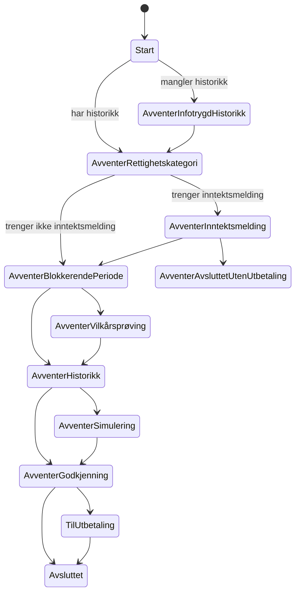

# Forenkle tilstandsmaskinen i Spleis

Dette dokumentet er planen for å fjerne tilstandene i Spleis som er spesifikke for selvstendig næringsdrivende, frilansere og arbeidsledige. Arbeidstakertilstandene blir de generiske tilstandene for alle. Etterpå innfører vi en ny tilstand, `AvventerRettighetskategori`, som avklarer rettighetskategorien for sykefraværstilfellet.

Dokumentet bygger på abstraksjonen [Rettighetskategori](abstraksjoner-kap8.md#rettighetskategori) og på rekkefølgen i [rekkefolge-kap8.md](rekkefolge-kap8.md).

## Sammendrag

- Vi får én tilstandsmaskin for arbeidstakere og selvstendig næringsdrivende. De 15 Selvstendig-tilstandene forsvinner. Forskjellene uttrykker vi som vilkår i de generiske tilstandene, ikke som egne tilstander.
- De fleste Selvstendig-tilstandene er allerede like arbeidstakertilstandene, bortsett fra navnet. Bare `AvventerBlokkerendePeriode`, `AvventerRevurdering` og inngangen til flyten har reelle forskjeller.
- Frilans- og Arbeidsledig-tilstandene fjerner vi helt. Flyten deres stopper med en feil i dag og har trolig aldri vært i produksjon. Søknader som gir yrkesaktiviteten `Frilans` eller `Arbeidsledig`, avviser vi før det opprettes en vedtaksperiode.
- Vi slår sammen tilstandene først. Når det er gjort, innfører vi `AvventerRettighetskategori` i den felles flyten.
- `AvventerRettighetskategori` kommer etter `AvventerInfotrygdHistorikk`. Den sender behovet `Rettighetskategori` og venter på løsningen. Den første løseren er et skall av en ekstern domenetjeneste, og den svarer ut fra hva brukeren har søkt som.
- Vi avklarer én gang per skjæringstidspunkt og gjenbruker svaret. Når en førstegangssøknad for en ny yrkesaktivitet treffer skjæringstidspunktet, avklarer vi på nytt.
- Behovet tar med `vedtaksperiodeId`, `behandlingId`, skjæringstidspunktet og søknadsidene til alle vedtaksperioder som hører til skjæringstidspunktet. Svaret finner veien tilbake til riktig vedtaksperiode.
- Løsningen har nøyaktig én rettighetskategori. I dag er den enten `ARBEIDSTAKER` eller `SELVSTENDIG_NARINGSDRIVENDE`.
- Spleis lagrer bare `rettighetskategoriId`, ikke selve kategorien. Den som trenger kategorien, slår den opp i domenetjenesten. Spleis sender for eksempel ID-en til `sp-vilkarsproving` i behovet `Opptjeningsvurdering` i stedet for `arbeidssituasjon`.

## Beslutninger

| # | Beslutning |
|---|---|
| B1 | Vi slår sammen tilstandene først. Avklaringen av rettighetskategori kommer etterpå, i den felles flyten. |
| B2 | `AvventerRettighetskategori` sender et ekte behov fra første dag. Løseren er et skall av en ekstern domenetjeneste, med arbeidsnavnet `sp-rettighetskategori`. I starten svarer den ut fra hva brukeren har søkt som. |
| B3 | Den felles flyten gjelder bare arbeidstaker og selvstendig næringsdrivende. |
| B4 | Overstyring fra saksbehandler og regler i domenetjenesten er en senere fase. Vi bygger ingenting for det nå. |
| B5 | Rettighetskategori er ikke det samme som yrkesaktivitetstype. Yrkesaktivitetstypen styrer fortsatt inntektsmelding, arbeidsgiverperiode/ventetid og refusjon per yrkesaktivitet. Vedtaksperioden flytter ikke til en annen yrkesaktivitet ut fra svaret. |
| B6 | Frilans- og Arbeidsledig-tilstandene fjernes helt, sammen med starten på flyten for yrkesaktivitetene `Frilans` og `Arbeidsledig`. |
| B7 | Vi avklarer per skjæringstidspunkt og gjenbruker avklaringen. En førstegangssøknad for en ny yrkesaktivitet på skjæringstidspunktet gir ny avklaring. |
| B8 | Venteårsaken for `AvventerRettighetskategori` er `AVVENTER_RETTIGHETSKATEGORI`. |
| B9 | Loggingen «skatt på direkten» i `AvventerGodkjenning` gjelder bare arbeidstakere. Selvstendig næringsdrivende bruker fortsatt inntektene fra søknaden. |
| B10 | En avklaring gir nøyaktig én rettighetskategori, ikke en liste. Verdiene er foreløpig `ARBEIDSTAKER` og `SELVSTENDIG_NARINGSDRIVENDE`. |
| B11 | Spleis lagrer bare `rettighetskategoriId` som referanse. Tjenester som trenger kategorien, slår den opp i domenetjenesten med ID-en. |

## Slik er det i dag

### Tilstandene

Startpunktet velges ut fra `yrkesaktivitet.yrkesaktivitetstype` når vedtaksperioden opprettes (`Vedtaksperiode.kt:104-112`):

| Yrkesaktivitetstype | Starttilstand |
|---|---|
| `Arbeidstaker` | `ArbeidstakerStart` (`START`) |
| `Selvstendig` | `SelvstendigStart` |
| `Frilans` | `FrilansStart` |
| `Arbeidsledig` | `ArbeidsledigStart` |

`nesteTilstandEtterIgangsattOverstyring` i `Vedtaksperiode.kt` flytter perioden videre fra start. Arbeidstakere går til `AvventerInfotrygdHistorikk` eller `AvventerInntektsmelding`. De andre går til sin egen `*AvventerInfotrygdHistorikk` eller `*AvventerBlokkerendePeriode`.

Selvstendig har en hel parallell flyt: blokkerende periode, vilkårsprøving, historikk, simulering, godkjenning, utbetaling, avsluttet og alle revurderingstilstandene.

### Frilans og arbeidsledig

`FrilansAvventerBlokkerendePeriode` og `ArbeidsledigAvventerBlokkerendePeriode` kaster feil i `entering()` («ikke støttet ennå»). Ingen periode med yrkesaktiviteten `Frilans` eller `Arbeidsledig` kan derfor ha kommet lenger enn hit.

Arbeidsledigsøknader der brukeren har oppgitt en tidligere arbeidsgiver, er noe annet. `NyeArbeidsledigSøknaderRiver` og `SendtArbeidsledigSøknaderRiver` gir dem yrkesaktiviteten `Arbeidstaker` med den tidligere arbeidsgiveren, og `Søknad.validerArbeidsledig` gir varsel. De går gjennom arbeidstakerflyten og berøres ikke av denne planen.

### Hvor like er Selvstendig-tilstandene?

Vi sammenlignet hver Selvstendig-tilstand med arbeidstakertilstanden med samme navn.

| Selvstendig-tilstand | Forskjell fra arbeidstakertilstanden |
|---|---|
| `SelvstendigStart`, `SelvstendigAvventerInfotrygdHistorikk` | Ingen. Delegerer eller har ingen oppførsel. |
| `SelvstendigAvventerVilkårsprøving` | Ingen. Valideringen velges allerede ut fra yrkesaktivitetstype (`Vedtaksperiode.kt:3266`). |
| `SelvstendigAvventerHistorikk` | Ingen. |
| `SelvstendigAvventerSimulering` | Ingen. |
| `SelvstendigAvventerGodkjenning` | Arbeidstaker logger i tillegg «skatt på direkten», se under. |
| `SelvstendigTilUtbetaling`, `SelvstendigAvsluttet` | Ingen. |
| Revurderingstilstandene unntatt `AvventerRevurdering` | Ingen. |
| `SelvstendigAvventerRevurdering` | Arbeidstaker venter på inntekt og refusjon fra andre arbeidsgivere før vilkårsprøving eller beregning. |
| `SelvstendigAvventerBlokkerendePeriode` | Arbeidstaker sjekker at perioden skal behandles i Speil, at refusjonstidslinjen ikke er tom, lagrer faktaavklart inntekt og venter på søknad, inntekt eller refusjon fra andre perioder. Selvstendig går rett videre. |

`loggEventuellSkattPåDirekten` i `AvventerGodkjenning` skriver bare til aktivitetsloggen. Den slår til når en periode skal til godkjenning uten skjæringstidspunkt og uten inntekt fra inntektsmelding eller vilkårsgrunnlag. Da logger den om perioden kunne vært beregnet på nytt med et skjæringstidspunkt som allerede er vilkårsprøvd. Den hører til arbeidstakerinntekter og skal ikke gjelde selvstendig næringsdrivende (B9).

Disse arbeidstakertilstandene har ingen Selvstendig-variant:

- `AvventerInntektsmelding`: selvstendig næringsdrivende har ingen arbeidsgiver som sender inntektsmelding.
- `AvventerAvsluttetUtenUtbetaling` og `AvsluttetUtenUtbetaling`: arbeidstakerperioder innenfor arbeidsgiverperioden. Selvstendig har ventetid, men den håndteres i beregningen, ikke i en egen tilstand.
- `AvventerInntektsopplysningerForAnnenArbeidsgiver` og `AvventerRefusjonsopplysningerAnnenPeriode`: gjelder andre arbeidsgivere og refusjon.
- `AvventerSøknadForOverlappendePeriode`.

### Hvor tilstandene brukes

- `Vedtaksperiode.kt` har 22 uttømmende `when (tilstand)` og over 300 referanser til Selvstendig-tilstander. Mesteparten av arbeidet ligger her.
- `ArbeidstakerAvklartInntekt.kt` lister alle tilstandene og kaster feil for Selvstendig, Frilans og Arbeidsledig.
- `starttilstander` i `Vedtaksperiodetilstand.kt:11`.
- Tilstanden lagres som `tilstand` i person-JSON. `PersonDataBuilder`, `VedtaksperiodetilstandDto` og `SpannerPersonDto` mapper navnene. Å fjerne en tilstand krever en serde-migrering.
- `vedtaksperiode_endret` sender `gjeldendeTilstand` og `forrigeTilstand`. Disse konsumentene bruker tilstandsnavnene:
  - `spesialist`: `VedtaksperiodeReberegnetRiver` lytter på `SELVSTENDIG_AVSLUTTET` og `SELVSTENDIG_TIL_UTBETALING` i tillegg til arbeidstakernavnene.
  - `spock`: lagrer gjeldende tilstand, sender påminnelser og velger påminnelsesintervall og sluttilstand ut fra navnet (`Tilstandsendringer.kt`).
  - `spetakkel`: har en egen enum med alle tilstandsnavnene i `TilstandsendringMonitor`.
  - `spammer`: `LoopMonitor`.
  - `bomlo-cli`: `TraceCommand`.
  - `spaghet`: tidsmålinger på tilstandsendringer.
  - `sporbar`, `spoogle` og andre som lagrer tilstand, sjekker vi før hvert trinn.

### Behov og ruting tilbake

Tilstandene kaller funksjoner som `trengerYtelser` og `trengerSimulering`. Aktivitetsloggen har vedtaksperioden som kontekst, så behovet får `vedtaksperiodeId` automatisk. Rivene for løsningene krever `vedtaksperiodeId`, og `HendelseMediator` ruter hendelsen via `Person` til riktig vedtaksperiode. Det nye behovet bruker samme mekanisme.

## Målbilde



Revurderings- og annulleringstilstandene er generiske på samme måte, men er utelatt fra figuren.

### Forskjellene blir vilkår, ikke tilstander

Vi samler forskjellene i noen få spørsmål til yrkesaktiviteten. Tilstandene stiller spørsmålene og trenger ikke vite hvilken yrkesaktivitetstype perioden har.

| Spørsmål | Arbeidstaker | Selvstendig |
|---|---|---|
| Trenger perioden inntektsmelding? | Ja | Nei |
| Kan perioden avsluttes uten utbetaling innenfor arbeidsgiverperioden? | Ja | Nei |
| Venter perioden på inntekt eller refusjon fra andre arbeidsgivere? | Ja | Nei |
| Kreves refusjonstidslinje før beregning? | Ja | Nei |
| Skal godkjenning logge «skatt på direkten»? | Ja | Nei |

Vi legger spørsmålene på `Behandlingsporing.Yrkesaktivitet` eller i en egen klasse ved siden av den, så de ligger samlet ett sted. Vi skal ikke spre `when (yrkesaktivitetstype)` utover tilstandene.

## Den nye tilstanden `AvventerRettighetskategori`

### Plassering

Tilstanden kommer etter `AvventerInfotrygdHistorikk`. Skjæringstidspunktet kan flytte seg når Infotrygd-historikken kommer, og avklaringen gjelder for skjæringstidspunktet. Når historikken allerede finnes, går `Start` rett hit.

### Gjenbruk og ny avklaring

Rettighetskategorien avgjøres per sykefraværstilfelle. Vi avklarer derfor én gang per skjæringstidspunkt.

Når en vedtaksperiode kommer til `AvventerRettighetskategori`, gjør Spleis dette:

1. Finnes det ingen avklaring for skjæringstidspunktet, sender Spleis behovet.
2. Er perioden fra en førstegangssøknad for en ny yrkesaktivitet på skjæringstidspunktet, sender Spleis behovet på nytt. Det gjelder den første søknaden for en yrkesaktivitet eller arbeidsgiver der `fom`–`tom` overlapper skjæringstidspunktet.
3. Ellers gjenbruker Spleis avklaringen og går rett videre.

Spleis lagrer bare `rettighetskategoriId` på behandlingen til hver vedtaksperiode som bruker avklaringen. Gjenbruk betyr at perioden kopierer ID-en fra en annen periode på samme skjæringstidspunkt.

Ved ny avklaring sender Spleis med `forrigeRettighetskategoriId`. Domenetjenesten svarer om kategorien er endret. Spleis trenger da ikke å lagre kategorien for å vite om noe har endret seg.

- Kategorien er den samme: Spleis gir alle periodene på skjæringstidspunktet den nye ID-en og fortsetter. Ingen revurdering.
- Kategorien er endret: Spleis gir alle periodene på skjæringstidspunktet den nye ID-en og starter et revurderingseventyr fra skjæringstidspunktet.

### Behovet

Behovet heter `Rettighetskategori` og sendes i `entering()` og ved påminnelse.

| Felt | Innhold | Hvorfor |
|---|---|---|
| `vedtaksperiodeId` | Kommer fra konteksten | Rivet ruter løsningen tilbake til riktig vedtaksperiode. |
| `behandlingId` | Den åpne behandlingen | Vi kan forkaste et svar som gjelder en eldre behandling. |
| `skjæringstidspunkt` | Skjæringstidspunktet til perioden | Rettighetskategorien avgjøres per sykefraværstilfelle. |
| `periode` | `fom` og `tom` | Den som avklarer, ser hvilken periode det gjelder. |
| `forrigeRettighetskategoriId` | ID-en fra forrige avklaring på skjæringstidspunktet, eller tom | Domenetjenesten kan si om kategorien er endret. |
| `søknader` | Liste med `søknadId`, `vedtaksperiodeId`, `yrkesaktivitetstype`, `organisasjonsnummer` og `arbeidssituasjon` for alle vedtaksperioder som hører til samme skjæringstidspunkt, på tvers av yrkesaktiviteter | Domenetjenesten avklarer ut fra alt brukeren har søkt om for sykefraværstilfellet, ikke bare den ene søknaden. |

Søknadsidene finnes i dokumentsporingen på behandlingene. `arbeidssituasjon` er den som er lagret på behandlingen (`ARBEIDSTAKER`, `SELVSTENDIG_NÆRINGSDRIVENDE`, `JORDBRUKER` og så videre).

### Løsningen

```json
{
  "@behov": ["Rettighetskategori"],
  "vedtaksperiodeId": "…",
  "behandlingId": "…",
  "@løsning": {
    "Rettighetskategori": {
      "rettighetskategoriId": "…",
      "rettighetskategori": "SELVSTENDIG_NARINGSDRIVENDE",
      "endretFraForrige": false
    }
  }
}
```

- Hver avklaring har en egen `rettighetskategoriId` og endres aldri, etter mønsteret fra `opptjeningsvurderingId` og [sykepengegrunnlag-domenetjeneste.md](sykepengegrunnlag-domenetjeneste.md). En ny avklaring gir ny ID.
- `rettighetskategori` er én verdi. Spleis bruker den bare til å sjekke svaret og lagrer den ikke.
- `endretFraForrige` er `true` når kategorien er en annen enn i `forrigeRettighetskategoriId`. Uten forrige avklaring er den `false`.

### Hva Spleis gjør med svaret

1. Svaret gjelder en annen behandling enn den åpne: Spleis logger og ignorerer det. Påminnelsen sender behovet på nytt.
2. Kategorien passer med yrkesaktiviteten til perioden: Spleis lagrer `rettighetskategoriId` og går videre til `AvventerInntektsmelding` eller `AvventerBlokkerendePeriode`. `ARBEIDSTAKER` passer med `Arbeidstaker`, og `SELVSTENDIG_NARINGSDRIVENDE` passer med `Selvstendig`.
3. Kategorien passer ikke med yrkesaktiviteten: I fase 1 skjer det bare når brukeren har søkt både som arbeidstaker og som selvstendig næringsdrivende på samme skjæringstidspunkt. Spleis støtter ikke den kombinasjonen i dag. Vilkårsprøvingen gir funksjonell feil med `RV_IV_13` («Inntekter for både arbeidstaker og selvstendig», `Vedtaksperiode.kt:3232-3235`). Forslaget er at Spleis gir samme feil og forkaster perioden allerede her. Se [Åpne spørsmål](#åpne-spørsmål).

### Bruk av rettighetskategorien

Spleis sender `rettighetskategoriId` videre i stedet for kategorien. Den første brukeren er opptjeningsvurderingen:

- I dag sender Spleis `arbeidssituasjon` (`Arbeidstaker`, `SelvstendigNæringsdrivende` og så videre) i behovet `Opptjeningsvurdering` (`EventBusOversetter.kt`).
- Etter endringen sender Spleis `rettighetskategoriId`. `sp-vilkarsproving` slår opp kategorien i `sp-rettighetskategori`.
- I en overgang sender Spleis begge feltene, til `sp-vilkarsproving` har tatt i bruk ID-en.

Andre steder i Spleis som i dag velger regler ut fra yrkesaktivitetstypen, beholder det inntil videre (B5).

### Løseren

`sp-rettighetskategori` er et skall av den eksterne domenetjenesten, etter mønsteret fra `sp-vilkarsproving`. Den lytter på behovet og svarer med én kategori ut fra `arbeidssituasjon` og `yrkesaktivitetstype` på søknadene. Den lagrer avklaringene, så andre tjenester kan slå opp kategorien med `rettighetskategoriId`. Den har ingen egne regler i fase 1.

## Trinn

Hvert trinn er en egen PR som kan rulles ut alene. Hvert trinn som fjerner tilstander, har en serde-migrering som skriver om `tilstand` i lagrede personer, og vi varsler konsumentene før trinnet rulles ut.

### Felles for trinnene som slår sammen tilstander

Trinn 3, 4 og 5 flytter vedtaksperioder som står i en Selvstendig-tilstand i produksjon, over i en generisk tilstand. Dette gjelder for alle tre trinnene.

**Før utrulling**

- Vi teller perioder per tilstand i tabellen `paminnelse` i `spock`. Den har gjeldende tilstand for hver vedtaksperiode. Da vet vi hvor mange perioder hvert trinn flytter, og hvilke tilstander som er tomme.
- Vi kjører migreringen mot en kopi av produksjonsdata i dev og sjekker at personene kan gjenopprettes og serialiseres uten feil.
- Vi oppdaterer konsumentene som filtrerer på tilstandsnavn, slik at de godtar både det gamle og det generiske navnet.

**Migreringen**

- Migreringen er en `JsonMigration` som bytter navn på `tilstand`, etter mønsteret i `V342RenameAvventersøknadForTidligereEllerOverlappendePeriode`. Den rører ikke behandlinger, utbetalinger eller noe annet.
- Spleis migrerer en person når den leser personen. Personer som ikke får meldinger, beholder det gamle navnet i databasen til de blir lest. Vil vi ha alle over med en gang, kjører vi jobben `migrate_v2`.
- Migreringen kjører ikke `entering()`. Perioden står i den generiske tilstanden som om den alltid hadde vært der, og ingen behov sendes på nytt. Det er trygt fordi tilstandene vi slår sammen, gjør det samme for selvstendig næringsdrivende.
- Spleis sender ikke `vedtaksperiode_endret` for perioder som migreres. Konsumenter som lagrer tilstanden, ser det gamle navnet til perioden bytter tilstand neste gang.

**Påminnelser og løsninger som er underveis**

- `spock` sender påminnelser med tilstanden den kjenner, altså det gamle navnet. `PåminnelserRiver` godtar bare navn som finnes i `TilstandType`. Derfor beholder vi de gamle verdiene i `TilstandType` til trinn 6.
- Når påminnelsen har feil tilstand, sender Spleis `vedtaksperiode_ikke_påminnet` med den nye tilstanden. `spock` lagrer den og påminner med riktig navn neste gang. Slik retter `spock` seg selv uten egen migrering.
- Løsninger på behov som er sendt før utrulling (Infotrygd-historikk, vilkårsprøving, ytelser, simulering, godkjenning, utbetaling), ruter vi som før på `vedtaksperiodeId`. Den generiske tilstanden håndterer løsningen på samme måte som Selvstendig-tilstanden gjorde.
- Perioder som står til godkjenning, har en oppgave i `spesialist`. Godkjenningen kommer tilbake til `AvventerGodkjenning` og går videre som før.

**Gammel og ny kode samtidig**

Migreringen er ikke en databasemigrering som kjører én gang ved deploy. Den ligger i koden og kjører hver gang en pod leser en person. Derfor er spørsmålet hvilke podder som kan lese og skrive personer mens gammel og ny kode finnes samtidig.

Gammel kode avviser ikke personer med høyere `skjema_versjon` enn den kjenner. Den hopper over migreringene og deserialiserer JSON-en som den er. For disse trinnene er det farlig, fordi de nye navnene (`START`, `AVSLUTTET`, `AVVENTER_HISTORIKK` og så videre) finnes i gammel kode. Gammel kode leser derfor en selvstendig periode i `AVVENTER_HISTORIKK` uten feil og behandler den med arbeidstakerlogikk.

Slik er det for hver app som leser `person`-tabellen:

| App | Deploy | Leser eller skriver | Konsekvens |
|---|---|---|---|
| `spleis` | `Recreate`, 8–24 podder i prod | Leser, migrerer og skriver | Kubernetes stopper alle gamle podder før de nye starter. Gammel og ny kode behandler derfor aldri meldinger samtidig. Meldinger som kommer mens podder byttes, blir liggende på Kafka og behandles av ny kode. |
| `spleis-api` | Rullerende, egen workflow | Leser bare, og migrerer i minnet | Gamle og nye podder kjører side om side en kort stund, og `spleis-api` kan bli deployet før eller etter `spleis`. En gammel pod som leser en migrert person, kan vise en selvstendig periode med feil status i Speil. Den skriver ingenting, så feilen forsvinner når utrullingen er ferdig. |
| `spleis-jobs` | Egen workflow og eget image | `migrate_v2` leser, migrerer og skriver | Kjører vi `migrate_v2` med et image som er eldre enn migreringen, skriver jobben personen tilbake med lavere `skjema_versjon` og gamle navn. Jobben `migrate` er trygg, fordi den bare sender meldinger som `spleis` behandler. |

Det gir disse reglene:

- **Ingen rollback av `spleis`.** Når ny kode har lagret en person med de nye navnene, ville gammel kode behandlet selvstendige perioder med arbeidstakerlogikk. Feil retter vi med en ny versjon.
- **Kjør `migrate_v2` bare med et image som har migreringen.** Sjekk at `main-jobs`-workflowen er ferdig før jobben startes.
- **Gjør migreringene idempotente.** Får en person likevel lavere `skjema_versjon`, for eksempel etter en rollback, kjører migreringen på nytt ved neste lesing. Et navnebytte som bare endrer gamle navn, tåler det.
- **Ikke gjør `spleis` avhengig av at `spleis-api` er oppdatert, eller omvendt.** De to rulles ut hver for seg, selv om de bygges fra samme commit.

Kafka følger den vanlige garantien om minst én levering. Stopper en gammel pod etter at personen er lagret, men før offset er committet, behandler ny kode meldingen på nytt. Det er ikke spesielt for disse trinnene, men nå leser ny kode en person som gammel kode nettopp skrev. Det går bra, fordi migreringen kjører ved lesing.

Trinn 8 er annerledes. `AVVENTER_RETTIGHETSKATEGORI` finnes ikke i gammel kode. En gammel `spleis-api`-pod feiler derfor når den leser en person med en periode i den tilstanden, til utrullingen er ferdig. Vil vi unngå det, legger vi verdien i enumene i en egen PR før tilstanden tas i bruk.

**Midlertidige broer**

Fram til trinn 5 finnes `SelvstendigAvventerBlokkerendePeriode` og `SelvstendigAvventerRevurdering` fortsatt. Generiske tilstander som sender perioden tilbake til en av disse, for eksempel ved et revurderingseventyr i `nesteTilstandEtterIgangsattOverstyring`, må velge riktig tilstand ut fra yrkesaktiviteten. Vi samler valget i to funksjoner, `avventerBlokkerendePeriode()` og `avventerRevurdering()`, og fjerner dem i trinn 5.

### Trinn 1: Fjerne Frilans og Arbeidsledig

- Vi sjekker i produksjonsdatabasen at ingen personer har vedtaksperioder i `FRILANS_*` eller `ARBEIDSLEDIG_*`. Finnes det noen, forkaster vi dem først.
- Søknader med yrkesaktiviteten `Frilans` eller `Arbeidsledig` får en funksjonell feil før vedtaksperioden opprettes, på samme måte som `BARNEPASSER` og `FISKER` i dag.
- Vi fjerner `FrilansStart`, `FrilansAvventerInfotrygdHistorikk`, `FrilansAvventerBlokkerendePeriode`, `ArbeidsledigStart`, `ArbeidsledigAvventerInfotrygdHistorikk` og `ArbeidsledigAvventerBlokkerendePeriode` med verdiene i `TilstandType`, DTO-ene og serde.
- Arbeidsledigsøknader med tidligere arbeidsgiver går som før, gjennom arbeidstakerflyten.

Rivene og `Behandlingsporing.Yrkesaktivitet.Frilans` og `.Arbeidsledig` blir værende. De brukes også av avbrutte søknader, sykmeldingsperioder og utgående meldinger.

### Trinn 2: Spørsmålene på yrkesaktiviteten

Vi lager spørsmålene fra tabellen over og bruker dem i de eksisterende arbeidstakertilstandene. Ingen tilstander endres, og ingen oppførsel endres. Arbeidstakertestene skal være grønne uten endringer.

I praksis:

- Vi lager spørsmålene som funksjoner på `Behandlingsporing.Yrkesaktivitet`, eller i en egen klasse ved siden av, og skriver enhetstester for hver yrkesaktivitetstype.
- Vi bytter ut implisitte arbeidstakerantakelser med spørsmålene der de ligger i dag:
  - valget mellom `AvventerInntektsmelding` og `AvventerBlokkerendePeriode` ut av `AvventerInfotrygdHistorikk`
  - sjekkene i `AvventerBlokkerendePeriode.entering()` og ventingen i `tilstandHvisBlokkeresAvAndre`
  - ventingen på andre arbeidsgivere i `AvventerRevurdering`
  - `loggEventuellSkattPåDirekten` i `AvventerGodkjenning`
- For arbeidstaker svarer alle spørsmålene ja, så koden gjør det samme som før.
- Selvstendig-tilstandene rører vi ikke.

Trinnet har ingen migrering og trenger ikke koordinering med konsumentene.

### Trinn 3: Start og Infotrygd-historikk

- `SelvstendigStart` blir `Start`, og `SelvstendigAvventerInfotrygdHistorikk` blir `AvventerInfotrygdHistorikk`. Den siste delegerer allerede dit.
- `Vedtaksperiode` opprettes i `Start` også for `Selvstendig`. `Start` bruker spørsmålene der den i dag går ut fra at perioden er arbeidstaker.
- Ut av `AvventerInfotrygdHistorikk` går perioden til `AvventerInntektsmelding` hvis den trenger inntektsmelding. Ellers går den til `avventerBlokkerendePeriode()`, som foreløpig gir `SelvstendigAvventerBlokkerendePeriode` for selvstendig næringsdrivende.
- Migrering: `SELVSTENDIG_START` blir `START`, og `SELVSTENDIG_AVVENTER_INFOTRYGDHISTORIKK` blir `AVVENTER_INFOTRYGDHISTORIKK`.

Perioder i produksjon:

- `SELVSTENDIG_START` er en overgangstilstand. Perioden forlater den i samme melding som oppretter den, så vi venter ingen perioder her. Migreringen tar dem likevel.
- Perioder i `SELVSTENDIG_AVVENTER_INFOTRYGDHISTORIKK` venter på svar på behovet for Infotrygd-historikk. Svaret kommer til `AvventerInfotrygdHistorikk` og sender perioden videre til `SelvstendigAvventerBlokkerendePeriode`, som før.

Tester: Selvstendig-testene skal vise `START` og `AVVENTER_INFOTRYGDHISTORIKK` i `assertTilstander`. Vi oppdaterer forventningene, men ikke selve scenarioene.

### Trinn 4: Slutten av flyten

Vi slår sammen tilstandene som er like, og begynner nederst i flyten:

1. `SelvstendigAvsluttet` og `SelvstendigTilUtbetaling`
2. `SelvstendigAvventerGodkjenning`, `SelvstendigAvventerSimulering`, `SelvstendigAvventerHistorikk` og `SelvstendigAvventerVilkårsprøving`
3. Revurderingstilstandene unntatt `SelvstendigAvventerRevurdering`

Rekkefølgen gjør at hver Selvstendig-tilstand bare peker videre til tilstander som allerede er generiske. Hvert punkt kan være en egen PR med egen migrering.

I praksis, for hver tilstand:

- Vi sletter Selvstendig-tilstanden og lar overgangene som pekte dit, peke til den generiske tilstanden.
- Vi fjerner grenene for tilstanden i de uttømmende `when`-ene. Kompilatoren viser hvor de er.
- Der den generiske tilstanden går tilbake til blokkerende periode eller revurdering, bruker vi `avventerBlokkerendePeriode()` og `avventerRevurdering()`. Et eksempel er `nesteTilstandEtterIgangsattOverstyring`, som i dag sender `SelvstendigAvsluttet` til `SelvstendigAvventerRevurdering`. Etter trinnet må `Avsluttet` sende en selvstendig periode dit.
- `AvventerGodkjenning` logger «skatt på direkten» bare når spørsmålet sier det (B9).
- Migreringen bytter `SELVSTENDIG_X` til `X` for tilstandene i punktet.

Perioder i produksjon:

- `SELVSTENDIG_AVSLUTTET` har trolig flest perioder. De blir `AVSLUTTET`. Et senere revurderingseventyr sender dem til `SelvstendigAvventerRevurdering` gjennom broen.
- Perioder i `SELVSTENDIG_TIL_UTBETALING` venter på kvittering fra oppdrag. Kvitteringen kommer til `TilUtbetaling`, som sender perioden til `Avsluttet`.
- Perioder i godkjenning, simulering, historikk og vilkårsprøving har et behov ute. Løsningen kommer til den generiske tilstanden og går videre i flyten.
- Perioder midt i en revurdering blir stående i den generiske revurderingstilstanden og fortsetter derfra.

Konsumenter: `spesialist` lytter allerede på `AVSLUTTET` og `TIL_UTBETALING` i `VedtaksperiodeReberegnetRiver`. `spock` har påminnelsesintervaller for de generiske navnene og regner `AVSLUTTET` som sluttilstand.

### Trinn 5: `AvventerBlokkerendePeriode` og `AvventerRevurdering`

Her ligger de reelle forskjellene.

- `AvventerBlokkerendePeriode.entering()` sjekker refusjonstidslinjen og om perioden skal behandles i Speil, og lagrer faktaavklart inntekt for arbeidstaker. Dette gjøres bare når spørsmålene sier at det gjelder.
- `tilstandHvisBlokkeresAvAndre` venter bare på inntekt og refusjon fra andre arbeidsgivere når yrkesaktiviteten gjør det.
- `AvventerRevurdering` hopper over ventingen på andre arbeidsgivere på samme måte.
- Vi fjerner broene `avventerBlokkerendePeriode()` og `avventerRevurdering()`. Alle overganger går rett til de generiske tilstandene.

Migrering: `SELVSTENDIG_AVVENTER_BLOKKERENDE_PERIODE` og `SELVSTENDIG_AVVENTER_REVURDERING` blir de generiske navnene.

Perioder i produksjon:

- Perioder i `SELVSTENDIG_AVVENTER_BLOKKERENDE_PERIODE` venter på at en tidligere periode skal bli ferdig. Migreringen kjører ikke `entering()`, så arbeidstakersjekkene kjører aldri for dem. Ved neste påminnelse eller når den tidligere perioden er ferdig, spør tilstanden yrkesaktiviteten og går videre som før.
- Perioder i `SELVSTENDIG_AVVENTER_REVURDERING` fortsetter fra `AvventerRevurdering` på samme måte.

Trinnet har mest risiko for å endre oppførsel. Vi kjører hele testsuiten for både arbeidstaker og selvstendig, og følger med på perioder i `AVVENTER_BLOKKERENDE_PERIODE` og `AVVENTER_REVURDERING` med `spammer` de første dagene.

### Trinn 6: Rydde opp

Etter trinn 5 finnes det ingen Selvstendig-tilstander i koden, men de gamle navnene lever fortsatt noen steder.

Før vi rydder, sjekker vi at ingenting bruker de gamle navnene lenger:

- Tabellen `paminnelse` i `spock` har ingen perioder med et gammelt navn. Hvis den har det, venter vi en påminnelsesrunde så `vedtaksperiode_ikke_påminnet` retter dem.
- Alle personer i databasen er migrert. Vi kjører `migrate_v2` hvis det er usikkert.

Deretter:

- Vi fjerner de gamle verdiene fra `TilstandType`, `VedtaksperiodetilstandDto` og `SpannerPersonDto`, og fra mappingen i `SpeilGenerasjonerBuilder`. Migreringene blir stående, siden de skriver til strenger og ikke bruker enumene.
- Vi fjerner grenene som er igjen i de uttømmende `when`-ene i `Vedtaksperiode.kt` og `ArbeidstakerAvklartInntekt.kt`.
- Vi fjerner `starttilstander` og det som er igjen av valget av starttilstand ut fra yrkesaktivitetstype i `Vedtaksperiode.kt`.
- Vi fjerner de gamle navnene hos konsumentene: `spesialist`, `spock`, `spetakkel`, `spammer`, `bomlo-cli`, `spaghet` og modellene i `bomlo-dbt`. Historiske data i `spaghet` og BigQuery beholder de gamle navnene, så rapporter som går bakover i tid, må fortsatt kjenne dem.

Etter dette trinnet har Spleis én tilstandsmaskin.

### Trinn 7: Løseren for rettighetskategori

Vi ruller ut skallet `sp-rettighetskategori`. Den lytter på behovet `Rettighetskategori`, svarer ut fra søknadene og har et endepunkt for oppslag på `rettighetskategoriId`. Ingen sender behovet ennå.

### Trinn 8: `AvventerRettighetskategori`

- Vi legger til `AVVENTER_RETTIGHETSKATEGORI` i `TilstandType`, DTO-ene og serde, og venteårsaken `AVVENTER_RETTIGHETSKATEGORI`.
- `Start` og `AvventerInfotrygdHistorikk` går til `AvventerRettighetskategori`.
- Spleis lagrer `rettighetskategoriId` på behandlingen, gjenbruker den per skjæringstidspunkt og avklarer på nytt ved førstegangssøknad for ny yrkesaktivitet.
- Ut av tilstanden går perioden til `AvventerInntektsmelding` eller `AvventerBlokkerendePeriode`.

Perioder som allerede er forbi Infotrygd-steget, får ingen avklaring. Det trenger de ikke i fase 1, fordi svaret ikke endrer flyten.

### Trinn 9: Opptjening med `rettighetskategoriId`

- Spleis sender `rettighetskategoriId` i behovet `Opptjeningsvurdering`, ved siden av `arbeidssituasjon`.
- `sp-vilkarsproving` slår opp kategorien i `sp-rettighetskategori` når ID-en finnes, og bruker `arbeidssituasjon` ellers.
- Når alle åpne perioder har en `rettighetskategoriId`, fjerner vi `arbeidssituasjon` fra behovet.

## Senere faser

Vi bygger ingenting for disse nå. De stiller disse kravene til kontrakten:

- **Domenetjeneste med regler.** Tjenesten avklarer per sykefraværstilfelle ut fra søknadene, inntekt og andre opplysninger. Behovet sender derfor alle søknadene på skjæringstidspunktet. Tilleggskategoriene fra [abstraksjoner-kap8.md](abstraksjoner-kap8.md#rettighetskategori) kan tjenesten eie selv. Spleis ser fortsatt bare ID-en.
- **Flere brukere av ID-en.** Sykepengegrunnlag, ventetid og maksdato kan slå opp kategorien på samme måte som opptjening.
- **Overstyring fra saksbehandler.** Spesialist sender en overstyring til domenetjenesten. Tjenesten lager en ny avklaring med ny `rettighetskategoriId` og varsler Spleis, som starter et revurderingseventyr fra skjæringstidspunktet.
- **Rettighetskategori som avviker fra yrkesaktivitetstypen.** For eksempel en søknad som arbeidstaker der tjenesten avklarer frilanser. Da må vi bestemme om perioden flytter til en annen yrkesaktivitet, eller om rettighetskategorien bare styrer regelsettet (B5).
- **Frilans og arbeidsledig.** Når reglene er på plass, kommer de inn i den felles flyten via spørsmålene på yrkesaktiviteten, ikke som egne tilstander.

## Risiko

| Risiko | Tiltak |
|---|---|
| En migrering skriver om en tilstand feil, og perioder blir stående fast. | Kjør migreringen mot en kopi av produksjonsdata i dev. Følg med på perioder i de nye tilstandene med `spammer` og påminnelser. |
| Konsumenter filtrerer på gamle tilstandsnavn og slutter å reagere. | Søk etter navnene i alle repoer før hvert trinn, og oppdater konsumentene først. |
| Det finnes likevel personer med perioder i Frilans- eller Arbeidsledig-tilstander. | Sjekk databasen før trinn 1, og forkast periodene før vi fjerner tilstandene. |
| Arbeidstakeroppførsel endres ved et uhell når vilkårene flyttes inn i tilstandene. | Trinn 2 endrer ingen oppførsel og kjøres alene. Hele testsuiten for arbeidstaker må være grønn uendret i hvert trinn. |
| Selvstendig-perioder treffer arbeidstakerkode som tidligere var utilgjengelig. | Testene for selvstendig kjøres mot de generiske tilstandene. Kode som bare gjelder arbeidstaker, ligger bak spørsmålene. |
| `sp-rettighetskategori` er nede, og nye perioder blir stående i `AvventerRettighetskategori`. | Påminnelse sender behovet på nytt. Vi setter opp alarm på antall perioder i tilstanden. |
| Ny avklaring ved førstegangssøknad starter revurderinger som ikke trengs. | Spleis starter bare revurderingseventyr når `endretFraForrige` er `true`. |
| `sp-vilkarsproving` får ikke slått opp kategorien fordi `sp-rettighetskategori` er nede. | Opptjeningsvurderingen feiler og prøves på nytt ved påminnelse, som andre behov. |

## Åpne spørsmål

1. Hvilken kategori skal skallet svare når brukeren har søkt både som arbeidstaker og som selvstendig næringsdrivende på samme skjæringstidspunkt? Det er to alternativer.

   **Alternativ A: kategorien til den første søknaden.** Perioden med den andre yrkesaktiviteten får da en kategori som ikke passer, og Spleis forkaster den med `RV_IV_13`. Utfallet er det samme som i dag, men perioden blir forkastet før vilkårsprøvingen i stedet for i den.

   **Alternativ B: en egen kategori, `ARBEIDSTAKER_OG_SELVSTENDIG_NARINGSDRIVENDE` (§ 8-41).** Spleis kan fortsatt ikke utbetale kombinasjonen. Den krever Dekning og et sykepengegrunnlag som er fordelt på yrkesaktivitetene. Konsekvensene er disse:

   - B10 får en tredje verdi.
   - Regelen for om kategorien passer, endres. Den kombinerte kategorien passer med både `Arbeidstaker` og `Selvstendig`, så begge periodene går videre. Forkastingen ved kategori som ikke passer, fanger ikke lenger opp dette tilfellet.
   - Spleis må fortsatt avvise kombinasjonen. Enten sjekker `AvventerRettighetskategori` den eksplisitt og gir `RV_IV_13`, eller så forkaster vilkårsprøvingen perioden som i dag (`Vedtaksperiode.kt:3232-3235`). Utfallet er det samme.
   - `rettighetskategoriId` blir riktig. Med alternativ A får den første perioden en ID som sier `ARBEIDSTAKER`, selv om saken egentlig hører under § 8-41. Den ID-en går videre til `sp-vilkarsproving`.
   - Rekkefølgen på søknadene får betydning. Kommer arbeidstakersøknaden først og blir utbetalt, gir en senere søknad som selvstendig næringsdrivende ny avklaring med `endretFraForrige = true`. Det starter et revurderingseventyr fra skjæringstidspunktet. Revurderingen treffer en kombinasjon Spleis ikke støtter, og den utbetalte perioden kan ikke forkastes. Vi må bestemme om bare den nye perioden skal forkastes, eller om Spleis ikke skal starte revurdering når den nye kategorien ikke støttes. Med alternativ A er kategorien uendret, så det startes ingen revurdering, og bare perioden for selvstendig næringsdrivende forkastes.
   - Kategorien erstatter ikke inntektssjekken. `erKombinert` bygger på inntekt, også ghost-inntekter fra A-ordningen. En person som bare har søkt som selvstendig næringsdrivende, men har arbeidstakerinntekt i skatteopplysningene, blir fortsatt fanget av `RV_IV_13` i vilkårsprøvingen. Skallet svarer bare ut fra søknadene og ser ikke dette tilfellet.
   - `sp-vilkarsproving` må håndtere den nye verdien i opptjeningsvurderingen. Det er trolig de samme reglene som for arbeidstaker, men det må avklares.
   - Kombinasjonene i § 8-42 og § 8-43 vil kreve det samme senere. Vi bør vurdere om verdiene skal følge hovedkategoriene i [abstraksjoner-kap8.md](abstraksjoner-kap8.md#hovedkategorier) fra starten, så nye kategorier bare blir nye verdier og ikke endrer betydningen av kontrakten.

   Forslaget er alternativ B. Spleis behandler kategorien som «ikke støttet» og gir `RV_IV_13`. Før trinn 8 må vi bestemme hvordan Spleis håndterer en endret kategori på perioder som allerede er utbetalt.
