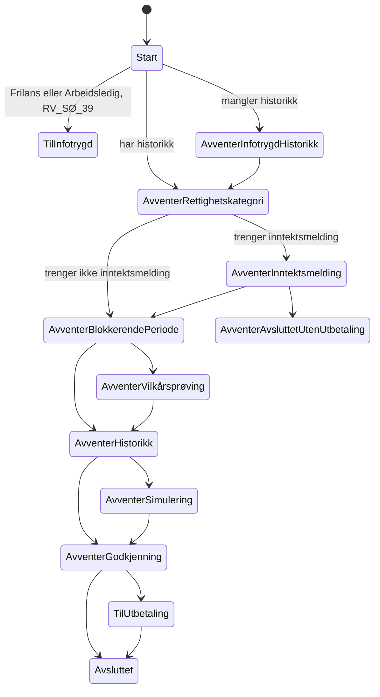

# Forenkle tilstandsmaskinen i Spleis

Dette dokumentet er planen for å fjerne tilstandene i Spleis som er spesifikke for selvstendig næringsdrivende, frilansere og arbeidsledige. Arbeidstakertilstandene blir de generiske tilstandene for alle. Etterpå innfører vi en ny tilstand, `AvventerRettighetskategori`, som avklarer rettighetskategorien for sykefraværstilfellet.

Dokumentet bygger på abstraksjonen [Rettighetskategori](abstraksjoner-kap8.md#rettighetskategori) og på rekkefølgen i [rekkefolge-kap8.md](rekkefolge-kap8.md).

## Sammendrag

- Vi får én tilstandsmaskin for arbeidstakere og selvstendig næringsdrivende. De 15 Selvstendig-tilstandene forsvinner. Forskjellene uttrykker vi som uttømmende `when (yrkesaktivitetstype)` i de generiske tilstandene, ikke som egne tilstander.
- Mange Selvstendig-tilstander har lite egen kode, men hendelseshåndteringen i `Vedtaksperiode.kt` skiller mellom tilstandene. Før sammenslåing må vi bevare forskjellene i forkasting, overstyring, korrigerte søknader og andre hendelser.
- Frilans- og Arbeidsledig-tilstandene fjerner vi helt. Vi oppretter vedtaksperiodene i felles `Start` (`START`) og forkaster dem direkte der med `RV_SØ_39` ut fra yrkesaktivitetstypen. Vi beholder `vedtaksperiode_forkastet`, som brukes til å opprette oppgaver i Gosys.
- Vi slår sammen tilstandene først. Når det er gjort, innfører vi `AvventerRettighetskategori` i den felles flyten.
- Vi flytter periodene ut av Selvstendig-tilstandene uten en JSON-migrering per tilstand. Ingen overganger går lenger til en Selvstendig-tilstand, og påminnelser sender periodene gjennom overgangene på nytt. Bare `SELVSTENDIG_AVSLUTTET` og `SELVSTENDIG_AVVENTER_BLOKKERENDE_PERIODE` JSON-migreres. Deretter fjerner vi tilstandene.
- `AvventerRettighetskategori` kommer etter `AvventerInfotrygdHistorikk`. Den sender behovet `Rettighetskategori` og venter på løsningen. Den første løseren er et skall av en ekstern domenetjeneste, og den svarer ut fra hva brukeren har søkt som.
- Vi avklarer én gang per skjæringstidspunkt og gjenbruker svaret. Når en førstegangssøknad for en ny yrkesaktivitet treffer skjæringstidspunktet, avklarer vi på nytt.
- Behovet tar med `vedtaksperiodeId`, `behandlingId`, skjæringstidspunktet og søknadsidene til alle vedtaksperioder som hører til skjæringstidspunktet. Svaret finner veien tilbake til riktig vedtaksperiode.
- Løsningen har nøyaktig én rettighetskategori. I dag er den enten `ARBEIDSTAKER` eller `SELVSTENDIG_NARINGSDRIVENDE`.
- Spleis lagrer bare `rettighetskategoriId`, ikke selve kategorien. Den som trenger kategorien, slår den opp i domenetjenesten. Spleis sender for eksempel ID-en til `sp-vilkarsproving` i behovet `Opptjeningsvurdering` i stedet for `arbeidssituasjon`.

## Beslutninger

| # | Beslutning |
|---|---|
| B1 | Vi slår sammen tilstandene først. Avklaringen av rettighetskategori kommer etterpå, i den felles flyten. |
| B2 | `AvventerRettighetskategori` sender et ekte behov fra første dag. Løseren er et skall av en ekstern domenetjeneste, med arbeidsnavnet `sp-rettighetskategori`. I starten svarer den ut fra hva brukeren har søkt som. |
| B3 | Den felles flyten gjelder bare arbeidstaker og selvstendig næringsdrivende. |
| B4 | Overstyring fra saksbehandler og regler i domenetjenesten er en senere fase. Vi bygger ingenting for det nå. |
| B5 | Rettighetskategori er ikke det samme som yrkesaktivitetstype. Yrkesaktivitetstypen styrer fortsatt inntektsmelding, arbeidsgiverperiode/ventetid og refusjon per yrkesaktivitet. Vedtaksperioden flytter ikke til en annen yrkesaktivitet ut fra svaret. |
| B6 | Frilans- og Arbeidsledig-tilstandene fjernes helt. Periodene opprettes i felles `Start` og forkastes direkte der med `RV_SØ_39` ut fra yrkesaktivitetstypen, før de går videre i den felles flyten. |
| B7 | Vi avklarer per skjæringstidspunkt og gjenbruker avklaringen. En førstegangssøknad for en ny yrkesaktivitet på skjæringstidspunktet gir ny avklaring. |
| B8 | Venteårsaken for `AvventerRettighetskategori` er `AVVENTER_RETTIGHETSKATEGORI`. |
| B9 | Loggingen «skatt på direkten» i `AvventerGodkjenning` gjelder bare arbeidstakere. Selvstendig næringsdrivende bruker fortsatt inntektene fra søknaden. |
| B10 | En avklaring gir nøyaktig én rettighetskategori, ikke en liste. Verdiene er foreløpig `ARBEIDSTAKER` og `SELVSTENDIG_NARINGSDRIVENDE`. |
| B11 | Spleis lagrer bare `rettighetskategoriId` som referanse. Tjenester som trenger kategorien, slår den opp i domenetjenesten med ID-en. |

## Slik er det i dag

### Tilstandene

Startpunktet velges ut fra `yrkesaktivitet.yrkesaktivitetstype` når vedtaksperioden opprettes (`Vedtaksperiode.kt:104-112`):

| Yrkesaktivitetstype | Starttilstand |
|---|---|
| `Arbeidstaker` | `ArbeidstakerStart` (`START`) |
| `Selvstendig` | `SelvstendigStart` |
| `Frilans` | `FrilansStart` |
| `Arbeidsledig` | `ArbeidsledigStart` |

`nesteTilstandEtterIgangsattOverstyring` i `Vedtaksperiode.kt` flytter perioden videre fra start. Arbeidstakere går til `AvventerInfotrygdHistorikk` eller `AvventerInntektsmelding`. De andre går til sin egen `*AvventerInfotrygdHistorikk` eller `*AvventerBlokkerendePeriode`.

Selvstendig har en hel parallell flyt: blokkerende periode, vilkårsprøving, historikk, simulering, godkjenning, utbetaling, avsluttet og alle revurderingstilstandene.

### Frilans og arbeidsledig

Søknader med yrkesaktiviteten `Frilans` eller `Arbeidsledig` avvises allerede med `RV_SØ_39` i `Yrkesaktivitet.kt:516-519`, men først etter at vedtaksperioden er opprettet i sin egen starttilstand. Forkastingen sender `vedtaksperiode_forkastet`, som `VedtaksperiodeForkastetRiver` i `spre/oppgaver` bruker til å opprette en oppgave i Gosys. Starttilstandene er dermed i bruk, selv om periodene ikke fortsetter i flyten.

`FrilansAvventerBlokkerendePeriode` og `ArbeidsledigAvventerBlokkerendePeriode` kaster feil i `entering()` («ikke støttet ennå»). Den videre flyten er ikke støttet. `BARNEPASSER` og `FISKER` avvises også etter at en vedtaksperiode er opprettet, ikke før.

Arbeidsledigsøknader der brukeren har oppgitt en tidligere arbeidsgiver, er noe annet. `NyeArbeidsledigSøknaderRiver` og `SendtArbeidsledigSøknaderRiver` gir dem yrkesaktiviteten `Arbeidstaker` med den tidligere arbeidsgiveren, og `Søknad.validerArbeidsledig` gir varsel. De går gjennom arbeidstakerflyten og berøres ikke av denne planen.

### Hvor like er Selvstendig-tilstandene?

Vi sammenlignet hver Selvstendig-tilstand med arbeidstakertilstanden med samme navn. Tabellen beskriver koden i tilstandsobjektene. Den er ikke tilstrekkelig til å fastslå lik oppførsel: mye av hendelseshåndteringen ligger i `when (tilstand)` i `Vedtaksperiode.kt`.

| Selvstendig-tilstand | Forskjell fra arbeidstakertilstanden |
|---|---|
| `SelvstendigStart`, `SelvstendigAvventerInfotrygdHistorikk` | Delegerer eller har ingen egen oppførsel. Hendelseshåndteringen skiller likevel mellom tilstandene, se under. |
| `SelvstendigAvventerVilkårsprøving` | Valideringen velges allerede ut fra yrkesaktivitetstype (`Vedtaksperiode.kt:3266`). Overstyringsflyten er forskjellig. |
| `SelvstendigAvventerHistorikk` | Ingen forskjell i tilstandsobjektet. Overstyringsflyten er forskjellig. |
| `SelvstendigAvventerSimulering` | Ingen forskjell i tilstandsobjektet. Overstyringsflyten er forskjellig. |
| `SelvstendigAvventerGodkjenning` | Arbeidstaker logger i tillegg «skatt på direkten», se under. |
| `SelvstendigTilUtbetaling`, `SelvstendigAvsluttet` | Ingen forskjell i tilstandsobjektene. Overganger ved revurdering må fortsatt velge riktig flyt under sammenslåingen. |
| Revurderingstilstandene unntatt `AvventerRevurdering` | Forskjeller ved blant annet overstyring og korrigert søknad, se under. |
| `SelvstendigAvventerRevurdering` | Arbeidstaker venter på inntekt og refusjon fra andre arbeidsgivere før vilkårsprøving eller beregning. |
| `SelvstendigAvventerBlokkerendePeriode` | Arbeidstaker sjekker at perioden skal behandles i Speil, at refusjonstidslinjen ikke er tom, lagrer faktaavklart inntekt og venter på søknad, inntekt eller refusjon fra andre perioder. Selvstendig går rett videre. |

#### Forskjeller i hendelseshåndteringen

Disse forskjellene må håndteres før de berørte tilstandene slås sammen. Linjereferansene er til `Vedtaksperiode.kt` slik den var ved gjennomgangen.

| Hendelse eller funksjon | Forskjell i dag | Krav før sammenslåing |
|---|---|---|
| Anmodning om forkasting (`488-536`) | `SelvstendigAvventerInfotrygdHistorikk` avviser anmodningen, mens `AvventerInfotrygdHistorikk` tillater den. | Bevar utfallet per yrkesaktivitet og test begge før trinn 3. |
| `nesteTilstandEtterIgangsattOverstyring` (`4384-4398`) | De generiske tilstandene for godkjenning, historikk, simulering og vilkårsprøving kaller `skalArbeidstakerBehandlesISpeil()`, som krever `Arbeidstaker` med `check()` (`3690-3692`). | Beskytt arbeidstakerkallet før trinn 4.2. En bro for neste tilstand hindrer ikke at sjekken feiler før overgangen. |
| `igangsettOverstyringPåBehandlingen` (`3462-3471`) | `SelvstendigAvventerGodkjenningRevurdering` oppretter verken ny behandling eller subsumsjon for fvl. § 35. Den generiske varianten gjør begge deler. | Bevar forskjellen og test behandlinger og subsumsjoner, ikke bare tilstandsrekkefølgen. |
| `håndterKorrigertSøknad` (`253-261`) | `SelvstendigAvventerRevurderingTilUtbetaling` kaller `nyBehandling`, mens den generiske varianten ikke gjør det. | Bevar forskjellen når revurderingstilstandene slås sammen. |
| Annullering (`2404-2410`, `2440-2456`) | Selvstendigs førstegangstilstander velger `AvventerAnnullering`, mens arbeidstakervariantene returnerer `null`. | Avklar om grenene er nåbare, og test eller dokumenter utfallet før de fjernes. Gjennomgangen har ikke bekreftet at Selvstendig-grenen kan nås. |
| Korrigert inntekt og inntektsmelding (`582-628`, `1362-1430`) | Flere Selvstendig-grener kaster feil, mens de generiske grenene håndterer hendelsen eller lar den passere. | Kartlegg de berørte hendelsene og bevar eksplisitt avvisning der hendelsen ikke støttes. |

Sammenslåingen skal ikke endre disse utfallene uten en egen beslutning og tester for den tilsiktede endringen.

Etter trinn 3 går nye selvstendige perioder gjennom de generiske tilstandene, og etter trinn 4 gjør også perioder som forlater en Selvstendig-tilstand det. Forskjellene i tabellen gjelder da bare så lenge perioden står i Selvstendig-tilstanden.

`loggEventuellSkattPåDirekten` i `AvventerGodkjenning` skriver bare til aktivitetsloggen. Den slår til når en periode skal til godkjenning uten skjæringstidspunkt og uten inntekt fra inntektsmelding eller vilkårsgrunnlag. Da logger den om perioden kunne vært beregnet på nytt med et skjæringstidspunkt som allerede er vilkårsprøvd. Den hører til arbeidstakerinntekter og skal ikke gjelde selvstendig næringsdrivende (B9).

Disse arbeidstakertilstandene har ingen Selvstendig-variant:

- `AvventerInntektsmelding`: selvstendig næringsdrivende har ingen arbeidsgiver som sender inntektsmelding.
- `AvventerAvsluttetUtenUtbetaling` og `AvsluttetUtenUtbetaling`: arbeidstakerperioder innenfor arbeidsgiverperioden. Selvstendig har ventetid, men den håndteres i beregningen, ikke i en egen tilstand.
- `AvventerInntektsopplysningerForAnnenArbeidsgiver` og `AvventerRefusjonsopplysningerAnnenPeriode`: gjelder andre arbeidsgivere og refusjon.
- `AvventerSøknadForOverlappendePeriode`.

### Hvor tilstandene brukes

- `Vedtaksperiode.kt` har 22 uttømmende `when (tilstand)` og over 300 referanser til Selvstendig-tilstander. Mesteparten av arbeidet ligger her.
- `ArbeidstakerAvklartInntekt.kt` lister alle tilstandene og kaster feil for Selvstendig, Frilans og Arbeidsledig.
- `starttilstander` i `Vedtaksperiodetilstand.kt:11`.
- Tilstanden lagres som `tilstand` i person-JSON. `PersonDataBuilder`, `VedtaksperiodetilstandDto` og `SpannerPersonDto` mapper navnene. Å fjerne en tilstand krever en serde-migrering.
- `vedtaksperiode_endret` sender `gjeldendeTilstand` og `forrigeTilstand`. Disse konsumentene bruker tilstandsnavnene:
  - `spesialist`: `VedtaksperiodeReberegnetRiver` lytter på `SELVSTENDIG_AVSLUTTET` og `SELVSTENDIG_TIL_UTBETALING` i tillegg til arbeidstakernavnene.
  - `spock`: lagrer gjeldende tilstand, sender påminnelser og velger påminnelsesintervall og sluttilstand ut fra navnet (`Tilstandsendringer.kt`).
  - `spetakkel`: har en egen enum med alle tilstandsnavnene i `TilstandsendringMonitor`.
  - `spammer`: `LoopMonitor`.
  - `bomlo-cli`: `TraceCommand`.
  - `spaghet`: tidsmålinger på tilstandsendringer.
  - `sporbar`, `spoogle` og andre som lagrer tilstand, sjekker vi før hvert trinn.

### Behov og ruting tilbake

Tilstandene kaller funksjoner som `trengerYtelser` og `trengerSimulering`. Aktivitetsloggen har vedtaksperioden som kontekst, så behovet får `vedtaksperiodeId` automatisk. Rivene for løsningene krever `vedtaksperiodeId`, og `HendelseMediator` ruter hendelsen via `Person` til riktig vedtaksperiode. Det nye behovet bruker samme mekanisme.

## Målbilde



Bare arbeidstaker og selvstendig går videre fra `Start` til Infotrygd-historikk eller rettighetskategori. Frilans og arbeidsledig forkastes i `Start`. Revurderings- og annulleringstilstandene er generiske på samme måte, men er utelatt fra figuren.

### Forskjellene blir sjekker, ikke tilstander

Alle forskjellene i tabellen under gjelder bare arbeidstakere. Derfor bruker tilstandene en uttømmende `when (yrkesaktivitetstype)` der forskjellen ligger, i stedet for å ha egne tilstander. `Frilans` og `Arbeidsledig` gir `error()`. Grenene står i tilstanden, så det er lett å se hva som gjelder for hvem.

| Forskjell | Arbeidstaker | Selvstendig |
|---|---|---|
| Trenger perioden inntektsmelding? | Ja | Nei |
| Kan perioden avsluttes uten utbetaling innenfor arbeidsgiverperioden? | Ja | Nei |
| Venter perioden på inntekt eller refusjon fra andre arbeidsgivere? | Ja | Nei |
| Kreves refusjonstidslinje før beregning? | Ja | Nei |
| Skal perioden vurderes for arbeidstakerbehandling i Speil? | Ja | Nei |
| Skal faktaavklart arbeidstakerinntekt lagres på perioden? | Ja | Nei |
| Skal godkjenning logge «skatt på direkten»? | Ja | Nei |

Vi lager ingen egen abstraksjon for sjekken, og vi skal ikke spre `when (yrkesaktivitetstype)` utover tilstandene.

## Den nye tilstanden `AvventerRettighetskategori`

### Plassering

Tilstanden kommer etter `AvventerInfotrygdHistorikk`. Skjæringstidspunktet kan flytte seg når Infotrygd-historikken kommer, og avklaringen gjelder for skjæringstidspunktet. Når historikken allerede finnes, går `Start` rett hit.

### Gjenbruk og ny avklaring

Rettighetskategorien avgjøres per sykefraværstilfelle. Vi avklarer derfor én gang per skjæringstidspunkt.

Når en vedtaksperiode kommer til `AvventerRettighetskategori`, gjør Spleis dette:

1. Finnes det ingen avklaring for skjæringstidspunktet, sender Spleis behovet.
2. Er perioden fra en førstegangssøknad for en ny yrkesaktivitet på skjæringstidspunktet, sender Spleis behovet på nytt. Det gjelder den første søknaden for en yrkesaktivitet eller arbeidsgiver der `fom`–`tom` overlapper skjæringstidspunktet.
3. Ellers gjenbruker Spleis avklaringen og går rett videre.

Spleis lagrer bare `rettighetskategoriId` på behandlingen til hver vedtaksperiode som bruker avklaringen. Gjenbruk betyr at perioden kopierer ID-en fra en annen periode på samme skjæringstidspunkt.

Ved ny avklaring sender Spleis med `forrigeRettighetskategoriId`. Domenetjenesten svarer om kategorien er endret. Spleis trenger da ikke å lagre kategorien for å vite om noe har endret seg.

- Kategorien er den samme: Spleis gir alle periodene på skjæringstidspunktet den nye ID-en og fortsetter. Ingen revurdering.
- Kategorien er endret: Spleis gir alle periodene på skjæringstidspunktet den nye ID-en og starter et revurderingseventyr fra skjæringstidspunktet.

### Behovet

Behovet heter `Rettighetskategori` og sendes i `entering()` og ved påminnelse.

| Felt | Innhold | Hvorfor |
|---|---|---|
| `vedtaksperiodeId` | Kommer fra konteksten | Rivet ruter løsningen tilbake til riktig vedtaksperiode. |
| `behandlingId` | Den åpne behandlingen | Vi kan forkaste et svar som gjelder en eldre behandling. |
| `skjæringstidspunkt` | Skjæringstidspunktet til perioden | Rettighetskategorien avgjøres per sykefraværstilfelle. |
| `periode` | `fom` og `tom` | Den som avklarer, ser hvilken periode det gjelder. |
| `forrigeRettighetskategoriId` | ID-en fra forrige avklaring på skjæringstidspunktet, eller tom | Domenetjenesten kan si om kategorien er endret. |
| `søknader` | Liste med `søknadId`, `vedtaksperiodeId`, `yrkesaktivitetstype`, `organisasjonsnummer` og `arbeidssituasjon` for alle vedtaksperioder som hører til samme skjæringstidspunkt, på tvers av yrkesaktiviteter | Domenetjenesten avklarer ut fra alt brukeren har søkt om for sykefraværstilfellet, ikke bare den ene søknaden. |

Søknadsidene finnes i dokumentsporingen på behandlingene. `arbeidssituasjon` er den som er lagret på behandlingen (`ARBEIDSTAKER`, `SELVSTENDIG_NÆRINGSDRIVENDE`, `JORDBRUKER` og så videre).

### Løsningen

```json
{
  "@behov": ["Rettighetskategori"],
  "vedtaksperiodeId": "…",
  "behandlingId": "…",
  "@løsning": {
    "Rettighetskategori": {
      "rettighetskategoriId": "…",
      "rettighetskategori": "SELVSTENDIG_NARINGSDRIVENDE",
      "endretFraForrige": false
    }
  }
}
```

- Hver avklaring har en egen `rettighetskategoriId` og endres aldri, etter mønsteret fra `opptjeningsvurderingId` og [sykepengegrunnlag-domenetjeneste.md](sykepengegrunnlag-domenetjeneste.md). En ny avklaring gir ny ID.
- `rettighetskategori` er én verdi. Spleis bruker den bare til å sjekke svaret og lagrer den ikke.
- `endretFraForrige` er `true` når kategorien er en annen enn i `forrigeRettighetskategoriId`. Uten forrige avklaring er den `false`.

### Hva Spleis gjør med svaret

1. Svaret gjelder en annen behandling enn den åpne: Spleis logger og ignorerer det. Påminnelsen sender behovet på nytt.
2. Kategorien passer med yrkesaktiviteten til perioden: Spleis lagrer `rettighetskategoriId` og går videre til `AvventerInntektsmelding` eller `AvventerBlokkerendePeriode`. `ARBEIDSTAKER` passer med `Arbeidstaker`, og `SELVSTENDIG_NARINGSDRIVENDE` passer med `Selvstendig`.
3. Kategorien passer ikke med yrkesaktiviteten: Forslaget er at Spleis gir `RV_IV_13` og forkaster perioden allerede her. Vilkårsprøvingen bruker denne feilen for inntekter fra både arbeidstaker og selvstendig (`Vedtaksperiode.kt:3232-3235`). Vi må avklare hvilke søknadskombinasjoner som faktisk kan nå den nye tilstanden: `RV_SØ_53` avviser allerede en annen yrkesaktivitetstype når periodene overlapper eller er kant i kant. Se [Åpne spørsmål](#åpne-spørsmål).

### Bruk av rettighetskategorien

Spleis sender `rettighetskategoriId` videre i stedet for kategorien. Den første brukeren er opptjeningsvurderingen:

- I dag sender Spleis `arbeidssituasjon` (`Arbeidstaker`, `SelvstendigNæringsdrivende` og så videre) i behovet `Opptjeningsvurdering` (`EventBusOversetter.kt`).
- Etter endringen sender Spleis `rettighetskategoriId`. `sp-vilkarsproving` slår opp kategorien i `sp-rettighetskategori`.
- I en overgang sender Spleis begge feltene når ID-en finnes, og beholder `arbeidssituasjon` for perioder uten ID. At `sp-vilkarsproving` har tatt i bruk ID-en, er ikke alene nok til å fjerne feltet. Håndtering av eldre perioder er et [åpent spørsmål](#åpne-spørsmål).

Andre steder i Spleis som i dag velger regler ut fra yrkesaktivitetstypen, beholder det inntil videre (B5).

### Løseren

`sp-rettighetskategori` er et skall av den eksterne domenetjenesten, etter mønsteret fra `sp-vilkarsproving`. Den lytter på behovet og svarer med én kategori ut fra `arbeidssituasjon` og `yrkesaktivitetstype` på søknadene. Den lagrer avklaringene, så andre tjenester kan slå opp kategorien med `rettighetskategoriId`. Den har ingen egne regler i fase 1.

## Trinn

Hvert trinn er en egen PR som kan rulles ut alene. Hvert trinn som fjerner tilstander, har en serde-migrering som skriver om `tilstand` i lagrede personer, og vi varsler konsumentene før trinnet rulles ut.

### Felles for trinnene som flytter perioder ut av Selvstendig-tilstandene

Trinn 3–7 flytter vedtaksperioder som står i en Selvstendig-tilstand i produksjon, over i en generisk tilstand. Vi bruker ikke en JSON-migrering per tilstand. I stedet sørger vi for at ingen overganger går til en Selvstendig-tilstand, og lar påminnelser flytte periodene videre gjennom de vanlige overgangene. Bare `SELVSTENDIG_AVSLUTTET` og `SELVSTENDIG_AVVENTER_BLOKKERENDE_PERIODE` får en JSON-migrering. En avsluttet periode skal ikke revurderes bare for å bytte tilstandsnavn, og en periode som venter på en periode foran, flytter seg ikke på en påminnelse.

Fordelen er at periodene går inn i den generiske tilstanden med `entering()`, sender behovene på nytt og gir `vedtaksperiode_endret`. Da får konsumentene det nye navnet med en gang, og vi slipper å resonnere om hvordan en migrert periode oppfører seg uten `entering()`.

**Før utrulling**

- Vi teller perioder per tilstand i tabellen `paminnelse` i `spock`. Den har gjeldende tilstand for hver vedtaksperiode. Da vet vi hvor mange perioder som må påminnes, og hvilke tilstander som er tomme.
- Vi oppdaterer konsumentene som filtrerer på tilstandsnavn, slik at de godtar både det gamle og det generiske navnet. `forrigeTilstand` i `vedtaksperiode_endret` kan fortsatt ha et gammelt navn når en periode forlater en Selvstendig-tilstand.

**Påminnelser og løsninger som er underveis**

- `spock` sender påminnelser med tilstanden den kjenner. `PåminnelserRiver` godtar bare navn som finnes i `TilstandType`. Derfor beholder vi de gamle verdiene i `TilstandType` til trinn 7.
- Når påminnelsen har feil tilstand, sender Spleis `vedtaksperiode_ikke_påminnet` med den nye tilstanden. `spock` lagrer den og påminner med riktig navn neste gang.
- Løsninger på behov som er sendt fra en Selvstendig-tilstand (Infotrygd-historikk, vilkårsprøving, ytelser, simulering, godkjenning, utbetaling), håndteres fortsatt i Selvstendig-tilstanden. Etter trinn 4 sender løsningen perioden videre til den generiske tilstanden.
- Perioder som står til godkjenning, har en oppgave i `spesialist`. Godkjenningen kommer tilbake til `SelvstendigAvventerGodkjenning` og går videre til `TilUtbetaling` eller `Avsluttet`.

**Gammel og ny kode samtidig**

JSON-migreringen i trinn 6 er ikke en databasemigrering som kjører én gang ved deploy. Den ligger i koden og kjører hver gang en pod leser en person. Derfor er spørsmålet hvilke podder som kan lese og skrive personer mens gammel og ny kode finnes samtidig.

Gammel kode avviser ikke personer med høyere `skjema_versjon` enn den kjenner. Den hopper over migreringene og deserialiserer JSON-en som den er. Det nye navnet `AVSLUTTET` finnes i gammel kode, og etter trinn 3 og 4 håndterer de generiske tilstandene selvstendige perioder. Gammel kode fra før trinn 2 ville derimot behandlet en selvstendig periode i en generisk tilstand med arbeidstakerlogikk.

Slik er det for hver app som leser `person`-tabellen:

| App | Deploy | Leser eller skriver | Konsekvens |
|---|---|---|---|
| `spleis` | `Recreate`, 8–24 podder i prod | Leser, migrerer og skriver | Kubernetes stopper alle gamle podder før de nye starter. Gammel og ny kode behandler derfor aldri meldinger samtidig. Meldinger som kommer mens podder byttes, blir liggende på Kafka og behandles av ny kode. |
| `spleis-api` | Rullerende, egen workflow | Leser bare, og migrerer i minnet | Gamle og nye podder kjører side om side en kort stund, og `spleis-api` kan bli deployet før eller etter `spleis`. En gammel pod som leser en migrert person, kan vise en selvstendig periode med feil status i Speil. Den skriver ingenting, så feilen forsvinner når utrullingen er ferdig. |
| `spleis-jobs` | Egen workflow og eget image | `migrate_v2` leser, migrerer og skriver | Kjører vi `migrate_v2` med et image som er eldre enn migreringen, skriver jobben personen tilbake med lavere `skjema_versjon` og gamle navn. Jobben `migrate` er trygg, fordi den bare sender meldinger som `spleis` behandler. |

Det gir disse reglene:

- **Ingen rollback av `spleis` til en versjon fra før trinn 2.** Feil retter vi med en ny versjon.
- **Kjør `migrate_v2` bare med et image som har migreringen.** Sjekk at `main-jobs`-workflowen er ferdig før jobben startes.
- **Gjør migreringen idempotent.** Får en person likevel lavere `skjema_versjon`, kjører migreringen på nytt ved neste lesing. Et navnebytte som bare endrer gamle navn, tåler det.
- **Ikke gjør `spleis` avhengig av at `spleis-api` er oppdatert, eller omvendt.** De to rulles ut hver for seg, selv om de bygges fra samme commit.

Trinn 9 er annerledes. `AVVENTER_RETTIGHETSKATEGORI` finnes ikke i gammel kode. En gammel `spleis-api`-pod feiler derfor når den leser en person med en periode i den tilstanden, til utrullingen er ferdig. Vil vi unngå det, legger vi verdien i enumene i en egen PR før tilstanden tas i bruk.

### Trinn 1: Fjerne Frilans og Arbeidsledig ✅

- Vi kartlegger `FRILANS_*` og `ARBEIDSLEDIG_*` i produksjonsdatabasen, også på forkastede perioder. Aktive perioder forkastes gjennom den vanlige hendelsesflyten før tilstandene fjernes. Eventuelle gamle navn som blir igjen i lagrede personer, må få en serde-migrering.
- Vi gjør `ArbeidstakerStart` til felles `Start` allerede her, uten å endre det serialiserte navnet `START`. `SelvstendigStart` blir stående til trinn 3.
- Søknader med yrkesaktiviteten `Frilans` eller `Arbeidsledig` oppretter en vedtaksperiode i `Start`. Ved søknadshåndtering i `Start` gir yrkesaktivitetstypen `RV_SØ_39`, og perioden forkastes direkte før behov eller videre overganger. Vi flytter dagens avvisning hit og beholder den vanlige forkastingsflyten og `vedtaksperiode_forkastet`.
- Vi oppdaterer både valget av starttilstand i konstruktøren og `opprettForkastetVedtaksperiode` til å bruke felles `Start` for disse yrkesaktivitetene.
- Vi fjerner `FrilansStart`, `FrilansAvventerInfotrygdHistorikk`, `FrilansAvventerBlokkerendePeriode`, `ArbeidsledigStart`, `ArbeidsledigAvventerInfotrygdHistorikk` og `ArbeidsledigAvventerBlokkerendePeriode` med verdiene i `TilstandType`, DTO-ene og serde.
- Arbeidsledigsøknader med tidligere arbeidsgiver går som før, gjennom arbeidstakerflyten.
- Tester skal vise `START` etterfulgt av forkasting for begge yrkesaktivitetene, med `RV_SØ_39` og hendelsen som gir Gosys-oppgave. De skal også vise at periodene ikke sender behov for Infotrygd-historikk eller går videre i flyten.

Rivene og `Behandlingsporing.Yrkesaktivitet.Frilans` og `.Arbeidsledig` blir værende. De brukes også av avbrutte søknader, sykmeldingsperioder og utgående meldinger.

### Trinn 2: Arbeidstakersjekker i tilstandene ✅

Vi legger en uttømmende `when (yrkesaktivitetstype)` inn i de eksisterende arbeidstakertilstandene der forskjellene fra tabellen over ligger. Ingen tilstander endres, og ingen oppførsel endres. Arbeidstakertestene skal være grønne uten endringer.

I praksis:

- Vi gjør implisitte arbeidstakerantakelser eksplisitte med `when (yrkesaktivitetstype)` der de ligger i dag:
  - valget mellom `AvventerInntektsmelding` og `AvventerBlokkerendePeriode` ut av `AvventerInfotrygdHistorikk`
  - sjekkene i `AvventerBlokkerendePeriode.entering()` og ventingen i `tilstandHvisBlokkeresAvAndre`
  - `AvventerBlokkerendePeriode.håndterPåminnelse`, som også kaller `lagreArbeidstakerFaktaavklartInntektPåPeriode`; funksjonen krever `Arbeidstaker` med `check()` (`Vedtaksperiode.kt:3721`)
  - kallene til `skalArbeidstakerBehandlesISpeil()` fra `nesteTilstandEtterIgangsattOverstyring`, også fra godkjenning, historikk, simulering og vilkårsprøving
  - ventingen på andre arbeidsgivere i `AvventerRevurdering`
  - `loggEventuellSkattPåDirekten` i `AvventerGodkjenning`
- For arbeidstaker gjør koden det samme som før. Selvstendig får logikken fra Selvstendig-tilstanden, og frilans og arbeidsledig gir feil.
- Selvstendig-tilstandene rører vi ikke.
- Vi kartlegger alle kall fra de berørte generiske tilstandene til funksjoner som krever `Arbeidstaker`, og alle direkte overganger til tilstander som fortsatt har en Selvstendig-variant. Kartleggingen skal dekke hendelseshåndteringen, ikke bare `entering()`.

Trinnet har ingen migrering og trenger ikke koordinering med konsumentene.

#### Gjennomført

De generiske tilstandene der Selvstendig-varianten har annen logikk, har fått en uttømmende `when (yrkesaktivitetstype)`. `Arbeidstaker` har dagens logikk, `Selvstendig` har logikken fra Selvstendig-tilstanden, og `Frilans` og `Arbeidsledig` kaster `error()`. Selvstendig-grenene går videre til Selvstendig-tilstandene, som før. Når en Selvstendig-tilstand slås sammen i trinn 3–5, peker kompilatoren ut grenene som må endres.

| Sted | `Arbeidstaker` | `Selvstendig` |
|---|---|---|
| `håndterHistorikkFraInfotrygd`, `AvventerInfotrygdHistorikk` | `AvventerInntektsmelding` | `SelvstendigAvventerBlokkerendePeriode` |
| `AvventerBlokkerendePeriode.entering()` | Sjekker Speil-behandling, refusjon og søknad, og lagrer faktaavklart inntekt | Ingen sjekker |
| `AvventerBlokkerendePeriode.gjenopptaBehandling` | Venter på andre perioder, så vilkårsprøving eller historikk | `SelvstendigAvventerVilkårsprøving` eller `SelvstendigAvventerHistorikk` |
| `AvventerBlokkerendePeriode.håndterPåminnelse` | Lagrer faktaavklart inntekt og venter på andre perioder | Gjenopptar behandling |
| `AvventerGodkjenning.håndterPåminnelse` | Logger «skatt på direkten» | Logger ikke (B9) |
| `AvventerRevurdering.venterpå` | Venter på andre arbeidsgivere | `VenterPå.Nestemann` |
| `AvventerRevurdering.gjenopptaBehandling` | Venter på andre arbeidsgivere, så vilkårsprøving eller historikk | `SelvstendigAvventerVilkårsprøvingRevurdering` eller `SelvstendigAvventerHistorikkRevurdering` |
| `AvventerRevurdering.håndterPåminnelse` | Gjenopptar behandling | Gjør ingenting |
| `nesteTilstandEtterIgangsattOverstyring`, gruppen med blokkerende periode, godkjenning, historikk, simulering og vilkårsprøving | `nesteTilstandEtterInntekt` eller `AvventerAvsluttetUtenUtbetaling` | `SelvstendigAvventerBlokkerendePeriode` |

De øvrige generiske tilstandene med Selvstendig-variant har lik logikk i tilstandsobjektet. Forskjellene i hendelseshåndteringen i `Vedtaksperiode.kt` (se [Forskjeller i hendelseshåndteringen](#forskjeller-i-hendelseshåndteringen)) tar vi i trinnet der den aktuelle tilstanden slås sammen.

#### Kartlegging

Funksjoner som krever `Arbeidstaker` med `check()`: `skalArbeidstakerBehandlesISpeil()`, `harInntektOgRefusjon()`, `lagreArbeidstakerFaktaavklartInntektPåPeriode()` og `avklarSykepengegrunnlagArbeidstaker()`. I tillegg kaster `somArbeidstakerOrThrow` feil.

Kall fra generiske tilstander med en Selvstendig-variant, etter trinn 2:

- `Start`, `AvventerInfotrygdHistorikk`, `AvventerVilkårsprøving`, `AvventerHistorikk`, `AvventerSimulering`, `TilUtbetaling`, `Avsluttet` og revurderingstilstandene kaller ingen av funksjonene i tilstandsobjektene.
- `AvventerBlokkerendePeriode`, `AvventerRevurdering` og `AvventerGodkjenning` kaller arbeidstakerfunksjonene bare i `Arbeidstaker`-grenen.
- `nesteTilstandEtterIgangsattOverstyring` kaller arbeidstakerfunksjonene bare i `Arbeidstaker`-grenen for de generiske tilstandene med Selvstendig-variant. Grenen for `AvventerInntektsmelding`, `AvventerAvsluttetUtenUtbetaling` og `AvsluttetUtenUtbetaling` kaller fortsatt `skalArbeidstakerBehandlesISpeil()` og `harInntektOgRefusjon()`, men disse tilstandene finnes bare for arbeidstaker.
- `avklarSykepengegrunnlagArbeidstaker()` kalles bare for perioder som er filtrert på `Arbeidstaker`.
- `venterPå` kaller `skalArbeidstakerBehandlesISpeil()` bare for `AvsluttetUtenUtbetaling`.

Arbeidstakertilstander uten Selvstendig-variant som kan nås fra `tilstandHvisBlokkeresAvAndre`, kaller `lagreArbeidstakerFaktaavklartInntektPåPeriode()` uten egen sjekk av yrkesaktivitetstype: `AvventerSøknadForOverlappendePeriode`, `AvventerInntektsopplysningerForAnnenArbeidsgiver` og `AvventerRefusjonsopplysningerAnnenPeriode`. `tilstandHvisBlokkeresAvAndre` kalles bare fra `Arbeidstaker`-grener og arbeidstakertilstander, så selvstendige perioder kommer ikke dit.

Direkte overganger fra generiske tilstander til tilstander som fortsatt har en Selvstendig-variant (linjenumre i `Vedtaksperiode.kt` etter trinn 2):

| Overgang | Sted | Trenger bro |
|---|---|---|
| `AvventerInfotrygdHistorikk` → `SelvstendigAvventerBlokkerendePeriode` for selvstendig | `håndterHistorikkFraInfotrygd` (`1504`) | Ligger allerede i `when`-en |
| `AvventerRevurderingTilUtbetaling` → `AvventerRevurdering` | `håndterUtbetalingHendelse` (`2169`) | `avventerRevurdering()` i trinn 4.1 |
| `AvventerVilkårsprøving` → `AvventerHistorikk` og revurderingsvarianten | `håndterVilkårsgrunnlag` (`2045`) | Nei, slås sammen i trinn 4.2 og 4.3 |
| `AvventerHistorikk` → `AvventerSimulering`/`AvventerGodkjenning` og revurderingsvarianten | `håndterYtelser` (`1608`) | Nei, slås sammen i trinn 4.2 og 4.3 |
| `AvventerSimulering` → `AvventerGodkjenning` og revurderingsvarianten | `håndterSimulering` (`2101`) | Nei, slås sammen i trinn 4.2 og 4.3 |
| `AvventerGodkjenning` → `TilUtbetaling`/`Avsluttet` | `håndterUtbetalingsavgjørelse` (`1900`) | Nei, slås sammen i trinn 4.1 |
| `TilUtbetaling` → `Avsluttet` | `håndterUtbetalingHendelse` (`2172`) | Nei, slås sammen i trinn 4.1 |
| `AvventerBlokkerendePeriode` → `AvventerVilkårsprøving`/`AvventerHistorikk` | `AvventerBlokkerendePeriode.gjenopptaBehandling` | Nei, `AvventerBlokkerendePeriode` slås sammen i trinn 5, etter trinn 4.2 |
| `AvventerRevurdering` → `AvventerVilkårsprøvingRevurdering`/`AvventerHistorikkRevurdering` | `AvventerRevurdering.tilstand()` | Nei, slås sammen i trinn 4.3 |
| Generiske tilstander → `AvventerBlokkerendePeriode`, `AvventerRevurdering` og `AvventerRevurderingTilUtbetaling` | `nesteTilstandEtterIgangsattOverstyring` (`4156`) | `avventerBlokkerendePeriode()` og `avventerRevurdering()` fra trinn 3 og 4.1 |

Tabellen er laget for den første strategien med broer og deltrinn 4.1–4.3. Med den nye strategien i trinn 3–7 trengs ikke broene, fordi de generiske tilstandene sender selvstendige perioder rett videre til andre generiske tilstander.

### Trinn 3: Start og generiske tilstander for nye perioder ✅

- Nye selvstendige vedtaksperioder opprettes i `Start` og går gjennom de generiske tilstandene, med `when (yrkesaktivitetstype)` fra trinn 2 der oppførselen er forskjellig.
- `Start` går til `AvventerInfotrygdHistorikk` hvis historikken mangler, og ellers til `AvventerBlokkerendePeriode` for selvstendig næringsdrivende.
- `AvventerBlokkerendePeriode` og `AvventerRevurdering` sender selvstendige perioder videre til de generiske tilstandene for vilkårsprøving og historikk. Broene `avventerBlokkerendePeriode()` og `avventerRevurdering()` trengs derfor ikke.
- Den generiske hendelseshåndteringen gjelder nå for nye selvstendige perioder. Forskjellene i [Forskjeller i hendelseshåndteringen](#forskjeller-i-hendelseshåndteringen) gjelder bare perioder som fortsatt står i en Selvstendig-tilstand.

Perioder som allerede står i en Selvstendig-tilstand, blir stående der. De flytter vi i trinn 4–6.

### Trinn 4: Ingen overganger til Selvstendig-tilstandene ✅

Ingen overgang går lenger til en Selvstendig-tilstand. Selvstendig-tilstandene kan bare nås ved å lese en lagret person, og alle overganger ut av dem går til den generiske tilstanden. Det gjelder både overgangene som en påminnelse starter, og overgangene som en løsning på et behov starter.

| Fra | Hendelse | Til |
|---|---|---|
| `SelvstendigStart` | Igangsatt overstyring | Som `Start`: `AvventerInfotrygdHistorikk` eller `AvventerBlokkerendePeriode` |
| `SelvstendigAvventerInfotrygdHistorikk` | Påminnelse med `ønskerReberegning` | `AvventerInfotrygdHistorikk` |
| `SelvstendigAvventerInfotrygdHistorikk` | Infotrygd-historikk | `AvventerBlokkerendePeriode` |
| `SelvstendigAvventerBlokkerendePeriode` | Påminnelse eller gjenopptakelse | `AvventerVilkårsprøving` eller `AvventerHistorikk` |
| `SelvstendigAvventerBlokkerendePeriode`, `…Vilkårsprøving`, `…Historikk`, `…Simulering`, `…Godkjenning` | Påminnelse med `ønskerReberegning` og annen overstyring | `AvventerBlokkerendePeriode` |
| `SelvstendigAvventerVilkårsprøving`, `…VilkårsprøvingRevurdering` | Vilkårsgrunnlag | `AvventerHistorikk`, `AvventerHistorikkRevurdering` |
| `SelvstendigAvventerHistorikk`, `…HistorikkRevurdering` | Ytelser | De generiske tilstandene for simulering eller godkjenning |
| `SelvstendigAvventerSimulering`, `…SimuleringRevurdering` | Simulering | `AvventerGodkjenning`, `AvventerGodkjenningRevurdering` |
| `SelvstendigAvventerGodkjenning`, `…GodkjenningRevurdering` | Utbetalingsavgjørelse | `TilUtbetaling` eller `Avsluttet` |
| `SelvstendigTilUtbetaling` | Utbetalt | `Avsluttet` |
| `SelvstendigTilUtbetaling`, `SelvstendigAvventerRevurderingTilUtbetaling` | Påminnelse med `ønskerReberegning` og annen overstyring | `AvventerRevurderingTilUtbetaling` |
| `SelvstendigAvventerRevurderingTilUtbetaling` | Utbetalt | `AvventerRevurdering` |
| `SelvstendigAvsluttet` og revurderingstilstandene | Påminnelse med `ønskerReberegning` og annen overstyring | `AvventerRevurdering` |
| `SelvstendigAvventerRevurdering` | Gjenopptakelse | `AvventerVilkårsprøvingRevurdering` eller `AvventerHistorikkRevurdering` |

Hendelseshåndteringen i selve Selvstendig-tilstandene er ikke endret. For eksempel oppretter overstyring i `SelvstendigAvventerGodkjenningRevurdering` fortsatt ikke ny behandling. Endringen gjelder bare hvilken tilstand perioden går til.

Trinnet har ingen migrering. Tilstandsobjektene, `TilstandType`, DTO-ene og serde er uendret.

Tester (`SelvstendigTilstanderTilGeneriskeTest`): Vi lagrer en selvstendig periode, bytter tilstanden i JSON-en til Selvstendig-navnet og gjenoppretter personen. Deretter sender vi påminnelse, påminnelse med `ønskerReberegning` eller løsningen på behovet, og sjekker at perioden går til den generiske tilstanden og videre i flyten.

### Trinn 5: Påminne periodene i Selvstendig-tilstandene

Vi sender påminnelser til alle perioder som står i en Selvstendig-tilstand, unntatt `SELVSTENDIG_AVSLUTTET` og `SELVSTENDIG_AVVENTER_BLOKKERENDE_PERIODE`, som vi JSON-migrerer i trinn 6. Periodene går da gjennom overgangene på nytt og havner i de generiske tilstandene.

| Tilstand | Påminnelse | Resultat |
|---|---|---|
| `SELVSTENDIG_START` | Ventes tom. Ellers `ønskerReberegning`. | Som `Start` |
| `SELVSTENDIG_AVVENTER_INFOTRYGDHISTORIKK` | Vanlig påminnelse | Behovet sendes på nytt, og svaret gir `AVVENTER_BLOKKERENDE_PERIODE` |
| `SELVSTENDIG_AVVENTER_VILKÅRSPRØVING`, `_HISTORIKK`, `_SIMULERING`, `_GODKJENNING` | `ønskerReberegning` | `AVVENTER_BLOKKERENDE_PERIODE` og videre |
| Revurderingstilstandene unntatt `_TIL_UTBETALING` | `ønskerReberegning` | `AVVENTER_REVURDERING` og videre |
| `SELVSTENDIG_TIL_UTBETALING`, `SELVSTENDIG_AVVENTER_REVURDERING_TIL_UTBETALING` | Ingen ekstra. Vi venter på kvitteringen. | `AVSLUTTET` eller `AVVENTER_REVURDERING` |

- Vi bruker `spock` til å sende påminnelsene, med flagget `ønskerReberegning` der tabellen sier det.
- Perioder i godkjenning får et nytt godkjenningsbehov. Oppgaven i `spesialist` erstattes, så vi avtaler tidspunktet med saksbehandlerne.
- Reberegning starter et revurderingseventyr fra skjæringstidspunktet. Andre perioder på samme skjæringstidspunkt blir også beregnet på nytt.
- Utbetalingsperiodene sender vi ikke reberegning til, fordi det ville startet en revurdering mens utbetalingen pågår.
- Vi teller på nytt i `paminnelse` etterpå og gjentar for perioder som står igjen.

### Trinn 6: JSON-migrere `SELVSTENDIG_AVSLUTTET` og `SELVSTENDIG_AVVENTER_BLOKKERENDE_PERIODE`

- En `JsonMigration` bytter `SELVSTENDIG_AVSLUTTET` til `AVSLUTTET` og `SELVSTENDIG_AVVENTER_BLOKKERENDE_PERIODE` til `AVVENTER_BLOKKERENDE_PERIODE`, etter mønsteret i `V342RenameAvventersøknadForTidligereEllerOverlappendePeriode`. Den rører ikke behandlinger, utbetalinger eller noe annet.
- Migreringen tar også eventuelle andre `SELVSTENDIG_*`-navn som står igjen etter trinn 5, og bytter dem til det generiske navnet. Det er en sikring, ikke hovedveien.
- `SelvstendigAvsluttet` og `Avsluttet` har lik oppførsel, og en senere overstyring går til `AvventerRevurdering` etter trinn 4. Migreringen kjører ikke `entering()`, og det trengs ikke.
- Perioder i `SELVSTENDIG_AVVENTER_BLOKKERENDE_PERIODE` venter på at en periode foran skal bli ferdig. En påminnelse flytter dem ikke, og reberegning ville startet et revurderingseventyr som også beregner perioden foran på nytt. For selvstendig næringsdrivende gjør `AvventerBlokkerendePeriode.entering()` bare en gjenopptakelse, og gjenopptakelse og påminnelse har allerede Selvstendig-oppførselen fra trinn 2. Derfor trenger heller ikke disse periodene `entering()`.
- Spleis sender ikke `vedtaksperiode_endret` for perioder som migreres. Konsumenter som lagrer tilstanden, ser det gamle navnet til perioden bytter tilstand neste gang. `spock` regner både `SELVSTENDIG_AVSLUTTET` og `AVSLUTTET` som sluttilstand.
- Personer som ikke får meldinger, beholder det gamle navnet i databasen til de blir lest. Vi kjører `migrate_v2` for å få alle over.

Vi kjører migreringen mot en kopi av produksjonsdata i dev og sjekker at personene kan gjenopprettes og serialiseres uten feil. Migreringstestene følger periodene videre med hendelser, ikke bare navnebyttet: en overstyring for avsluttet periode, og gjenopptakelse når perioden foran er ferdig for blokkerende periode.

### Trinn 7: Fjerne Selvstendig-tilstandene

Før vi fjerner noe, sjekker vi at ingenting bruker de gamle navnene lenger:

- Tabellen `paminnelse` i `spock` har ingen perioder med et gammelt navn.
- Alle personer i databasen er migrert. Vi kjører `migrate_v2` hvis det er usikkert.

Deretter:

- Vi sletter alle Selvstendig-tilstandsobjektene og fjerner verdiene fra `TilstandType`, `VedtaksperiodetilstandDto`, `SpannerPersonDto`, serde og mappingen i `SpeilGenerasjonerBuilder`. Migreringene blir stående, siden de skriver til strenger og ikke bruker enumene.
- Vi fjerner grenene for Selvstendig-tilstandene i de uttømmende `when`-ene i `Vedtaksperiode.kt` og `ArbeidstakerAvklartInntekt.kt`.
- Vi fjerner `starttilstander` og det som er igjen av valget av starttilstand ut fra yrkesaktivitetstype.
- Vi fjerner de gamle navnene hos konsumentene: `spesialist`, `spock`, `spetakkel`, `spammer`, `bomlo-cli`, `spaghet` og modellene i `bomlo-dbt`. Historiske data i `spaghet` og BigQuery beholder de gamle navnene, så rapporter som går bakover i tid, må fortsatt kjenne dem.

Etter dette trinnet har Spleis én tilstandsmaskin.

### Trinn 8: Løseren for rettighetskategori

Vi ruller ut skallet `sp-rettighetskategori`. Den lytter på behovet `Rettighetskategori`, svarer ut fra søknadene og har et endepunkt for oppslag på `rettighetskategoriId`. Ingen sender behovet ennå.

### Trinn 9: `AvventerRettighetskategori`

- Vi legger til `AVVENTER_RETTIGHETSKATEGORI` i `TilstandType`, DTO-ene og serde, og venteårsaken `AVVENTER_RETTIGHETSKATEGORI`.
- `Start` og `AvventerInfotrygdHistorikk` går til `AvventerRettighetskategori`.
- Spleis lagrer `rettighetskategoriId` på behandlingen, gjenbruker den per skjæringstidspunkt og avklarer på nytt ved førstegangssøknad for ny yrkesaktivitet.
- Ut av tilstanden går perioden til `AvventerInntektsmelding` eller `AvventerBlokkerendePeriode`.

Perioder som allerede er forbi Infotrygd-steget, får ingen avklaring i dette trinnet. De kan senere trenge opptjeningsvurdering uten å ha en `rettighetskategoriId`, blant annet ved revurdering. Trinn 10 må derfor fortsatt støtte perioder uten ID.

### Trinn 10: Opptjening med `rettighetskategoriId`

- Spleis sender `rettighetskategoriId` i behovet `Opptjeningsvurdering`, ved siden av `arbeidssituasjon`.
- `sp-vilkarsproving` slår opp kategorien i `sp-rettighetskategori` når ID-en finnes, og bruker `arbeidssituasjon` ellers.
- Vi beholder `arbeidssituasjon` inntil håndteringen av eldre perioder uten ID er avklart. At alle åpne perioder har ID, er ikke tilstrekkelig: avsluttede perioder kan senere revurderes. Vilkåret for å fjerne feltet er et [åpent spørsmål](#åpne-spørsmål).

## Senere faser

Vi bygger ingenting for disse nå. De stiller disse kravene til kontrakten:

- **Domenetjeneste med regler.** Tjenesten avklarer per sykefraværstilfelle ut fra søknadene, inntekt og andre opplysninger. Behovet sender derfor alle søknadene på skjæringstidspunktet. Tilleggskategoriene fra [abstraksjoner-kap8.md](abstraksjoner-kap8.md#rettighetskategori) kan tjenesten eie selv. Spleis ser fortsatt bare ID-en.
- **Flere brukere av ID-en.** Sykepengegrunnlag, ventetid og maksdato kan slå opp kategorien på samme måte som opptjening.
- **Overstyring fra saksbehandler.** Spesialist sender en overstyring til domenetjenesten. Tjenesten lager en ny avklaring med ny `rettighetskategoriId` og varsler Spleis, som starter et revurderingseventyr fra skjæringstidspunktet.
- **Rettighetskategori som avviker fra yrkesaktivitetstypen.** For eksempel en søknad som arbeidstaker der tjenesten avklarer frilanser. Da må vi bestemme om perioden flytter til en annen yrkesaktivitet, eller om rettighetskategorien bare styrer regelsettet (B5).
- **Frilans og arbeidsledig.** Når reglene er på plass, kommer de inn i den felles flyten med eksplisitte sjekker på yrkesaktiviteten, ikke som egne tilstander.

## Risiko

| Risiko | Tiltak |
|---|---|
| En migrering skriver om en tilstand feil, og perioder blir stående fast. | Kjør migreringen mot en kopi av produksjonsdata i dev. Følg med på perioder i de nye tilstandene med `spammer` og påminnelser. |
| Konsumenter filtrerer på gamle tilstandsnavn og slutter å reagere. | Søk etter navnene i alle repoer før hvert trinn, og oppdater konsumentene først. |
| Det finnes likevel personer med perioder i Frilans- eller Arbeidsledig-tilstander. | Sjekk databasen før trinn 1, og forkast periodene før vi fjerner tilstandene. |
| Arbeidstakeroppførsel endres ved et uhell når arbeidstakersjekkene legges inn i tilstandene. | Trinn 2 endrer ingen oppførsel og kjøres alene. Hele testsuiten for arbeidstaker må være grønn uendret i hvert trinn. |
| Selvstendig-perioder treffer arbeidstakerkode som tidligere var utilgjengelig. | Testene for selvstendig kjøres mot de generiske tilstandene. Kode som bare gjelder arbeidstaker, ligger i `Arbeidstaker`-grenen av en uttømmende `when`. |
| `sp-rettighetskategori` er nede, og nye perioder blir stående i `AvventerRettighetskategori`. | Påminnelse sender behovet på nytt. Vi setter opp alarm på antall perioder i tilstanden. |
| Ny avklaring ved førstegangssøknad starter revurderinger som ikke trengs. | Spleis starter bare revurderingseventyr når `endretFraForrige` er `true`. |
| `sp-vilkarsproving` får ikke slått opp kategorien fordi `sp-rettighetskategori` er nede. | Opptjeningsvurderingen feiler og prøves på nytt ved påminnelse, som andre behov. |

## Åpne spørsmål

1. Hvilken kategori skal skallet svare når brukeren har søkt både som arbeidstaker og som selvstendig næringsdrivende på samme skjæringstidspunkt? Det er to alternativer.

   Alternativene nedenfor forutsetter at kombinasjonen kan nå avklaringen. Det må vurderes mot `RV_SØ_53`, se punkt 2.

   **Alternativ A: kategorien til den første søknaden.** Hvis perioden med den andre yrkesaktiviteten når avklaringen, får den en kategori som ikke passer, og Spleis forkaster den med `RV_IV_13`. Vi må avklare forholdet til dagens avvisning med `RV_SØ_53` før vi kan si at utfallet er det samme som i dag.

   **Alternativ B: en egen kategori, `ARBEIDSTAKER_OG_SELVSTENDIG_NARINGSDRIVENDE` (§ 8-41).** Spleis kan fortsatt ikke utbetale kombinasjonen. Den krever Dekning og et sykepengegrunnlag som er fordelt på yrkesaktivitetene. Konsekvensene er disse:

   - B10 får en tredje verdi.
   - Regelen for om kategorien passer, endres. Den kombinerte kategorien passer med både `Arbeidstaker` og `Selvstendig`, så begge periodene går videre. Forkastingen ved kategori som ikke passer, fanger ikke lenger opp dette tilfellet.
   - Spleis må fortsatt avvise kombinasjonen. Enten sjekker `AvventerRettighetskategori` den eksplisitt og gir `RV_IV_13`, eller så forkaster vilkårsprøvingen perioden som i dag (`Vedtaksperiode.kt:3232-3235`). Utfallet er det samme.
   - `rettighetskategoriId` blir riktig. Med alternativ A får den første perioden en ID som sier `ARBEIDSTAKER`, selv om saken egentlig hører under § 8-41. Den ID-en går videre til `sp-vilkarsproving`.
   - Hvis en senere søknad som selvstendig næringsdrivende passerer `RV_SØ_53` og når samme skjæringstidspunkt som en utbetalt arbeidstakerperiode, kan den gi ny avklaring med `endretFraForrige = true`. Det starter et revurderingseventyr fra skjæringstidspunktet. Revurderingen treffer en kombinasjon Spleis ikke støtter, og den utbetalte perioden kan ikke forkastes. Vi må først avklare om scenarioet er nåbart. Hvis det er det, må vi bestemme om bare den nye perioden skal forkastes, eller om Spleis ikke skal starte revurdering når den nye kategorien ikke støttes.
   - Kategorien erstatter ikke inntektssjekken. `erKombinert` bygger på inntekt, også ghost-inntekter fra A-ordningen. En person som bare har søkt som selvstendig næringsdrivende, men har arbeidstakerinntekt i skatteopplysningene, blir fortsatt fanget av `RV_IV_13` i vilkårsprøvingen. Skallet svarer bare ut fra søknadene og ser ikke dette tilfellet.
   - `sp-vilkarsproving` må håndtere den nye verdien i opptjeningsvurderingen. Det er trolig de samme reglene som for arbeidstaker, men det må avklares.
   - Kombinasjonene i § 8-42 og § 8-43 vil kreve det samme senere. Vi bør vurdere om verdiene skal følge hovedkategoriene i [abstraksjoner-kap8.md](abstraksjoner-kap8.md#hovedkategorier) fra starten, så nye kategorier bare blir nye verdier og ikke endrer betydningen av kontrakten.

   Forslaget er alternativ B. Spleis behandler kategorien som «ikke støttet» og gir `RV_IV_13`. Før trinn 9 må vi bestemme hvordan Spleis håndterer en endret kategori på perioder som allerede er utbetalt.

2. Hvordan skal `RV_SØ_53` påvirke avklaringen av rettighetskategori? `vurderOmSøknadIkkeKanHåndteres` i `Yrkesaktivitet.kt:526-534` avviser allerede en søknad med en annen yrkesaktivitetstype når den overlapper eller er kant i kant med en eksisterende periode. Det skjer før tilstandsflyten. Vi må avklare hvilke kombinasjoner som kan nå `AvventerRettighetskategori`, om avvisningen skal bestå, og om forkastede søknader skal inngå i behovet. Vurderingen av alternativ A og B må bygge på nåbare scenarioer. `RV_IV_13` fanger dessuten kombinerte inntekter, også ghost-inntekter, uten at brukeren har søkt under begge yrkesaktivitetstypene.

3. Når kan vi fjerne `arbeidssituasjon` fra `Opptjeningsvurdering`? Perioder som er forbi Infotrygd-steget ved trinn 9, får ingen ID. Også avsluttede perioder kan senere revurderes og trenge ny opptjeningsvurdering. `OpptjeningsvurderingRiver` i `sp-vilkarsproving` krever i dag `Opptjeningsvurdering.arbeidssituasjon` (`requireKey`, linje 40). Vi må velge mellom å beholde feltet som fallback for eldre perioder og å sikre at disse får en ID før et nytt behov sendes, for eksempel med backfill eller avklaring ved revurdering. Fjerning krever at både Spleis og konsumenten håndterer dette; alle åpne perioder med ID er ikke et tilstrekkelig kriterium.
