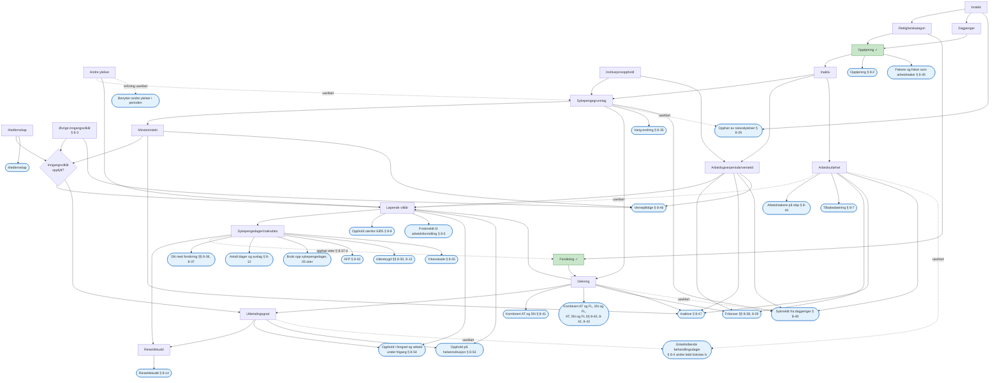

# Funksjonskart for kapittel 8

Dette dokumentet viser hvilke abstraksjoner fra [abstraksjoner-kap8.md](abstraksjoner-kap8.md) vi trenger for å dekke funksjonene som mangler før Infotrygd kan erstattes. Målet er å prioritere rekkefølgen vi lager abstraksjonene i, og å vite hvilke funksjoner vi kan levere etter hver abstraksjon.

Opptjening og Forsikring er allerede laget som abstraksjoner, med overstyring. Forsikring dekker både selvstendig næringsdrivende og frilansere. I diagrammet er de merket som ferdige.

## Graf

Grafen viser abstraksjoner som rektangler og funksjoner som avrundede bokser. En pil fra A til B betyr at A må være ferdig før B kan bli ferdig. En funksjon kan leveres når alle abstraksjonene den kan nås fra, er ferdige. For eksempel trenger kombinert arbeidstaker og selvstendig næringsdrivende Dekning, som trenger Sykepengegrunnlag, som igjen trenger Inntekt.

Grafen har bare de pilene som ikke følger av andre veier. En pil viser derfor ikke hvilken abstraksjon som bruker hjemlene for en funksjon. Det står i tabellen [Funksjoner per trinn](#funksjoner-per-trinn).

Stiplede piler viser koblinger som ikke er avklart, og resultater som føres tilbake fra senere sykefraværstilfeller. Bare heltrukne piler er brukt for å avgjøre om en pil følger av en annen vei. En stiplet pil er fjernet hvis en heltrukken vei gir den samme avhengigheten.

Hjemlene for avhengighetene mellom abstraksjonene står i [rekkefolge-kap8.md](rekkefolge-kap8.md#avhengigheter).

Spleis har i dag flat logikk for arbeidstakere og det meste for selvstendig næringsdrivende. En abstraksjon kan bruke resultatet fra denne logikken før forgjengeren er laget som abstraksjon. Den kan likevel ikke bruke en overstyrt verdi fra forgjengeren før forgjengeren er en abstraksjon.

## Trinn

Lager vi abstraksjonene i denne rekkefølgen, er forgjengerne til hver abstraksjon på plass når vi starter på den. Abstraksjonene i samme trinn er uavhengige av hverandre og kan lages parallelt.

| Trinn | Abstraksjoner |
|---|---|
| Ferdig | Opptjening, Forsikring |
| 1 | Inntekt, Medlemskap, Øvrige inngangsvilkår (§ 8-3), Andre ytelser, Institusjonsopphold |
| 2 | Rettighetskategori, Dagpenger |
| 3 | Inaktiv |
| 4 | Sykepengegrunnlag, Arbeidsgiverperiode/ventetid, Arbeidsuførhet |
| 5 | Minsteinntekt, Dekning |
| 6 | Løpende vilkår, Utbetalingsgrad |
| 7 | Sykepengedager/maksdato |
| 8 | Reisetilskudd |

Opptjening og Forsikring bruker Rettighetskategori og Dagpenger, selv om de er laget før. Forsikring bruker også Sykepengedager/maksdato (§ 8-37 bokstav d).

## Funksjoner per trinn

Tabellen viser det første trinnet der alle abstraksjonene en funksjon trenger, er laget. Funksjonen kan leveres etter dette trinnet.

| Funksjon | Hjemmel | Abstraksjoner | Kan leveres etter trinn |
|---|---|---|---|
| Opptjening | § 8-2 | Opptjening | Ferdig |
| Medlemskap | § 8-1 og kapittel 2 | Medlemskap | 1 |
| Benytter andre ytelser i perioden | Utenfor kapittel 8 | Andre ytelser | 1, men virkningen er ikke avklart |
| Fiskere og fisker som arbeidstaker | § 8-45 | Rettighetskategori, Opptjening | 2 |
| Arbeidstakere på skip | § 8-44 | Rettighetskategori, Opptjening, Arbeidsuførhet | 4 |
| Tilbakedatering | § 8-7 andre ledd | Arbeidsuførhet | 4 |
| Varig endring for selvstendig næringsdrivende | § 8-35 tredje ledd | Inntekt, Sykepengegrunnlag | 4 |
| Opphør av naturalytelser | § 8-29 femte ledd | Inntekt, Sykepengegrunnlag | 4, men endring av grunnlaget er ikke avklart |
| Kombinert arbeidstaker og selvstendig næringsdrivende | § 8-41 | Inntekt, Rettighetskategori, Sykepengegrunnlag, Dekning | 5 |
| Kombinert AT og FL, SN og FL, AT, SN og FL | §§ 8-40, 8-42, 8-43 | Inntekt, Rettighetskategori, Sykepengegrunnlag, Dekning | 5 |
| Frilanser | §§ 8-38, 8-39 | Inntekt, Rettighetskategori, Forsikring, Sykepengegrunnlag, Arbeidsgiverperiode/ventetid, Arbeidsuførhet, Dekning | 5 |
| Inaktive | § 8-47 | Inaktiv, Sykepengegrunnlag, Arbeidsgiverperiode/ventetid, Arbeidsuførhet, Minsteinntekt, Dekning | 5 |
| Sykmeldt fra dagpenger | § 8-49 | Inntekt, Dagpenger, Sykepengegrunnlag, Arbeidsgiverperiode/ventetid, Arbeidsuførhet, Dekning | 5, men dekningsgraden er ikke avklart |
| Vernepliktige | § 8-46 | Inntekt, Rettighetskategori, Opptjening, Øvrige inngangsvilkår, Sykepengegrunnlag, Arbeidsgiverperiode/ventetid, Minsteinntekt | 5 |
| Opphold utenfor EØS | § 8-9 | Løpende vilkår | 6 |
| Friskmeldt til arbeidsformidling | § 8-5 | Løpende vilkår | 6 |
| Opphold i fengsel og arbeid under frigang | § 8-54 | Institusjonsopphold, Sykepengegrunnlag, Arbeidsgiverperiode/ventetid, Løpende vilkår, Utbetalingsgrad | 6 |
| Opphold på helseinstitusjon | § 8-53 | Institusjonsopphold, Løpende vilkår, Utbetalingsgrad | 6 |
| Selvstendig næringsdrivende med forsikring | §§ 8-36, 8-37 | Forsikring, Dekning, Sykepengedager/maksdato | 7 |
| Antall dager og avslag | § 8-12 | Sykepengedager/maksdato | 7 |
| Brukt opp sykepengedager, 26 uker | § 8-12 andre ledd | Sykepengedager/maksdato | 7 |
| AFP | §§ 8-51, 8-52 | Andre ytelser, Sykepengegrunnlag, Løpende vilkår, Sykepengedager/maksdato | 7, men endring av grunnlaget er ikke avklart |
| Uføretrygd | §§ 8-50, 8-12 tredje ledd | Andre ytelser, Sykepengegrunnlag, Sykepengedager/maksdato | 7, men endring av grunnlaget er ikke avklart |
| Yrkesskade | § 8-55 | Rettighetskategori, Opptjening, Forsikring, Sykepengegrunnlag, Arbeidsgiverperiode/ventetid, Løpende vilkår, Sykepengedager/maksdato | 7 |
| Reisetilskudd | § 8-14 | Reisetilskudd | 8 |
| Enkeltstående behandlingsdager | § 8-4 andre ledd bokstav b | Ikke avklart: Arbeidsuførhet eller Utbetalingsgrad | 4 eller 6 |

## Utenfor omfanget

- Kronisk syke og gravide (§ 8-20). Et annet team har ansvaret for disse sakene.
- Refusjonskrav i forbindelse med forsikring, kronisk syke og lignende (§ 8-20).

## Ikke avklart

- Hvor Arbeidsuførhet ligger i rekkefølgen. Dette påvirker ikke trinnene, men det kan påvirke inndelingen i sykefraværstilfeller. Se [abstraksjoner-kap8.md](abstraksjoner-kap8.md#uavklart-hvor-arbeidsuførhet-ligger-i-rekkefølgen).
- Hvilken abstraksjon enkeltstående behandlingsdager hører til. Se [abstraksjoner-kap8.md](abstraksjoner-kap8.md#uavklart-enkeltstående-behandlingsdager).
- Hvordan Andre ytelser og opphør av naturalytelser endrer sykepengegrunnlaget. Se [abstraksjoner-kap8.md](abstraksjoner-kap8.md#uavklart-sykepengegrunnlag-som-endrer-seg-i-et-sykefraværstilfelle).
- Hvordan ytelser utenfor kapittel 8 påvirker de andre abstraksjonene.
- Hvilken dekningsgrad Dagpenger har. Se [abstraksjoner-kap8.md](abstraksjoner-kap8.md#uavklart-dekningsgrad-for-dagpenger).
