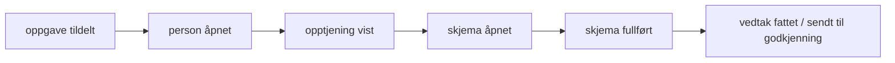

# Innblikk i Speil

> Dette dokumentet er KI-generert.

Dette dokumentet beskriver hvordan Speil sender brukerhendelser til Innblikk, Navs analyseverktøy fra team ResearchOps. Det er skrevet for dem som skal godkjenne at vi tar det i bruk i produksjon.

## Sammendrag

- Sporingen er bare slått på lokalt og i dev. I prod laster Speil ikke sporingsskriptet. Vi venter på godkjenning før vi skrur det på.
- Speil sender navngitte hendelser som «person åpnet», «vedtak fattet» og «skjema validering feilet». Hendelsene har bare faste verdier som enum-er, tall og ja/nei. Ingen fritekst, fødselsnummer, navn eller NAV-ident.
- Hendelser om samme sykmeldte henger sammen gjennom en tilfeldig ID som bare finnes i nettleseren til saksbehandleren. Verken Innblikk eller Speil kan regne seg tilbake fra ID-en til personen.
- Innblikk kjenner igjen saksbehandleren ut fra IP-adresse og nettleser. Hvis det viser seg for grovt til å følge en saksbehandler over tid, lager spesialist en nøkkel-hash (HMAC) av NAV-identen med en hemmelig nøkkel som bare finnes på serveren.
- Pseudonymer hindrer ikke at noen med tilgang til logger eller database kan finne personen ved å sammenligne tidspunkter. Dataene i Innblikk er derfor personopplysninger, og vi behandler dem som det.
- Vi utvider med flere hendelser ved behov, for eksempel oppgavetype og egenskaper på saken, og hvilke varsler saksbehandlerne ser og klikker på.

## Hva som er tatt i bruk

Speil laster `sporing-dev.js` fra `cdn.nav.no/team-researchops/sporing/` når appen kjører lokalt eller i dev (`erUtvikling` i `src/env.ts`). Skriptet sender hendelser til `reops-event-proxy`. Derfra går de gjennom personvernfilteret i `reops-raw-to-clean` og videre til BigQuery, der Innblikk leser dem.

Dev har bare syntetiske testpersoner. Saksbehandlerne i dev er utviklere og testere.

Koden ligger i Speil:

- `src/app/layout.tsx` laster skriptet og registrerer `innblikkBeforeSend` som `data-before-send`.
- `src/observability/hendelser.ts` definerer alle hendelser og typene deres. Det er bare mulig å sende hendelser som står her.
- `src/observability/innblikk.ts` lager ID-en for den sykmeldte og legger den på hendelsene.

Vi følger taksonomien i `@navikt/analytics-types` der den har en passende hendelse, for eksempel for skjemaer og modaler. Resten er egne hendelser for saksbehandling.

## Hendelser vi sender

### Personbesøk

| Hendelse | Egenskaper | Når |
|---|---|---|
| `person åpnet` | `kilde`: `oppgaveliste`, `behandlet i dag`, `dialogmeldinger`, `personsøk`, `spoogle` eller `direkte` | Saksbehandleren åpner saksbildet |
| `person forlatt` | `utfall`: `vedtak fattet`, `sendt til godkjenning`, `sendt i retur`, `kan ikke behandles`, `lagt på vent`, `forkastet` eller `uten handling` | Saksbehandleren går til en annen person eller lukker fanen |

### Oppgaver og vedtak

| Hendelse | Egenskaper |
|---|---|
| `oppgave tildelt`, `oppgave avmeldt` | `kilde`: `oppgaveliste` eller `saksbildemeny` |
| `vedtak fattet` | `beslutter`, `revurdering`, `utbetalingTil` (`arbeidsgiver`, `person`, `begge`, `ingen`), `harIndividuellBegrunnelse` |
| `fatt vedtak feilet` | `feilkode` fra spesialist |
| `sendt til godkjenning` | `harIndividuellBegrunnelse` |
| `sendt i retur` | ingen |
| `kan ikke behandles` | `antallBegrunnelser`, `harKommentar` |
| `forkastet` | `antallÅrsaker`, `harKommentar` |
| `lagt på vent`, `fjernet fra på vent` | `kilde` for `fjernet fra på vent` |

Vi sender om det finnes en begrunnelse eller kommentar, aldri teksten.

### Vilkår og skjemaer

| Hendelse | Egenskaper |
|---|---|
| `opptjening vist` | `utfall`, `erOverførtFraInfotrygd`, `avgjørendeVilkår` |
| `opptjening vurdert automatisk på nytt` | `status` |
| `skjema åpnet`, `skjema fullført`, `skjema avbrutt`, `skjema innsending feilet` | `skjemanavn`: `skjønnsfastsetting`, `opptjening arbeid` eller `opptjening likestilt ytelse` |
| `skjema validering feilet` | `skjemanavn`, `feltMedFeil` (navnene på feltene, sortert og kommaseparert) |
| `modal åpnet` | `komponentId` (`fatt-vedtak`, `send-til-godkjenning`), `opprinnelse` (`knapp`, `hurtigtast`) |
| `modal lukket` | `komponentId`, `lukkMetode`, `varighetMs` |

I tillegg sender skriptet sidevisninger. URL-ene har `personPseudoId`, men personvernfilteret i Innblikk maskerer UUID-er til `[PROXY-UUID]`.

## Samme sykmeldt på tvers av hendelser

Vi vil vite at «person åpnet», «skjema fullført» og «vedtak fattet» gjelder samme sykmeldte, uten at noen kan finne ut hvem det er. Det løser vi i to lag.

1. **`personPseudoId` fra spesialist.** Speil kjenner aldri fødselsnummeret i URL-en. Spesialist lager en ny tilfeldig UUID (`personPseudoId`) hver gang den viser en person i oppgavelista, i søket eller i «behandlet i dag». Koblingen til fødselsnummeret ligger i Valkey hos spesialist og forsvinner etter 7 dager.
2. **Innblikk-ID i nettleseren.** `finnInnblikkPerson` slår opp `personPseudoId` i `localStorage` og gir tilbake en tilfeldig ID på 16 små bokstaver. Første gang lager den en ny ID med `crypto.getRandomValues`. ID-en blir slettet etter 7 dager uten bruk, samme levetid som `personPseudoId`. Speil legger den på hendelsene som `person`.

ID-en er tilfeldig. Den er ikke en hash av fødselsnummeret eller av `personPseudoId`, så ingen kan regne seg tilbake. Koblingen finnes bare i nettleseren til saksbehandleren. ID-en har bare små bokstaver fordi personvernfilteret ellers fjerner UUID-er og sifferrekker.

Dette gir noen begrensninger vi har valgt med vilje:

- To saksbehandlere som åpner samme sykmeldte, får hver sin ID. Vi kan ikke følge en sak fra saksbehandler til beslutter.
- Ny `personPseudoId` gir ny ID. Åpner saksbehandleren samme person fra en ny oppgaveliste dagen etter, ser det ut som en ny person.
- ID-en kan ikke kobles til personer i andre systemer eller i andre Innblikk-nettsteder.

Vi kunne fått en ID som er stabil over tid og på tvers av saksbehandlere ved å hashe fødselsnummeret på serveren. Det ville gjort ID-en sterkere knyttet til den sykmeldte og lettere å koble mot andre data. Analysene vi trenger, handler om ett besøk eller én behandling, så vi har valgt den svakere koblingen.

## Hvordan Innblikk kjenner igjen saksbehandleren

Speil kaller ikke `sporing.identify()`, så Innblikk må kjenne igjen saksbehandleren på egen hånd. Ifølge dokumentasjonen i [navikt/reops-meta](https://github.com/navikt/reops-meta/tree/main/docs/app):

- `reops-event-proxy` regner ut `session_id` og `visit_id` fra IP-adressen, `User-Agent` og nettsted-ID-en. IP-adressen lagres ikke.
- `session_id` er saltet med et salt som byttes hver kalendermåned. Den er stabil gjennom måneden så lenge IP og `User-Agent` er uendret.
- `visit_id` bytter hver hele time (UTC).

For saksbehandlere er dette trolig for grovt. Mange saksbehandlere går ut mot internett fra de samme IP-adressene og har samme nettleserversjon fra Navs utrulling. Da kan flere saksbehandlere få samme `session_id`. Samme saksbehandler får dessuten ny `session_id` når IP-adressen endrer seg, for eksempel mellom kontor og hjemmekontor, og ved hvert månedsskifte. Vi sjekker dette i dev før vi bestemmer oss.

### Løsningen hvis sesjonen ikke holder

Spesialist lager en analyse-ID for den innloggede saksbehandleren, og Speil sender den med `sporing.identify()` før første hendelse:

```
analyseId = HMAC-SHA256(nøkkel, NAVident)
```

- Nøkkelen er en Nais-secret i spesialist. Den kommer aldri til nettleseren.
- Spesialist tar NAV-identen fra tokenet, ikke fra forespørselen. En saksbehandler kan bare få sin egen analyse-ID.
- Vi koder ID-en med bare bokstaver, slik at personvernfilteret ikke fjerner den.
- Spesialist logger ikke analyse-ID-en sammen med NAV-identen.

Innblikk lagrer verdien fra `identify()` som `distinctId` uten hashing eller salt. Derfor må ID-en være pseudonymisert før den forlater spesialist.

syfomodiaperson gjør noe lignende, men hasher NAV-identen med SHA-256 i nettleseren uten salt ([`src/utils/umami.ts`](https://github.com/navikt/syfomodiaperson/blob/main/src/utils/umami.ts)). En NAV-ident er én bokstav og seks sifre, altså rundt 26 millioner mulige verdier. Alle som ser hashen, kan prøve alle identer på noen sekunder. Med HMAC og en hemmelig nøkkel må man ha nøkkelen for å gjøre det samme.

Vi bytter ikke nøkkelen rutinemessig, fordi det bryter analyser over tid. Sletter vi nøkkelen, kan ingen lenger knytte analyse-ID-ene til saksbehandlere.

## Tellinger

Eksempler på tellinger vi kan gjøre med hendelsene vi har:

- Hvor saksbehandlerne finner personene: fordeling av `kilde` på `person åpnet`. Hvor mye går via oppgavelista, og hvor mye via søk og Spoogle?
- Utfall av personbesøk: fordeling av `utfall` på `person forlatt`. Høy andel `uten handling` viser at saksbehandlere åpner saker de ikke behandler.
- Andel vedtak med individuell begrunnelse, fordelt på `revurdering` og `utbetalingTil`.
- Feil ved fatting av vedtak: `fatt vedtak feilet` per `feilkode`, sett mot antall `vedtak fattet`.
- Hvilke felter saksbehandlerne oftest får valideringsfeil på: `feltMedFeil` per `skjemanavn`.
- Opptjening: fordeling av `utfall` og `avgjørendeVilkår` på `opptjening vist`, og hvor ofte saksbehandlere trykker «vurder automatisk på nytt».
- Bruk av hurtigtast: `opprinnelse` på `modal åpnet`.

## Traktanalyser

Innblikk har traktanalyse («Traktanalyse»), brukerreiser («Brukerreiser (Sankey)») og retention. Med `person`-ID-en kan vi lage trakter per sykmeldt i stedet for bare per sesjon.

### Frafall

**Fra oppgave til vedtak:**



Hvor mange stopper underveis, og hva er `utfall` på `person forlatt` for dem som stopper? Store frafall mellom to steg viser hvor i saksbildet saksbehandlerne gir opp eller må hente informasjon andre steder.

**Skjemaer:** `skjema åpnet` → `skjema validering feilet` → `skjema fullført`, med `skjema avbrutt` og `skjema innsending feilet` som utganger. Per `skjemanavn` ser vi hvilke skjemaer folk avbryter, og om valideringsfeil fører til at de gir opp.

**Fatte vedtak:** `modal åpnet` → `vedtak fattet` eller `modal lukket` uten vedtak. Mange som lukker uten å fatte vedtak, tyder på at saksbehandleren er usikker når modalen vises.

**Vent:** `lagt på vent` → `fjernet fra på vent` → `vedtak fattet`. Hvor mange saker kommer tilbake fra vent og blir avsluttet innen 7 dager?

### Tid brukt

- Tid per besøk: tiden mellom `person åpnet` og `person forlatt` for samme `person`, fordelt på `utfall` og `kilde`.
- Tid fra tildeling til vedtak: tiden fra `oppgave tildelt` til `vedtak fattet` for samme `person`, også når det går over flere besøk.
- Antall besøk før vedtak: hvor mange `person åpnet` det er for samme `person` før `vedtak fattet`.
- Tid i skjemaer: tiden fra `skjema åpnet` til `skjema fullført` per `skjemanavn`.
- Tid i godkjenningsmodalen: `varighetMs` på `modal lukket`.

Med analyse-ID for saksbehandleren kan vi også se hvor lang tid nye saksbehandlere bruker sammenlignet med erfarne, og om tiden går ned etter endringer i Speil. Vi bruker tallene til å forbedre Speil og saksbehandlingen, ikke til å måle enkeltpersoner.

## Tidspunkter kan avsløre hvem som står bak

Alle hendelser har et tidspunkt med millisekunder. Spesialist lagrer også tidspunkter: når et vedtak ble fattet og av hvem, og hvem som slo opp en person og når (auditlogg). Applikasjonsloggene har tidspunkter for de samme handlingene.

Den som har tilgang til både Innblikk og databasen eller loggene, kan derfor koble `vedtak fattet` kl. 10:41:07 til vedtaket i spesialist som ble fattet samtidig. Da vet hen både hvem saksbehandleren er og hvem den sykmeldte er, og kan følge alle hendelsene med samme ID bakover. Ingen pseudonymisering i Speil eller Innblikk kan hindre det. Det gjelder `person`-ID-en, `session_id` og en analyse-ID fra HMAC.

Konsekvensene for oss:

- Hendelsene i Innblikk er personopplysninger om saksbehandlerne og, indirekte, om de sykmeldte. Pseudonymiserte data er fortsatt personopplysninger etter GDPR.
- Vi kobler aldri Innblikk-data mot logger, database eller auditlogg.
- Vi holder tilgangen til Innblikk-dataene for Speil så smal som mulig.
- Vi sender bare det vi trenger for analysene over, og ingen fritekst.

## Utvidelser vi ser for oss

Vi legger til hendelser når vi har et konkret spørsmål vi vil ha svar på. Vi følger de samme reglene som nå: faste verdier, ingen fritekst og ingen identer. Hver nye hendelse og egenskap står i typene i `hendelser.ts`, og vi gjennomgår dem før de går i prod.

### Oppgavetype og egenskaper på saken

Vi kan legge oppgavetypen og egenskapene på oppgaven fra spesialist på `person åpnet` og `person forlatt`, for eksempel `SØKNAD` eller `REVURDERING`, `FORSTEGANGSBEHANDLING` eller `FORLENGELSE`, `FLERE_ARBEIDSGIVERE`, `DELVIS_REFUSJON`, `SKJØNNSFASTSETTELSE`, `TILBAKEDATERT` og `MANGLER_IM`.

Det gjør at vi kan dele alle tellingene og traktene over på type sak:

- Hvor lang tid saksbehandlerne bruker på en førstegangsbehandling med flere arbeidsgivere, sammenlignet med en forlengelse med én arbeidsgiver.
- Hvilke typer saker som oftest ender med `uten handling`, `lagt på vent` eller `kan ikke behandles`.
- Hvilke saker som tar flest besøk før vedtak. De er kandidater for bedre støtte i Speil eller for automatisering.
- Om en endring i Speil gjorde akkurat den sakstypen den var ment for, raskere.

Vi sender ikke egenskaper som sier noe sensitivt om den sykmeldte eller hvem som får se saken: `FORTROLIG_ADRESSE`, `STRENGT_FORTROLIG_ADRESSE`, `EGEN_ANSATT`, `VERGEMÅL` og `SPESIALSAK`. Det er få slike saker, og egenskapen ville gjort det lettere å finne personen.

### Varsler som vises og klikkes på

Spleis og spesialist lager varsler på perioden når noe må vurderes manuelt, med en varselkode som `RV_IV_3` eller `RV_AY_7`. Vi kan sende hvilke varselkoder som vises i saksbildet, og når saksbehandleren klikker på et varsel eller vurderer det.

Det gjør at vi kan se:

- Hvilke varsler som tar mest tid å vurdere: tiden fra varselet vises til det er vurdert, per varselkode.
- Hvilke varsler saksbehandlerne aldri klikker på før de fatter vedtak. Er det mange, gir varselet lite verdi og kan kanskje fjernes eller automatiseres.
- Hvilke varsler som henger sammen med at saken blir lagt på vent, sendt i retur eller ikke kan behandles i Speil.
- Hvilke varsler vi bør bruke tid på å gjøre tydeligere i Speil eller løse automatisk i Spleis.

## Før vi slår på i prod

- Godkjenning av behandlingen, inkludert vurdering av personvern for saksbehandlerne og de sykmeldte.
- Sjekk i dev om `session_id` holder til å følge en saksbehandler, og lag analyse-ID i spesialist hvis den ikke gjør det.
- Fjerne `erUtvikling`-sjekken rundt skriptet i `layout.tsx`. Prod får da `sporing.js` og nettsted-ID-en i `envs/.env.production`.
