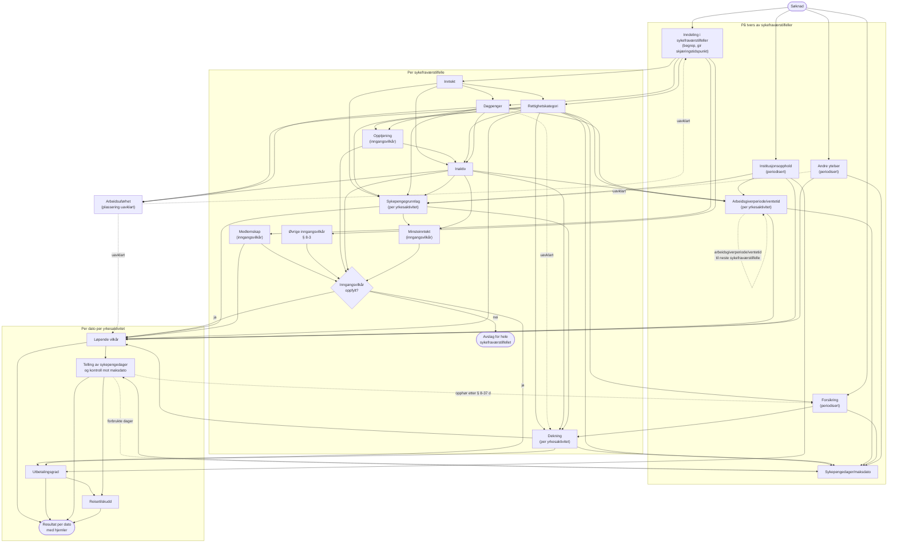

# Rekkefølge for abstraksjonene i folketrygdloven kapittel 8

Dette dokumentet viser i hvilken rekkefølge abstraksjonene i [abstraksjoner-kap8.md](abstraksjoner-kap8.md) må vurderes. En abstraksjon kan først vurderes når abstraksjonene den bruker resultatet fra, er ferdige. Abstraksjoner uten avhengigheter mellom seg kan vurderes parallelt.

## Nivåer

Abstraksjonene vurderes på tre nivåer:

- **På tvers av sykefraværstilfeller.** Vurderes for personen over tid. Resultatet kan bygge på tidligere sykefraværstilfeller.
- **Per sykefraværstilfelle.** Vurderes én gang, ut fra skjæringstidspunktet.
- **Per dato per yrkesaktivitet.** Vurderes for hver dato i sykefraværstilfellet, for hver yrkesaktivitet. En yrkesaktivitet er arbeid for én arbeidsgiver, selvstendig næringsvirksomhet, all frilansvirksomhet samlet, Dagpenger eller Inaktiv. Se [abstraksjoner-kap8.md](abstraksjoner-kap8.md#begreper).

## Diagram

Heltrukne piler viser at resultatet fra én abstraksjon er nødvendig input til den neste. Stiplede piler viser resultater som føres videre til senere sykefraværstilfeller, og avhengigheter som ikke er avklart.

## Rekkefølge

### 1. Opplysninger på tvers av sykefraværstilfeller

Behandlingen starter når Nav mottar en søknad. Disse kan da vurderes parallelt, og før noe annet:

- Inndeling i sykefraværstilfeller. Én frisk dag starter et nytt sykefraværstilfelle. Inndelingen gir skjæringstidspunktet for hvert sykefraværstilfelle.
- Andre ytelser, Institusjonsopphold og Forsikring. Alle er periodiserte og uavhengige av sykefraværstilfellene. Forsikring bruker likevel tilleggskategorien Yrkesskade fra Rettighetskategori (§ 8-55 bokstav a) og opphører når retten faller bort etter § 8-12 (§ 8-37 bokstav d).

Arbeidsuførhet avgjør hvilke dager som er arbeidsuførhet. Vi har ikke avklart om den skal vurderes før inndelingen i sykefraværstilfeller eller sammen med Løpende vilkår. Flere av reglene gjelder bare for en bestemt rettighetskategori, Inaktiv eller Dagpenger, og disse avgjøres ut fra skjæringstidspunktet. Vurderes Arbeidsuførhet før inndelingen, blir avhengigheten sirkulær.

### 2. Per sykefraværstilfelle

Inntekt, Medlemskap og de øvrige inngangsvilkårene (§ 8-3) kan vurderes parallelt, så snart skjæringstidspunktet er kjent. Deretter går rekkefølgen slik:

1. Rettighetskategori og Dagpenger, som begge bruker Inntekt og kan vurderes parallelt. Tilleggskategoriene avgjør om kravet om opptjening faller bort.
2. Opptjening, som bruker Rettighetskategori og Dagpenger. Tid med dagpenger er likestilt med arbeid (§ 8-2 andre ledd).
3. Inaktiv, som bruker Rettighetskategori, Dagpenger, Opptjening og Inntekt. Inaktiv vurderes når hovedkategorien er «Ingen» og Dagpenger ikke gjelder, eller når opptjeningen ikke er oppfylt. Når § 8-47 gjelder, erstatter Inaktiv rettighetskategorien i stegene etterpå.
4. Sykepengegrunnlag, som bruker Inntekt, Rettighetskategori eller Inaktiv, Dagpenger og Institusjonsopphold (§ 8-54 tredje ledd). Grunnlaget fordeles på yrkesaktivitetene. Hvordan Andre ytelser påvirker grunnlaget, er ikke avklart.
5. Minsteinntekt og Dekning, som begge bruker Sykepengegrunnlag og kan vurderes parallelt. Dekning fastsettes per yrkesaktivitet og bruker Forsikring. Dekningsgraden for Dagpenger er ikke avklart.
6. Inngangsvilkårene samlet. Er ett av dem ikke oppfylt, får personen avslag for hele sykefraværstilfellet. Opptjening som ikke er oppfylt, gir likevel ikke avslag hvis Inaktiv gjelder.

### 3. Arbeidsgiverperiode/ventetid

Arbeidsgiverperiode/ventetid beregnes per yrkesaktivitet, på tvers av sykefraværstilfeller. Beregningen bruker Rettighetskategori eller Inaktiv og Dagpenger fra hvert sykefraværstilfelle, og den bruker Institusjonsopphold. Fordi en arbeidsgiverperiode kan fortsette i neste sykefraværstilfelle, må sykefraværstilfellene behandles i kronologisk rekkefølge.

### 4. Per dato per yrkesaktivitet

Hver dato vurderes for hver yrkesaktivitet, ut fra sykepengegrunnlaget, dekningen og arbeidsgiverperioden eller ventetiden for yrkesaktiviteten.

1. Løpende vilkår og Utbetalingsgrad kan vurderes parallelt.
2. Telling av sykepengedager, som bruker Løpende vilkår. Bare dager med rett til sykepenger telles. Maksdatoen bygger på dager fra tidligere sykefraværstilfeller, rettighetskategorien (248 eller 250 dager) og om trygden dekker de første 16 dagene (260 dager).
3. Reisetilskudd, som bruker Utbetalingsgrad og tellingen av sykepengedager. Tilskuddet kan ikke være høyere enn sykepengene personen ville fått (§ 8-14 tredje ledd).

Datoene må vurderes i kronologisk rekkefølge, fordi hver utbetalt dag flytter maksdatoen.

## Avhengigheter

| Fra | Til | Hvorfor | Hjemmel |
|---|---|---|---|
| Inndeling i sykefraværstilfeller | Alt per sykefraværstilfelle | Skjæringstidspunktet bestemmer hvilke opplysninger som brukes | |
| Inntekt | Rettighetskategori | Yrkesaktivitetene på skjæringstidspunktet avgjør hovedkategorien | §§ 8-40 til 8-43 |
| Inntekt | Dagpenger | Om personen mottar dagpenger, ventelønn eller vartpenger | § 8-49 første og andre ledd |
| Inntekt | Inaktiv | Tidspunktet personen var ute av inntektsgivende arbeid, og sluttvederlag eller etterlønn | § 8-47 første og fjerde ledd |
| Inntekt | Sykepengegrunnlag | Grunnlaget beregnes av inntekten | §§ 8-28 til 8-30, 8-35, 8-49 |
| Rettighetskategori | Opptjening | Tilleggskategorier og Vernepliktig fjerner opptjeningskravet | §§ 8-44, 8-45, 8-46, 8-55 |
| Dagpenger | Opptjening | Tid med dagpenger er likestilt med arbeid | § 8-2 andre ledd |
| Rettighetskategori | Inaktiv | Hovedkategorien «Ingen» gjør at Inaktiv må vurderes | § 8-47 siste ledd |
| Dagpenger | Inaktiv | Inaktiv gjelder ikke når § 8-49 gir rett | § 8-47 siste ledd |
| Opptjening | Inaktiv | Variant b gjelder personer i arbeid uten opptjening | § 8-47 første ledd bokstav b |
| Rettighetskategori eller Inaktiv | Sykepengegrunnlag | Kategorien avgjør hvilke regler for fastsetting som gjelder | §§ 8-10, 8-41, 8-46, 8-47 |
| Dagpenger | Sykepengegrunnlag | Grunnlaget for yrkesaktiviteten er dagpengene per uke, ventelønnen eller vartpengene | § 8-49 tredje og fjerde ledd |
| Institusjonsopphold | Sykepengegrunnlag | Grunnlaget etter løslatelse | § 8-54 tredje ledd |
| Andre ytelser | Sykepengegrunnlag | Ikke avklart | §§ 8-50, 8-52 |
| Sykepengegrunnlag | Minsteinntekt | Grunnlaget må være over grensen | §§ 8-3, 8-47 |
| Inaktiv | Minsteinntekt | Grensen er 1G | § 8-47 femte ledd |
| Sykepengegrunnlag | Dekning | Dekning settes per yrkesaktivitet | § 8-41 tredje ledd |
| Rettighetskategori eller Inaktiv | Dekning | Dekningsgraden følger av kategorien | §§ 8-16, 8-34, 8-38, 8-47 |
| Dagpenger | Dekning | Ikke avklart | § 8-49 |
| Rettighetskategori eller Inaktiv | Arbeidsgiverperiode/ventetid | Arbeidsgiverperiode eller ventetid, og fra-dag | §§ 8-19, 8-34, 8-38, 8-46, 8-47 |
| Dagpenger | Arbeidsgiverperiode/ventetid | Sykepenger fra og med første dag med arbeidsuførhet | § 8-49 første og andre ledd |
| Rettighetskategori, Inaktiv og Dagpenger | Arbeidsuførhet | Reglene om «arbeidsufør tidligst fra» gjelder for bestemte kategorier | §§ 8-34, 8-38, 8-44, 8-47, 8-49 |
| Arbeidsuførhet | Inndeling i sykefraværstilfeller eller Løpende vilkår | Ikke avklart | §§ 8-4, 8-7 |
| Rettighetskategori | Forsikring | Ingen opptjeningstid for forsikringen ved yrkesskade | § 8-55 bokstav a |
| Forsikring | Dekning | Dekningsgrad og fra-dag ved forsikring | §§ 8-36, 8-39 |
| Forsikring | Sykepengedager/maksdato | 260 dager når forsikringen dekker de første 16 dagene | § 8-12 første ledd |
| Telling av sykepengedager | Forsikring | Forsikringen opphører når retten faller bort etter § 8-12 | § 8-37 bokstav d |
| Medlemskap | Løpende vilkår | Medlemmer etter §§ 2-5, 2-6 og 2-8 er unntatt fra oppholdskravet | § 8-9 andre ledd bokstav a |
| Rettighetskategori | Løpende vilkår | Oppholdskravet gjelder ikke ved yrkesskade | § 8-55 bokstav d |
| Andre ytelser | Sykepengedager/maksdato | Ny rett for mottakere av uføretrygd | § 8-12 tredje ledd |
| Institusjonsopphold | Arbeidsgiverperiode/ventetid | Ingen arbeidsgiverperiode under arbeid utenfor fengselet | § 8-54 andre ledd |
| Institusjonsopphold | Løpende vilkår | Ingen rett under varetekt og soning | § 8-54 første ledd |
| Institusjonsopphold | Utbetalingsgrad | Reduksjon på 50 % | §§ 8-53, 8-54 |
| Andre ytelser | Løpende vilkår | Ugradert AFP gir ingen rett | § 8-52 første ledd |
| Sykepengegrunnlag | Løpende vilkår | Grunnlaget må være over 2G fra og med 67-årsdagen | § 8-51 andre ledd |
| Løpende vilkår | Telling av sykepengedager | Bare dager med rett telles | § 8-12 |
| Rettighetskategori | Sykepengedager/maksdato | 248 eller 250 dager | § 8-12 første ledd |
| Dekning og Arbeidsgiverperiode/ventetid | Sykepengedager/maksdato | 260 dager når trygden dekker de første 16 dagene | § 8-12 første ledd |
| Utbetalingsgrad og telling av sykepengedager | Reisetilskudd | Tilskuddet kan ikke være høyere enn sykepengene | § 8-14 tredje ledd |

## Ikke avklart

- Hvordan Andre ytelser og opphør av naturalytelser påvirker Sykepengegrunnlag. Se [abstraksjoner-kap8.md](abstraksjoner-kap8.md#uavklart-sykepengegrunnlag-som-endrer-seg-i-et-sykefraværstilfelle).
- Om en gradert dag teller som en hel sykepengedag. Diagrammet viser derfor ingen pil fra Utbetalingsgrad til tellingen av sykepengedager.
- Hvilken dekningsgrad Dagpenger har. Se [abstraksjoner-kap8.md](abstraksjoner-kap8.md#uavklart-dekningsgrad-for-dagpenger).
- Hvor Arbeidsuførhet ligger i rekkefølgen. Se [abstraksjoner-kap8.md](abstraksjoner-kap8.md#uavklart-hvor-arbeidsuførhet-ligger-i-rekkefølgen).
