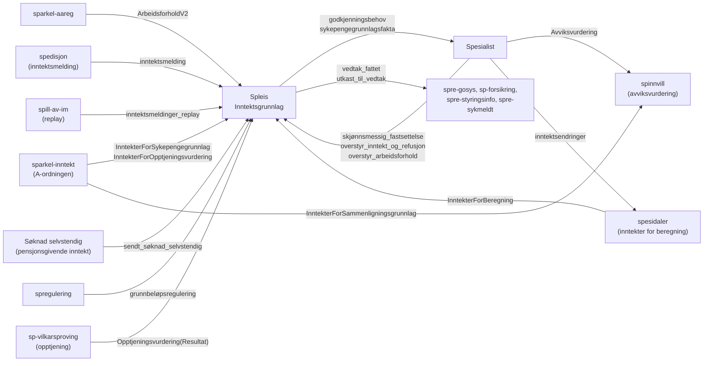
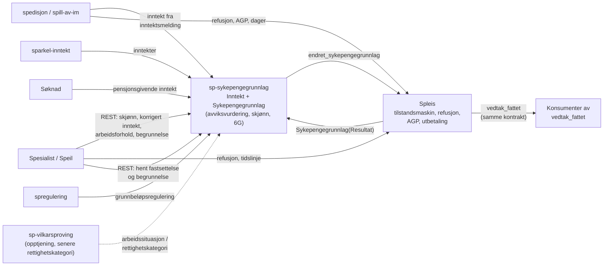
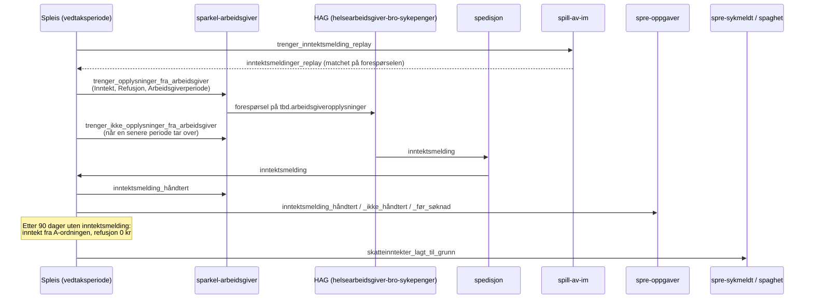

# Domenetjeneste for inntekt og sykepengegrunnlag

Dette dokumentet beskriver hvordan vi flytter inntektsavklaring og fastsettelse av sykepengegrunnlaget ut av Spleis og inn i en egen domenetjeneste. Tjenesten følger mønsteret fra `sp-vilkarsproving`, som allerede eier opptjeningsvurderingen. Arbeidsnavnet i dokumentet er `sp-sykepengegrunnlag`.

Dokumentet bygger på abstraksjonene [Inntekt og Sykepengegrunnlag](abstraksjoner-kap8.md#inntekt) og på rekkefølgen i [rekkefolge-kap8.md](rekkefolge-kap8.md) og [funksjonskart-kap8.md](funksjonskart-kap8.md).

## Sammendrag

- Tjenesten eier to abstraksjoner: Inntekt (rå inntektsopplysninger med kilde) og Sykepengegrunnlag (fastsettelse per sykefraværstilfelle, fordelt på yrkesaktiviteter, med hjemler, avviksvurdering, skjønn og 6G-tak).
- Spleis beholder tilstandsmaskinen, refusjon, arbeidsgiverperiode, utbetaling og beregning per dato. Spleis slutter å regne ut grunnlaget, men lagrer en uforanderlig kopi av resultatet den har brukt.
- Spleis beholder også protokollen for å be arbeidsgiveren om inntektsmelding: replay, forespørsel, tilbaketrekking, 90-dagersfristen og statusmeldingene. Tjenesten eier reglene for hvilken inntekt som gjelder, og Spleis avgjør om den skal spørre om inntekt ut fra tjenestens resultat.
- Hver fastsettelse får en egen ID og endres aldri. En endring gir en ny fastsettelse med ny ID. Spleis peker på ID-en fra vilkårsgrunnlaget, slik den i dag peker på `opptjeningsvurderingId`.
- Skjønnsfastsettelsen flytter samlet til tjenesten: beløp, type, årsak og begrunnelse lagres sammen. I dag ligger beløpet i Spleis og begrunnelsen i Spesialist, og de to er bare koblet via skjæringstidspunkt og tidsstempel.
- Nye kategorier (selvstendig, frilans, inaktiv, dagpenger, kombinerte, vernepliktige, yrkesskade) blir egne fastsettelsesregler med egne hjemler. Vi legger dem til uten å endre kontrakten mot Spleis.
- Vi migrerer i ni trinn. De første trinnene kjører tjenesten i skygge og sammenligner med Spleis. Spleis slutter å regne først når sammenligningen har vært lik over tid, og først for arbeidstakere uten skjønn.

## Mål og avgrensning

Målet er at reglene for inntekt og sykepengegrunnlag i kapittel 8 får én eier, som:

- lagrer hvilke opplysninger og hjemler hver fastsettelse bygger på
- kan ta inn nye kategorier uten at Spleis må endres for hver av dem
- lar saksbehandler overstyre og skjønnsfastsette med begrunnelsen lagret sammen med vurderingen
- gir Spleis et ferdig grunnlag per yrkesaktivitet som Spleis kan beregne utbetaling fra

Utenfor dette arbeidet:

- Refusjon og arbeidsgiverperiode fra inntektsmeldingen. Det blir i Spleis.
- Inntekter for beregning per dato (tilkommen inntekt). Det eier Spesidaler i dag, og det hører til Utbetalingsgrad og Dekning, ikke til grunnlaget.
- Minsteinntekt (§ 8-3 andre ledd og § 8-47 femte ledd). Det er en egen abstraksjon i trinn 5 i funksjonskartet. Den bruker resultatet fra tjenesten, men kan lages som eget inngangsvilkår senere.
- Dekning. Tjenesten leverer grunnlaget per yrkesaktivitet, ikke dekningsgraden.

## Slik er det i dag

### Modellen i Spleis

Grunnlaget ligger i `VilkårsgrunnlagHistorikk` i `sykepenger-model`. Hvert innslag knytter et skjæringstidspunkt til et `VilkårsgrunnlagElement`, som enten er `Grunnlagsdata` (Spleis har vurdert) eller `InfotrygdVilkårsgrunnlag` (overført fra Infotrygd). Hvert element har en `vilkårsgrunnlagId`, og Spleis lager et nytt element ved hver endring.

`Inntektsgrunnlag` (`person/inntekt/Inntektsgrunnlag.kt`) regner ut grunnlaget:

- `ArbeidsgiverInntektsopplysning` per arbeidsgiver har `faktaavklartInntekt`, `korrigertInntekt` (saksbehandler) og `skjønnsmessigFastsatt`.
- `omregnetÅrsinntekt` er korrigert inntekt hvis den finnes, ellers faktaavklart inntekt.
- `fastsattÅrsinntekt` er skjønnsfastsatt beløp hvis det finnes, ellers omregnet årsinntekt.
- `beregningsgrunnlag` er summen av fastsatt årsinntekt, eller beregningen for selvstendig næringsdrivende (`SelvstendigInntektsopplysning`, § 8-35).
- `sykepengegrunnlag` er beregningsgrunnlaget begrenset til 6G. Spleis henter 6G fra `Grunnbeløp` på skjæringstidspunktet.
- `deaktiverteArbeidsforhold` holder arbeidsforhold saksbehandler har tatt ut av grunnlaget.

Skjønnsfastsettelsen er alt eller ingenting (`validerSkjønnsmessigAltEllerIntet`). Kommer det en ny inntekt med endret beløp, eller saksbehandler aktiverer eller deaktiverer et arbeidsforhold, fjerner Spleis skjønnsfastsettelsen (`rullTilbakeEventuellSkjønnsmessigFastsettelse`).

Spleis bruker grunnlaget i `sykepenger-økonomi` til dagsats og fordeling mellom arbeidsgiver og person. Grunnlaget publiseres i `utkast_til_vedtak`, `avsluttet_med_vedtak` og godkjenningsbehovet (`sykepengegrunnlagsfakta`, se `EventBusOversetter.kt`). Spesialist henter det også fra Spleis' REST-API for personen.

### Integrasjoner rundt grunnlaget



| Integrasjon | Retning | Hvor i dag | Innhold |
|---|---|---|---|
| `InntekterForSykepengegrunnlag` | Behov fra Spleis, løses av `sparkelapper/inntekt` | `EventBusOversetter.mapTrengerInformasjonTilVilkårsprøving`, `VilkårsgrunnlagRiver` | A-inntekt for beregningsperioden (filter 8-28) |
| `InntekterForSammenligningsgrunnlag` | Behov fra spinnvill | `spinnvill` | A-inntekt siste tolv måneder (filter 8-30) |
| `inntektsmelding` og `inntektsmeldinger_replay` | Spedisjon og spill-av-im til Spleis | `NavNo*InntektsmeldingerRiver`, `InntektsmeldingerReplayRiver`, `InntektsopplysningerFraLagretInntektsmeldingRiver` | Beregnet inntekt, refusjon, arbeidsgiverperiode, naturalytelser |
| `trenger_opplysninger_fra_arbeidsgiver` og `trenger_ikke_opplysninger_fra_arbeidsgiver` | Spleis til HAG via sparkel-arbeidsgiver | `AvventerInntektsmelding`, `EventBusOversetter` | Forespørsel om inntekt, refusjon og arbeidsgiverperiode. Se [egen beskrivelse](#forespørsel-om-og-mottak-av-inntektsmelding) |
| `skatteinntekter_lagt_til_grunn` | Spleis til spre-sykmeldt og spaghet | `EventBusOversetter.mapSkatteinntekterLagtTilGrunn` | Skatteinntekter brukt i stedet for inntektsmelding |
| Pensjonsgivende inntekt | Søknaden for selvstendig næringsdrivende | `Søknad.kt`, `SelvstendigFaktaavklartInntekt` | Pensjonsgivende inntekt siste tre år |
| `skjønnsmessig_fastsettelse` | Spesialist til Spleis | `SkjønnsmessigFastsettelseRiver` | Årlig beløp per arbeidsgiver |
| `overstyr_inntekt_og_refusjon` | Spesialist til Spleis | `OverstyrArbeidsgiveropplysningerRiver` | Korrigert inntekt og refusjon i samme melding |
| `overstyr_arbeidsforhold` | Spesialist til Spleis | `OverstyrArbeidsforholdRiver` | Aktiver eller deaktiver arbeidsforhold |
| `grunnbeløpsregulering` | spregulering til Spleis | `GrunnbeløpsreguleringRiver` | Skjæringstidspunkt som har feil 6G |
| `Avviksvurdering` | Behov fra Spesialist, løses av spinnvill | `VurderBehovForAvviksvurdering.kt` i Spesialist | Omregnede årsinntekter per arbeidsgiver, nøkkel `vilkårsgrunnlagId` |
| `sykepengegrunnlagsfakta` | Spleis ut | `EventBusOversetter.kt`, `UtkastTilVedtakBuilder` | Grunnlag, 6G, omregnet og skjønnsfastsatt per arbeidsgiver, selvstendig-variant |

### Skjønnsfastsettelse i dag

1. Saksbehandler fyller ut skjema i Speil (`SkjønnsfastsettingForm.tsx`) med type, årsak, beløp per arbeidsgiver og tre tekster: mal, fritekst og konklusjon.
2. Spesialist (`PostSykepengegrunnlagBehandler`) lagrer overstyringen i `skjonnsfastsetting_sykepengegrunnlag` og `skjonnsfastsetting_sykepengegrunnlag_arbeidsgiver`. Tekstene lagres i `begrunnelse` med referanser fra skjønnstabellen. Overstyringen knyttes til den aktive totrinnsvurderingen.
3. Spesialist legger `skjønnsmessig_fastsettelse` og en subsumsjonsmelding i outboxen med en gang. Meldingen har beløpene, men ikke begrunnelsen.
4. Spleis lagrer `SkjønnsmessigFastsatt` per arbeidsgiver. `Inntektsdata.hendelseId` er ID-en til meldingen fra Spesialist.
5. Når Spleis sender `avsluttet_med_vedtak`, slår Spesialist opp begrunnelsen på person og skjæringstidspunkt og velger den nyeste. Begrunnelsen legges i `vedtak_fattet` sammen med `skjønnsfastsettingtype` og `skjønnsfastsettingårsak`.

Svakheten er steg 5. Begrunnelsen og beløpet er ikke knyttet sammen med en ID, bare med skjæringstidspunkt og tidsstempel. Hvis Spleis ruller tilbake skjønnet etter en ny inntektsmelding, vet ikke Spesialist det før den leser grunnlaget på nytt.

### Mønsteret fra sp-vilkarsproving

Opptjening ble flyttet ut med disse grepene. Vi gjenbruker alle.

- **To behov.** Ved vilkårsprøving ber Spleis om `Opptjeningsvurdering` og får tilbake en ID. Ved beregning ber Spleis om `OpptjeningsvurderingResultat` for ID-en. Spleis lagrer bare ID-en i `Grunnlagsdata`.
- **Endringer som hendelser.** Ny automatisk eller manuell vurdering sendes som `endret_opptjeningsvurdering`. Spleis tar imot den i `EndretVurderingPåSkjæringstidspunktRiver` og starter revurdering.
- **Kilde på hver vurdering.** `Opptjeningsvurderingskilde` skiller automatisk vurdering (med `versjonAvKode`), saksbehandler, `OverførtFraSpleis` og `OverførtFraInfotrygd`.
- **Begrunnelse i tjenesten.** Saksbehandler vurderer manuelt via REST (`PostManuellVilkårsvurderingBehandler`). Fritekst, journalpost og ident lagres sammen med vurderingen.
- **Outbox.** Tjenesten publiserer løsninger og endringer først når transaksjonen er lagret (`OutboxPubliseringsjobb`).
- **Faste ID-er før uttrekk.** Spleis fikk migreringer (`V345`, `V346`) som ga hver opptjeningsvurdering en fast ID før tjenesten tok over.
- **Historikk per person ved behov.** `PersonAvstemmingService` henter historikken fra Spleis' `POST /api/opptjeningsvurderinger` første gang personen dukker opp, og skriver til `migreringslogg` i samme transaksjon. Tjenesten slår også opp i Spleis hvis den ikke kjenner ID-en.
- **Sammenligning i en periode.** Tjenesten sammenlignet egen vurdering med Spleis' vurdering, og fjernet sammenligningen da resultatene var like.
- **Toggles per steg og miljø.** Spleis fikk egne toggles for å sende behovet og for å bruke resultatet, først i dev og så i prod.

Spinnvill og Spesidaler er også relevante forløpere. Spinnvill viser at avviksvurderingen kan bo utenfor Spleis med `vilkårsgrunnlagId` som nøkkel. Spesidaler viser mønsteret der Spesialist sender en endring til tjenesten, tjenesten beriker den med fra-og-med-dato, og Spleis revurderer og henter data på nytt med et behov.

## Målbilde



### Ansvar

| Ansvar | Eier i målbildet | Merknad |
|---|---|---|
| Rå inntektsopplysninger med kilde og mottakstidspunkt | sp-sykepengegrunnlag | Abstraksjonen Inntekt. Ingen beregning |
| Velge hvilken opplysning som gjelder per yrkesaktivitet (§§ 8-28, 8-29) | sp-sykepengegrunnlag | Også valget mellom inntektsmelding og A-ordningen. Valget av inntektsmelding blant periodene blir i Spleis i første omgang |
| Omregnet årsinntekt, G-regulering, § 8-35-beregning | sp-sykepengegrunnlag | |
| Avviksvurdering (§ 8-30 andre ledd, § 8-35 tredje ledd) | sp-sykepengegrunnlag | Spinnvill flyttes inn eller kalles fra tjenesten, se trinn 6 |
| Skjønnsfastsettelse med begrunnelse | sp-sykepengegrunnlag | Totrinnsvurderingen blir i Spesialist |
| Korrigert inntekt og aktivering/deaktivering av arbeidsforhold | sp-sykepengegrunnlag | |
| 6G-tak og grunnbeløpsregulering | sp-sykepengegrunnlag | spregulering sender til tjenesten i stedet for Spleis |
| Refusjon, arbeidsgiverperiode, dager fra inntektsmelding | Spleis | |
| Inntekter for beregning per dato | Spesidaler | Uendret |
| Dagsats, fordeling, utbetaling, revurdering | Spleis | Bruker grunnlaget per yrkesaktivitet |
| Totrinnsvurdering, oppgaver, vedtaksbrev-tekster | Spesialist | Henter begrunnelsen fra tjenesten |
| Rettighetskategori og arbeidssituasjon | Spleis nå, egen abstraksjon senere | Tjenesten tar den inn som input |

### Domenemodell

Tjenesten har to deler med hver sin livssyklus.

**Inntekt** er en logg over opplysninger. En opplysning endres aldri. Den har:

- person og yrkesaktivitet (arbeidsgiver, selvstendig, frilans, dagpenger, inaktiv)
- type, med eget typet felt per type: `ArbeidsinntektFraAOrdningen` per måned, `InntektFraInntektsmelding`, `PensjonsgivendeInntekt` per år, `KorrigertAvSaksbehandler`, og senere `Dagpengesats`, `InntektFørPermittering`, `InntektFørTjeneste`
- kilde (meldingsreferanse, inntektsmelding-ID, journalpost, saksbehandler)
- mottakstidspunkt og gjelder-periode

**Sykepengegrunnlag** er en fastsettelse per skjæringstidspunkt. Den har:

- `sykepengegrunnlagId`, som aldri gjenbrukes
- `forrigeId` når fastsettelsen erstatter en annen. Det gir en historikk per skjæringstidspunkt
- variant (se under) og hjemler for hele fastsettelsen
- én linje per yrkesaktivitet med valgt inntektsopplysning, omregnet årsinntekt, fastsatt årsinntekt og hjemmel
- avviksvurdering med sammenligningsgrunnlag, avviksprosent og hjemmel, når varianten krever det
- skjønnsfastsettelse, når den finnes: type, årsak, beløp per yrkesaktivitet, mal, fritekst, konklusjon, saksbehandler og tidspunkt
- beregningsgrunnlag, 6G med grunnbeløpets virkningsdato, sykepengegrunnlag og begrensning
- kilde: automatisk (med `versjonAvKode`), saksbehandler, `OverførtFraSpleis` eller `OverførtFraInfotrygd`
- `vurdertTidspunkt`

Vi bruker samme skille som i sp-vilkarsproving mellom prøving og vurdering. En prøving venter på opplysninger, for eksempel inntektsmelding eller A-inntekt. Den blir til en fastsettelse når alt er på plass.

### Varianter

Hver variant er en fastsettelsesregel med egne hjemler. Regelen tar inn arbeidssituasjon og inntektsopplysninger og gir en fastsettelse. Spleis ser bare resultatet per yrkesaktivitet, så en ny variant krever ingen endring i kontrakten.

| Variant | Hjemler | Inntektstyper | Når |
|---|---|---|---|
| Arbeidstaker, hovedregel | §§ 8-28, 8-29, 8-30, 8-10 | Inntektsmelding, A-ordningen, korrigert | Trinn 3 |
| Arbeidstaker, skjønn | § 8-30 andre og tredje ledd | Som over, pluss skjønnsbeløp | Trinn 5 |
| Selvstendig næringsdrivende | § 8-35 | Pensjonsgivende inntekt | Trinn 7 |
| Selvstendig, varig endring (skjønn) | § 8-35 tredje ledd | Pensjonsgivende inntekt, skjønnsbeløp | Trinn 7 |
| Frilanser | §§ 8-38, 8-40 | A-ordningen | Trinn 8 |
| Kombinert | §§ 8-41, 8-42, 8-43 | Flere | Trinn 8 |
| Inaktiv | § 8-47 sjette ledd | Pensjonsgivende inntekt | Trinn 8, etter abstraksjonen Inaktiv |
| Sykmeldt fra dagpenger | § 8-49 tredje og fjerde ledd | Dagpengesats, inntekt før permittering | Trinn 8, etter abstraksjonen Dagpenger |
| Vernepliktig | § 8-46 bokstav b | Inntekt før tjenesten | Trinn 8 |
| Yrkesskade | § 8-55 bokstav b | Grunnlag på skadetidspunktet | Trinn 8 |

Varianter for Infotrygd-grunnlag blir bare `OverførtFraInfotrygd`. Tjenesten regner dem ikke ut.

Etter [rekkefolge-kap8.md](rekkefolge-kap8.md) bygger Sykepengegrunnlag på Rettighetskategori, Inaktiv og Dagpenger. Til de finnes som abstraksjoner, sender Spleis `arbeidssituasjon` i behovet, slik Spleis gjør for `Opptjeningsvurdering` i dag. Senere kan tjenesten hente kategorien selv.

### Kontrakten mot Spleis

Vi følger mønsteret fra opptjening, med én forskjell: Spleis trenger beløpene, ikke bare et ja eller nei.

**Ved vilkårsprøving** sender Spleis behovet `Sykepengegrunnlag` sammen med de andre behovene i `mapTrengerInformasjonTilVilkårsprøving`:

```json
{
  "@behov": ["Sykepengegrunnlag"],
  "fødselsnummer": "...",
  "Sykepengegrunnlag": {
    "skjæringstidspunkt": "2026-09-01",
    "arbeidssituasjon": "Arbeidstaker",
    "yrkesaktiviteter": [{ "type": "Arbeidstaker", "organisasjonsnummer": "..." }],
    "inntektsmeldinger": [{ "organisasjonsnummer": "...", "inntektsmeldingId": "..." }]
  }
}
```

Løsningen er `{ "sykepengegrunnlagId": "..." }`. Spleis lagrer ID-en i `Grunnlagsdata` ved siden av `opptjeningsvurderingId` og `forsikringsvurderingId`.

**Ved beregning** sender Spleis `SykepengegrunnlagResultat` med ID-en. Løsningen har grunnlaget per yrkesaktivitet, 6G, beregningsgrunnlag, sykepengegrunnlag, begrensning og et ferdig `sykepengegrunnlagsfakta`-objekt. Spleis lagrer svaret sammen med ID-en og bruker det i `sykepenger-økonomi`.

Resultatet for en ID endres aldri. Spleis kan derfor lagre det og gjenbruke det ved senere beregninger. Det gjør utbetalinger reproduserbare, og Spleis' JSON-snapshot kan fortsatt spilles av uten tjenesten.

**Ved endring** publiserer tjenesten `endret_sykepengegrunnlag` med `skjæringstidspunkt`, ny `sykepengegrunnlagId`, `forrigeId` og hvilke yrkesaktiviteter som har endret beløp. Spleis legger hendelsen til i `EndretVurderingPåSkjæringstidspunktRiver` som et nytt `Vurderingsformat` og starter revurdering. Hendelsen erstatter `skjønnsmessig_fastsettelse`, inntektsdelen av `overstyr_inntekt_og_refusjon`, `overstyr_arbeidsforhold` og `grunnbeløpsregulering` sett fra Spleis.

Listen over endrede yrkesaktiviteter er nødvendig. Spleis bruker den i dag (`Inntektsgrunnlag.Endret.arbeidsgivereMedEndretBeløp`) for å avgjøre hvilke perioder som skal revurderes og hvilke varsler som skal lages.

### Forespørsel om og mottak av inntektsmelding

Protokollen for å be arbeidsgiveren om opplysninger blir i Spleis. Forespørselen er knyttet til en vedtaksperiode, og den spør om tre ting: inntekt, refusjon og arbeidsgiverperiode. Bare inntekt hører til tjenesten. Tjenesten eier reglene for hvilken inntekt som skal gjelde. Spleis eier når og hvordan vi spør, og hvilken periode svaret hører til.

#### Slik virker protokollen i dag



1. **Avklaring.** Når en periode går inn i `AvventerInntektsmelding`, bestemmer `opplysningerViTrenger` hva Spleis skal spørre om:
   - Inntekt spørres om når `skalEtterspørreInntekt` sier ja. Spleis spør ikke hvis en annen periode på skjæringstidspunktet har inntekt (`kanAvklareInntekt`), eller hvis første fraværsdag er i en annen måned enn skjæringstidspunktet. I det siste tilfellet velger Spleis uansett A-ordningen. Spleis spør likevel hvis skjæringstidspunktet er vilkårsprøvd med inntekt fra A-ordningen for denne arbeidsgiveren, for eksempel når arbeidsgiveren var ghost eller bare hadde perioder innenfor arbeidsgiverperioden.
   - Refusjon spørres alltid om sammen med inntekt, fordi skjemaet hos HAG ikke støtter inntekt uten refusjon. Refusjon spørres også om alene når refusjonstidslinjen er tom.
   - Arbeidsgiverperiode spørres bare om fra den første perioden knyttet til arbeidsgiverperioden, og ikke når Nav allerede har tatt ansvar for dagene.
2. **Replay.** Før Spleis sender forespørselen, ber den om `trenger_inntektsmelding_replay`. spill-av-im finner inntektsmeldinger som allerede er mottatt og passer forespørselen (`matching/Forespørsel.kt`), og sender dem tilbake som `inntektsmeldinger_replay`.
3. **Forespørsel.** Spleis sender `trenger_opplysninger_fra_arbeidsgiver` med `vedtaksperiodeId`, `skjæringstidspunkt`, sykmeldings- og egenmeldingsperioder, `førsteFraværsdager` for alle arbeidsgivere på skjæringstidspunktet og `forespurteOpplysninger`. sparkel-arbeidsgiver videresender til HAG. HAG bruker `vedtaksperiodeId` som nøkkel for forespørselen.
4. **Tilbaketrekking.** Når en senere periode med samme første fraværsdag tar over forespørselen, sender Spleis `trenger_ikke_opplysninger_fra_arbeidsgiver` for den gamle perioden.
5. **Mottak.** Spleis deler inntektsmeldingen i tre: dager og arbeidsgiverperiode (`DagerFraInntektsmelding`), inntekt (`ArbeidstakerFaktaavklartInntekt` med kilde `Arbeidsgiver`) og refusjon (refusjonstidslinjen). Inntekten lagres på behandlingen til perioden, ikke i vilkårsgrunnlaget.
6. **Valg av inntekt.** Ved vilkårsprøving velger `ArbeidstakerFaktaavklarteInntekter.besteInntekt()` blant inntektene på periodene til arbeidsgiveren. Spleis tar den sist mottatte inntekten blant periodene fram til den første perioden det skal fattes vedtak på, regnet fra første fraværsdag. Gjenbruk av inntekt fra et tidligere skjæringstidspunkt gir varselet `RV_IV_7`. Uten inntekt fra arbeidsgiveren bruker Spleis A-ordningen.
7. **Status ut.** Spleis sender `inntektsmelding_håndtert`, `inntektsmelding_ikke_håndtert` (Spleis brukte ikke inntekten) eller `inntektsmelding_før_søknad`. spre-oppgaver lager eller lukker oppgaver i Gosys, og sparkel-arbeidsgiver sender `inntektsmelding_håndtert` videre til HAG.
8. **Når inntektsmeldingen ikke kommer.** Etter 90 dager i `AvventerInntektsmelding` (`Flagg("ønskerInntektFraAOrdningen")`) går Spleis videre med inntekt fra A-ordningen og setter refusjonen til 0 kr der den mangler. Spleis sender `skatteinntekter_lagt_til_grunn`, som spre-sykmeldt og spaghet bruker til å informere den sykmeldte.

#### Ansvar i målbildet

| Del av protokollen | Eier | Hvorfor |
|---|---|---|
| Vente på arbeidsgiveren, replay, forespørsel og tilbaketrekking | Spleis | Knyttet til vedtaksperiode, arbeidsgiverperiode og refusjon. HAG bruker `vedtaksperiodeId` som nøkkel |
| Om vi skal spørre om inntekt (`skalEtterspørreInntekt`) | Spleis, ut fra tjenestens resultat | Bygger på hva grunnlaget har som kilde per yrkesaktivitet. Se under |
| Matching av inntektsmelding mot periode | Spleis og spill-av-im | Uendret |
| Lagring av inntekten fra inntektsmeldingen | Tjenesten | Abstraksjonen Inntekt |
| Hvilken inntektsmelding som gjelder for skjæringstidspunktet (`besteInntekt`, `RV_IV_7`) | Spleis først, tjenesten senere | Valget bruker kunnskap om vedtaksperioder og perioder innenfor arbeidsgiverperioden |
| Arbeidsgiver eller A-ordningen (§ 8-28 tredje ledd, første fraværsdag i annen måned) | Tjenesten | Regel for inntektsavklaring |
| 90-dagersfristen og refusjon 0 kr | Spleis | Tilstandsmaskin og refusjon |
| `inntektsmelding_håndtert`, `_ikke_håndtert`, `_før_søknad` | Spleis | Uendret kontrakt mot spre-oppgaver og HAG |
| `skatteinntekter_lagt_til_grunn` | Spleis, bygd fra tjenestens resultat | Meldingen trenger `vedtaksperiodeId` og `behandlingId` |

#### Kontrakten for inntektsmeldingen

- Tjenesten leser inntektsmeldinger fra rapiden selv og lagrer inntekten som en opplysning med inntektsmeldingens ID.
- Spleis sender ID-ene til inntektsmeldingene den har valgt, i behovet `Sykepengegrunnlag` (feltet `inntektsmeldinger`). Har tjenesten ikke fått meldingen ennå, venter prøvingen. Tjenesten kan også hente meldingen fra spill-av-im.
- Spleis sier fra i behovet når 90-dagersfristen har gått ut. Tjenesten bruker da A-ordningen og lagrer at det skjedde fordi inntektsmeldingen ikke kom.
- Resultatet fra tjenesten har kilde per yrkesaktivitet (`Arbeidsgiver`, `AOrdningen`, `Saksbehandler`, `Skjønn`) og de månedlige skatteinntektene som ble brukt. Spleis bruker kilden i `skalEtterspørreInntekt` og skatteinntektene i `skatteinntekter_lagt_til_grunn`.
- Ny inntektsmelding etter vedtak går som i dag til Spleis. Spleis ber om et nytt grunnlag med den nye ID-en, og tjenesten svarer med ny `sykepengegrunnlagId` hvis beløpet er endret. Tjenesten avgjør da også om skjønnet faller bort.

Vi lar Spleis bestemme om den skal spørre om inntekt, fordi avgjørelsen skjer i det perioden går inn i `AvventerInntektsmelding`. Et ekstra behov der ville gitt en ny ventetilstand før forespørselen går ut. Spleis har allerede tjenestens siste resultat for skjæringstidspunktet lagret, med kilde per yrkesaktivitet, og det er nok til avgjørelsen.

[Forespørsel til arbeidsgiver utenfor Spleis](arbeidsgiverforesporsel-utenfor-spleis.md) beskriver alternativet, der en egen tjeneste eier hele protokollen og sp-sykepengegrunnlag avgjør om vi skal spørre om inntekt.

### Kontrakten mot Spesialist

- Spesialist sender skjønn, korrigert inntekt og endring av arbeidsforhold til tjenesten med REST, med begrunnelsen. Tjenesten svarer med den nye `sykepengegrunnlagId`, og Spesialist knytter den til totrinnsvurderingen.
- Godkjenningsbehovet fra Spleis får `sykepengegrunnlagId`, slik det i dag har `opptjeningsvurderingId`.
- Spesialist henter fastsettelse og begrunnelse fra tjenesten med ID-en når den bygger `vedtak_fattet`, i stedet for å slå opp på skjæringstidspunkt og nyeste begrunnelse.
- Avviksvurderingen kommer fra tjenesten. Spesialist lager fortsatt varselet `RV_IV_2`, men ut fra resultatet i fastsettelsen.
- Speil viser historikken for grunnlaget fra tjenesten. Fram til det er på plass, viser Speil grunnlaget fra Spleis' snapshot som før.

Korrigering av inntekt og refusjon er i dag én handling i Speil (`overstyr_inntekt_og_refusjon`). Vi beholder én handling for saksbehandler, men Spesialist deler den i to kall: inntekten til tjenesten og refusjonen til Spleis. Begge må ha samme meldingsreferanse, slik at Spleis kan vente på `endret_sykepengegrunnlag` før den revurderer med ny refusjon. Ellers får vi to revurderinger etter hverandre.

### Kontrakten mot konsumentene

`vedtak_fattet` og `utkast_til_vedtak` skal se like ut før og etter migreringen. Disse appene leser feltene:

- `spre-gosys`: `sykepengegrunnlag`, `sykepengegrunnlagsfakta`, `avviksprosent`, skjønnstype og -årsak, arbeidsgivere, selvstendig `beregningsgrunnlag` og `pensjonsgivendeInntekter`. Brukes i vedtaks-PDF
- `sp-forsikring`: `sykepengegrunnlag`
- `spre-styringsinfo`: `sykepengegrunnlagsfakta`
- `spregulering`: `sykepengegrunnlagsfakta.6G` fra `utkast_til_vedtak`
- `spre-sykmeldt`: omregnet årsinntekt og skatteinntekter

Vi lar tjenesten lage `sykepengegrunnlagsfakta` og legger objektet uendret inn i meldingene fra Spleis og Spesialist. Da har formatet én eier. Vi legger til `sykepengegrunnlagId` som nytt felt, men fjerner ingen felter. Nye varianter får nye verdier i `fastsatt`, og vi varsler konsumentene før de kommer.

## Integrasjoner som må flyttes

| Integrasjon | Fra | Til | Trinn | Merknad |
|---|---|---|---|---|
| `InntekterForSykepengegrunnlag` | Spleis | sp-sykepengegrunnlag | 2 (les), 4 (ta over) | Spleis slutter å be om behovet når tjenesten eier resultatet |
| `InntekterForSammenligningsgrunnlag` og avviksvurdering | Spesialist og spinnvill | sp-sykepengegrunnlag | 6 | Spesialist slutter å sende `Avviksvurdering` |
| Inntekt fra inntektsmelding | Spleis | sp-sykepengegrunnlag | 2 (les), 4 (ta over) | Spleis beholder refusjon, arbeidsgiverperiode, dager og hele forespørselsprotokollen |
| Valg mellom inntektsmelding og A-ordningen | Spleis | sp-sykepengegrunnlag | 4 | Spleis sender valgte inntektsmeldinger og om 90-dagersfristen har gått ut |
| Valg av inntektsmelding blant periodene (`besteInntekt`) | Spleis | sp-sykepengegrunnlag | 8 eller senere | Krever at tjenesten får vite om periodene. Se utfordringer |
| `skalEtterspørreInntekt` | Spleis | Spleis, ut fra tjenestens resultat | 4 | Leser kilde per yrkesaktivitet fra lagret resultat |
| `skatteinntekter_lagt_til_grunn` | Spleis | Spleis, ut fra tjenestens resultat | 4 | Samme kontrakt mot spre-sykmeldt og spaghet |
| Pensjonsgivende inntekt | Spleis (søknaden) | sp-sykepengegrunnlag | 7 | Tjenesten kan hente den fra Sigrun selv i stedet for fra søknaden |
| `skjønnsmessig_fastsettelse` | Spesialist til Spleis | Spesialist til tjenesten (REST) | 5 | Begrunnelsen flytter med |
| Inntektsdelen av `overstyr_inntekt_og_refusjon` | Spesialist til Spleis | Spesialist til tjenesten (REST) | 4 | Refusjonsdelen blir i Spleis |
| `overstyr_arbeidsforhold` | Spesialist til Spleis | Spesialist til tjenesten (REST) | 4 | Deaktivering påvirker bare grunnlaget. Spleis sletter koblingen til opptjening |
| `grunnbeløpsregulering` | spregulering til Spleis | spregulering til tjenesten | 4 | Tjenesten lager ny fastsettelse og sender `endret_sykepengegrunnlag` |
| `sykepengegrunnlagsfakta` | Spleis bygger | Tjenesten bygger, Spleis videresender | 3 | Samme format |
| Begrunnelse i `vedtak_fattet` | Spesialist-DB | Tjenesten, hentet med ID | 5 | |
| Grunnlaget i Speil | Spleis' snapshot | Tjenesten | 9 | Kan vente |

## Trinnvis plan

Hvert trinn kan rulles ut og rulles tilbake for seg. Trinn 1 til 3 endrer ikke hva Spleis utbetaler. Fra trinn 4 bruker Spleis tjenestens resultat, bak en toggle per miljø og per variant.

### Trinn 0: Forbered Spleis

- Gi hvert `Inntektsgrunnlag` i `VilkårsgrunnlagHistorikk` en fast `sykepengegrunnlagId` med en JSON-migrering, som `V345` og `V346` gjorde for opptjening. Vi bruker `vilkårsgrunnlagId` som utgangspunkt der grunnlaget er nytt i elementet, og arver ID-en der elementet bare har endret noe annet (for eksempel medlemskap eller opptjening).
- Legg `sykepengegrunnlagId` til i godkjenningsbehovet, `utkast_til_vedtak` og `vedtak_fattet`.
- Lag `POST /api/sykepengegrunnlag` i Spleis etter modell av `OpptjeningApi`. Endepunktet gir alle grunnlag for en person med ID, opplysninger, skjønn, 6G og hvilket element det først dukket opp i.
- Sjekk at `@id` på `skjønnsmessig_fastsettelse` fra Spesialist er lik `Inntektsdata.hendelseId` på `SkjønnsmessigFastsatt` i Spleis. Den koblingen bruker vi til å flytte begrunnelsene i trinn 5.

Ferdig når: alle personer i prod har ID på grunnlagene, og API-et svarer for et utvalg personer.

### Trinn 1: Opprett tjenesten

- Ny app etter `sp-vilkarsproving` sin struktur: domene, Postgres med Flyway, Rapids & Rivers, REST med `rammeverk/auth`, outbox og `opprydding-dev`.
- Domenemodell for Inntekt og Sykepengegrunnlag med kilde og `versjonAvKode`.
- Regelen for arbeidstaker, hovedregel, uten skjønn.
- `PersonAvstemmingService` og `migreringslogg` som henter historikken fra Spleis første gang personen dukker opp, og lagrer den som `OverførtFraSpleis` eller `OverførtFraInfotrygd`.

Ferdig når: tjenesten kjører i dev og prod, og kan lese inn historikken for et utvalg personer uten feil.

### Trinn 2: Skyggeberegning

- Tjenesten lytter på løsningene Spleis allerede får: `InntekterForSykepengegrunnlag`, inntektsmeldinger og søknader. Den lagrer opplysningene i Inntekt.
- Tjenesten lytter på `utkast_til_vedtak` og regner ut sitt eget grunnlag for samme skjæringstidspunkt.
- Tjenesten sammenligner med `sykepengegrunnlagsfakta` fra Spleis og lagrer avvikene i en egen tabell med årsak. Vi lager et dashboard over andelen like.
- Tjenesten sammenligner også kilden per arbeidsgiver (inntektsmelding eller A-ordningen) og hvilken inntektsmelding som ble brukt. Ulike valg her er den vanligste årsaken til ulikt grunnlag.
- Spleis endres ikke.

Ferdig når: over en avtalt periode (for eksempel fire uker) er alle avvik for arbeidstakere uten skjønn forklart og rettet.

### Trinn 3: Behovet og ID-en i drift

- Spleis sender `Sykepengegrunnlag` ved vilkårsprøving og `SykepengegrunnlagResultat` ved beregning, bak toggle. Spleis bruker fortsatt sin egen utregning, men sammenligner med løsningen og logger avvik.
- Tjenesten bygger `sykepengegrunnlagsfakta`. Spleis sammenligner objektet med sitt eget.
- `sykepengegrunnlagId` fra tjenesten lagres i `Grunnlagsdata`.

Ferdig når: sammenligningen i Spleis viser ingen uforklarte avvik i prod.

### Trinn 4: Tjenesten eier arbeidstaker uten skjønn

- Spleis bruker resultatet fra tjenesten for arbeidstakere uten skjønn, bak toggle. Spleis' egen utregning ligger igjen som sammenligning en periode og fjernes så.
- Korrigert inntekt og aktivering/deaktivering av arbeidsforhold går fra Spesialist til tjenesten. Spleis får `endret_sykepengegrunnlag`.
- spregulering sender `grunnbeløpsregulering` til tjenesten.
- Spleis slutter å be om `InntekterForSykepengegrunnlag` selv.
- `skalEtterspørreInntekt` og `skatteinntekter_lagt_til_grunn` leser kilde og skatteinntekter fra tjenestens resultat i stedet for fra `Inntektsgrunnlag`. Vi sjekker at antallet forespørsler med inntekt til HAG ikke endrer seg.
- Spleis sender valgte inntektsmeldinger og 90-dagersfristen i behovet. Tjenesten velger mellom inntektsmelding og A-ordningen.

Ferdig når: alle nye arbeidstakervedtak uten skjønn i prod bruker tjenestens grunnlag, og revurderinger etter overstyring og G-regulering virker.

### Trinn 5: Skjønnsfastsettelse

- Ny REST-ressurs i tjenesten for skjønn, med type, årsak, beløp per yrkesaktivitet, mal, fritekst og konklusjon.
- Spesialist kaller tjenesten i stedet for å sende `skjønnsmessig_fastsettelse`. Spesialist knytter `sykepengegrunnlagId` til totrinnsvurderingen.
- Flytt eksisterende begrunnelser fra Spesialist til tjenesten. Vi kobler dem til fastsettelsene med `eksternHendelseId` fra Spesialist og `hendelseId` på `SkjønnsmessigFastsatt` fra trinn 0. Begrunnelser uten treff logges og vurderes manuelt.
- `VedtakFattetMeldingBuilder` henter begrunnelsen fra tjenesten med ID.
- Tjenesten bestemmer når skjønnet faller bort, for eksempel ved ny inntektsmelding med annet beløp, og sender da `endret_sykepengegrunnlag` uten skjønn.

Ferdig når: alle skjønnsfastsettelser i prod går via tjenesten, og alle vedtak med skjønn har begrunnelse fra tjenesten.

### Trinn 6: Avviksvurdering

- Tjenesten gjør avviksvurderingen som del av fastsettelsen. Vi velger mellom å flytte koden fra spinnvill inn i tjenesten eller å la tjenesten kalle spinnvill. Siden avviksvurderingen er en del av abstraksjonen Sykepengegrunnlag, anbefaler vi å flytte den inn.
- Flytt historiske avviksvurderinger fra spinnvill. Nøkkelen er `vilkårsgrunnlagId`, som vi kan slå opp til `sykepengegrunnlagId` med data fra trinn 0.
- Spesialist slutter å sende `Avviksvurdering` og leser resultatet fra fastsettelsen.

Ferdig når: spinnvill ikke får nye behov, og `RV_IV_2` kommer ut fra tjenestens resultat.

### Trinn 7: Selvstendig næringsdrivende

- Regel for § 8-35 med G-regulering og tak mellom 6G og 12G, og varig endring med skjønn.
- Pensjonsgivende inntekt registreres i Inntekt. Vi vurderer om tjenesten skal hente den fra Sigrun selv.
- Sammenlign i skygge som i trinn 2 før Spleis bytter.

### Trinn 8: Nye kategorier

Vi legger til variantene i den rekkefølgen [funksjonskart-kap8.md](funksjonskart-kap8.md) gir. Hver variant går gjennom samme løp: regel med hjemler, tester, skyggeberegning der Spleis har en utregning, og toggle per variant. Varianter Spleis ikke kan i dag (inaktiv, dagpenger, vernepliktige, yrkesskade) har ingen utregning å sammenligne med. De trenger testdata og fagpersoner som kontrollerer resultatet.

### Trinn 9: Rydd opp

- Fjern utregningen i `Inntektsgrunnlag`, rivers for skjønn og inntektsoverstyring, og behovet `InntekterForSykepengegrunnlag` fra Spleis.
- Spleis beholder lagrede resultater og ID-er for historikk og avspilling.
- Speil og Spesialist henter grunnlaget fra tjenesten.
- Fjern skjønnstabellene i Spesialist når begrunnelsene er flyttet og verifisert.

## Utfordringer

### Inntektsmeldingen har flere eiere

Inntektsmeldingen har inntekt, refusjon, arbeidsgiverperiode og naturalytelser. Spleis bestemmer i dag hvilken inntektsmelding som gjelder for hvilken periode, også ved korrigerte meldinger og replay. Hvis tjenesten og Spleis tolker samme melding hver for seg, kan de velge ulike meldinger.

Tiltak: Spleis beholder forespørselsprotokollen og matchingen. Spleis sender ID-en til inntektsmeldingene den har valgt, i behovet. Tjenesten bruker bare de meldingene.

### Valget av inntektsmelding bygger på vedtaksperioder

`besteInntekt()` velger blant inntekter som ligger på behandlingene til ulike perioder. Valget avhenger av om Spleis skal fatte vedtak på perioden (perioder innenfor arbeidsgiverperioden teller ikke), av første fraværsdag og av når meldingen kom. Varselet om gjenbruk (`RV_IV_7`) avhenger av om arbeidsgiverperioden er endret. Dette er kunnskap tjenesten ikke har.

Tiltak: Valget blir i Spleis til vi har et godt alternativ. Skal det flyttes, må Spleis sende kandidatene i behovet, med periode, `skalFattesVedtakPåPerioden` og endret arbeidsgiverperiode. Da kan tjenesten gjøre valget og lagre hjemmelen for det.

### Forespørsel ut fra et gammelt resultat

Spleis avgjør om den skal spørre om inntekt ut fra det siste resultatet den har lagret. Har tjenesten laget en ny fastsettelse som Spleis ikke har mottatt ennå, kan Spleis spørre feil. Den kan spørre arbeidsgiveren om inntekt vi allerede har, eller la være å spørre når grunnlaget nå bygger på A-ordningen.

Tiltak: Spleis behandler `endret_sykepengegrunnlag` før nye hendelser for samme person, slik meldinger per person behandles i rekkefølge i dag. Vi overvåker antallet forespørsler med inntekt per dag før og etter trinn 4.

### Inntekten i meldingen om ubrukt inntektsmelding

`inntektsmelding_ikke_håndtert` betyr i dag at Spleis ikke brukte inntekten. Når tjenesten velger inntekt, kan Spleis sende inntektsmeldingen videre og tjenesten likevel velge A-ordningen, for eksempel når første fraværsdag er i en annen måned. Da blir meldingen til spre-oppgaver feil.

Tiltak: Resultatet fra tjenesten sier hvilke inntektsmeldinger som ble brukt. Spleis sender `inntektsmelding_ikke_håndtert` ut fra det, og vi beholder kontrakten mot spre-oppgaver.

### Inntekt og refusjon i én overstyring

Saksbehandler endrer ofte inntekt og refusjon samtidig. Etter delingen går endringene til to systemer.

Tiltak: Samme meldingsreferanse på begge kallene, og Spleis venter på `endret_sykepengegrunnlag` før den revurderer. Spesialist viser feil hvis bare det ene kallet lykkes.

### Historikk og Infotrygd

Spleis har mange versjoner av grunnlaget per skjæringstidspunkt, og noen er fra Infotrygd. Tidspunktet for når et grunnlag ble vurdert, er ikke lagret. Det må gjettes ut fra `opprettet` på innslaget, slik README-en til sp-vilkarsproving beskriver for opptjening.

Tiltak: Flytt historikken som `OverførtFraSpleis` og `OverførtFraInfotrygd`. Tjenesten regner aldri ut overførte grunnlag på nytt. Skriv i README-en at `vurdertTidspunkt` for overførte grunnlag er et anslag.

### Revurdering må gi samme svar

Spleis revurderer gamle perioder. Hvis tjenesten regner ut et gammelt grunnlag på nytt med nyere regler, kan revurderingen gi et annet beløp uten at noe har endret seg.

Tiltak: Resultatet for en ID endres aldri, og Spleis lagrer det. Bare en hendelse (`endret_sykepengegrunnlag`) kan gi ny ID. Ny `versjonAvKode` gir ikke nye fastsettelser for gamle saker.

### Rekkefølge og ventetilstander

Spleis venter i dag i `AvventerInntektsmelding`, `AvventerVilkårsprøving` og `AvventerInntektsopplysningerForAnnenArbeidsgiver`. Når tjenesten avgjør om opplysningene er komplette, kan Spleis og tjenesten bli uenige om hva som mangler. Da blir saker liggende.

Tiltak: Spleis eier fortsatt avgjørelsen om å vente på inntektsmelding i trinn 3 og 4. Tjenesten svarer med en prøving som venter, og en tydelig årsak, hvis den mangler noe. Vi overvåker prøvinger som har ventet lenge.

### Behovsakkumulatoren og tidsavbrudd

Spleis sender mange behov samtidig, og behovsakkumulatoren slår svarene sammen. Er tjenesten treg eller nede, stopper hele vilkårsprøvingen.

Tiltak: Tjenesten svarer raskt med ID og venter på data i prøvingen. Vi har alarmer på `behov_uten_fullstendig_løsning` for det nye behovet.

### Skjønn og totrinnsvurdering

Spesialist sender skjønnet til Spleis før beslutter har godkjent, og beslutter kan sende saken tilbake. Det må fortsatt virke når skjønnet går til tjenesten. Saksbehandler kan også skjønnsfastsette flere ganger i samme totrinnsvurdering.

Tiltak: Spesialist lagrer alle `sykepengegrunnlagId` som hører til totrinnsvurderingen. Vedtaket bruker ID-en fra godkjenningsbehovet, og begrunnelsen hentes for nettopp den ID-en.

### Avvik mellom resultatene i overgangen

I trinn 3 og 4 finnes to utregninger. Det er fristende å la sammenligningen ligge, men da har vi to fasiter.

Tiltak: Sammenligningen har en sluttdato, som i sp-vilkarsproving. Når den er nådd, fjerner vi den gamle utregningen.

### Nye varianter uten fasit

Inaktiv, dagpenger, vernepliktige og yrkesskade finnes ikke i Spleis, og Infotrygd har andre regler for flere av dem. Vi har ingen automatisk sammenligning.

Tiltak: Testdata fra `spleis-testdata` og fagpersoner som kontrollerer et utvalg saker før vi skrur på varianten i prod.

### Personvern og tilgang

Tjenesten lagrer inntekter og skjønnsbegrunnelser. Begrunnelser kan inneholde opplysninger om personen.

Tiltak: Samme tilgangsmodell som sp-vilkarsproving (`PersonPseudoId`, `Tilgang.Skriv`), sikker logg for personopplysninger, og `opprydding-dev`. Vi skriver en ny behandlingsoversikt for tjenesten.

## Åpne spørsmål

- Skal Minsteinntekt være en del av tjenesten eller et eget inngangsvilkår i sp-vilkarsproving?
- Skal tjenesten hente pensjonsgivende inntekt fra Sigrun selv?
- Skal spinnvill avvikles, eller bli et bibliotek tjenesten bruker?
- Hvordan endres grunnlaget når uføretrygd eller gradert AFP innvilges midt i et sykefraværstilfelle? Se [abstraksjoner-kap8.md](abstraksjoner-kap8.md#uavklart-sykepengegrunnlag-som-endrer-seg-i-et-sykefraværstilfelle). Svaret avgjør om en fastsettelse kan ha perioder.
- Skal sp-sykepengegrunnlag være en egen app, eller en ny del av sp-vilkarsproving? Egen app gir tydelig eierskap og egen database. Samme app gir felles rammeverk og én avstemmingsjobb.

## Referanser i koden

- Spleis: `sykepenger-model/.../person/inntekt/Inntektsgrunnlag.kt`, `ArbeidsgiverInntektsopplysning.kt`, `SkjønnsmessigFastsatt.kt`, `person/VilkårsgrunnlagHistorikk.kt`, `sykepenger-mediators/.../spleis/Behov.kt`, `utboks/EventBusOversetter.kt`, `meldinger/EndretVurderingPåSkjæringstidspunktRiver.kt`, `sykepenger-api/.../opptjening/OpptjeningApi.kt`
- sp-vilkarsproving: `domain/Opptjeningsprøving.kt`, `domain/Opptjeningsvurdering.kt`, `domain/Opptjeningsvurderingskilde.kt`, `infra/kafka/OpptjeningsvurderingRiver.kt`, `infra/kafka/OutboxPubliseringsjobb.kt`, `infra/rest/PostManuellVilkårsvurderingBehandler.kt`, `PersonAvstemmingService.kt`, `infra/spleis/SpleisClient.kt`
- Spesialist: `spesialist-api/.../sykepengegrunnlag/PostSykepengegrunnlagBehandler.kt`, `spesialist-domain/.../overstyringer/SkjønnsfastsattSykepengegrunnlag.kt`, `spesialist-kafka/.../VedtakFattetMeldingBuilder.kt`, `spesialist-application/.../VurderBehovForAvviksvurdering.kt`, `PgBegrunnelseForSkjønnsfastsettelseRepository.kt`
- Andre: `spinnvill/spinnvill-app/.../AvviksvurderingbehovRiver.kt`, `spesidaler/async/.../InntektsendringerRiver.kt`, `sparkelapper/inntekt/.../Inntekter.kt`, `spregulering/src/main/kotlin/Grunnbeløpsregulering.kt`, `spre/gosys/.../vedtakFattet/VedtakFattetRiver.kt`
- Inntektsmelding: `spleis/.../tilstandsmaskin/AvventerInntektsmelding.kt` (`opplysningerViTrenger`, `skalEtterspørreInntekt`, `timeout`), `spleis/.../person/inntekt/ArbeidstakerFaktaavklarteInntekter.kt` (`besteInntekt`), `sparkelapper/arbeidsgiver/.../arbeidsgiveropplysninger/TrengerArbeidsgiveropplysningerRiver.kt`, `spill-av-im/matching/.../Forespørsel.kt`, `spre/oppgaver/.../InntektsmeldingIkkeHåndtertRiver.kt`, `spre/sykmeldt/.../SkatteinntekterLagtTilGrunnRiver.kt`
