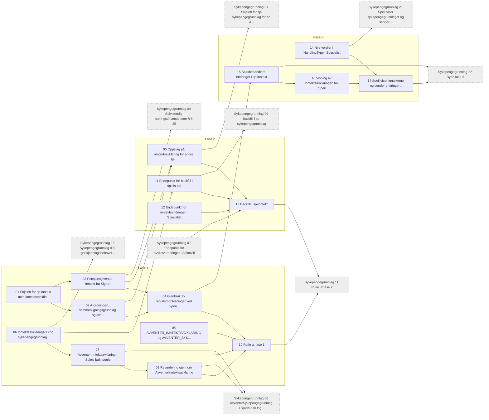

# Tickets: avklare inntekt

Tickets for [Avklare inntekt i sp-inntekt](../../specs/avklare-inntekt.md). Statusen står i hver ticket og i tabellen under. Fasene står i specen og er felles med [tickets: fastsette sykepengegrunnlag](../fastsette-sykepengegrunnlag/index.md). Grå bokser i diagrammet er tickets derfra. Hver fase rulles ut i dev før prod.

Tickets som gjelder begge specene, ligger der de først trengs. Ticket 06 og 08 gjelder også sykepengegrunnlaget, og byttet og opprydningen ligger i sykepengegrunnlaget (22–24).

| # | Ticket | Fase | Repo | Blokkeres av | Status |
|---|---|---|---|---|---|
| 01 | [Skjelett for sp-inntekt med inntektsmelding fra Spedisjon](01-skjelett-sp-inntekt.md) | 1 | sp-inntekt | Ingen | klar |
| 02 | [A-ordningen, sammenligningsgrunnlag og arbeidsforhold uten søknad](02-a-ordningen-og-arbeidsforhold-uten-soknad.md) | 1 | sp-inntekt | 01 | klar |
| 03 | [Pensjonsgivende inntekt fra Sigrun](03-pensjonsgivende-inntekt-fra-sigrun.md) | 1 | sp-inntekt | 01 | klar |
| 04 | [Gjenbruk av registeropplysninger ved `nyInnhenting: false`](04-gjenbruk-av-registeropplysninger.md) | 1 | sp-inntekt | 02, 03 | klar |
| 05 | [Oppslag på inntektsavklaring for andre tjenester](05-oppslag-pa-inntektsavklaring.md) | 2 | sp-inntekt | 02, 03 | klar |
| 06 | [Inntektsavklarings-ID og sykepengegrunnlag-ID på alle vilkårsgrunnlag i Spleis](06-ider-pa-alle-vilkarsgrunnlag.md) | 1 | spleis | Ingen | klar |
| 07 | [`AvventerInntektsavklaring` i Spleis bak toggle](07-spleis-avventer-inntektsavklaring.md) | 1 | spleis, sp-rettighetskategori | 06 | klar |
| 08 | [`AVVENTER_INNTEKTSAVKLARING` og `AVVENTER_SYKEPENGEGRUNNLAG` i Spock og spammer](08-tilstandene-i-spock-og-spammer.md) | 1 | spock, spammer | Ingen | klar |
| 09 | [Revurdering gjennom `AvventerInntektsavklaring`](09-revurdering-gjennom-avventer-inntektsavklaring.md) | 1 | spleis | 07 | klar |
| 10 | [Rulle ut fase 1](10-rulle-ut-fase-1.md) | 1 | spleis, sp-inntekt | 04, 07, 08, 09 | klar |
| 11 | [Endepunkt for backfill i spleis-api](11-spleis-api-sykepengegrunnlag.md) | 2 | spleis | 06 | klar |
| 12 | [Endepunkt for inntektsendringer i Spesialist](12-spesialist-inntektsendringer.md) | 2 | spesialist | Ingen | klar |
| 13 | [Backfill i sp-inntekt](13-backfill-i-sp-inntekt.md) | 2 | sp-inntekt | 05, 11, 12, sykepengegrunnlag 07 | klar |
| 14 | [Nye verdier i `HandlingType` i Spesialist](14-nye-handlingstyper-i-spesialist.md) | 3 | spesialist | Ingen | klar |
| 15 | [Saksbehandlers endringer i sp-inntekt](15-saksbehandlers-endringer-i-sp-inntekt.md) | 3 | sp-inntekt | 04 | klar |
| 16 | [Visning av inntektsavklaringen for Speil](16-visning-av-inntektsavklaringen.md) | 3 | sp-inntekt | 15 | klar |
| 17 | [Speil viser inntektene og sender endringer til sp-inntekt bak toggle](17-speil-inntekter-mot-sp-inntekt.md) | 3 | speil | 14, 16 | klar |

