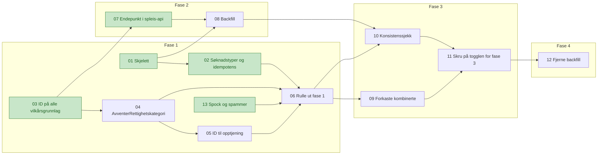

# Tickets: avklare rettighetskategori

Tickets for [Avklare rettighetskategori i sp-rettighetskategori](../../specs/avklare-rettighetskategori.md). Statusen står i hver ticket og i tabellen under. Ferdige tickets er grønne i diagrammet. Fasene står i specen. Hver fase rulles ut i dev før prod, og bare én toggle er i bruk om gangen.

| # | Ticket | Fase | Repo | Blokkeres av | Status |
|---|---|---|---|---|---|
| 01 | [Skjelett for sp-rettighetskategori som svarer på behov](01-skjelett-sp-rettighetskategori.md) | 1 | sp-rettighetskategori | Ingen | ferdig |
| 02 | [Alle søknadstyper, kombinasjoner og idempotens i sp-rettighetskategori](02-alle-soknadstyper-kombinasjoner-og-idempotens.md) | 1 | sp-rettighetskategori | 01 | ferdig |
| 03 | [Rettighetskategori-ID på alle vilkårsgrunnlag i Spleis](03-rettighetskategori-id-pa-alle-vilkarsgrunnlag.md) | 1 | spleis | Ingen | ferdig |
| 04 | [`AvventerRettighetskategori` i Spleis bak toggle](04-spleis-avventer-rettighetskategori.md) | 1 | spleis | 03 | klar |
| 05 | [Rettighetskategori-ID i opptjeningsbehovet](05-rettighetskategori-id-til-opptjening.md) | 1 | spleis, sp-vilkarsproving | 04 | klar |
| 06 | [Rulle ut fase 1](06-rulle-ut-fase-1.md) | 1 | spleis, sp-rettighetskategori | 02, 04, 05, 13 | klar |
| 07 | [Endepunkt for rettighetskategorier i spleis-api](07-spleis-api-rettighetskategorier.md) | 2 | spleis | 03 | ferdig |
| 08 | [Backfill av historikken i sp-rettighetskategori](08-backfill-i-sp-rettighetskategori.md) | 2 | sp-rettighetskategori | 01, 07 | pågår |
| 09 | [Forkaste kombinerte rettighetskategorier i Spleis](09-forkaste-kombinerte-kategorier.md) | 3 | spleis | 06 | klar |
| 10 | [Konsistenssjekk av rettighetskategori i `AvventerHistorikk`](10-konsistenssjekk-i-avventer-historikk.md) | 3 | spleis | 06, 08 | klar |
| 11 | [Skru på togglen for fase 3](11-skru-pa-togglen-for-fase-3.md) | 3 | spleis, sp-rettighetskategori | 09, 10 | klar |
| 12 | [Fjerne backfill](12-fjerne-backfill.md) | 4 | sp-rettighetskategori, spleis | 11 | klar |
| 13 | [`AVVENTER_RETTIGHETSKATEGORI` i Spock og spammer](13-tilstanden-i-spock-og-spammer.md) | 1 | spock, spammer | Ingen | ferdig |

