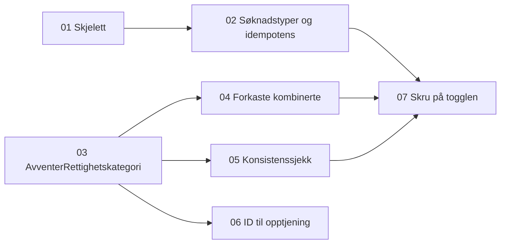

# Tickets: avklare rettighetskategori

Tickets for [Avklare rettighetskategori i sp-rettighetskategori](../../specs/avklare-rettighetskategori.md). Status står i hver ticket.

| # | Ticket | Repo | Blokkeres av |
|---|---|---|---|
| 01 | [Skjelett for sp-rettighetskategori som svarer på behov](01-skjelett-sp-rettighetskategori.md) | sp-rettighetskategori | Ingen |
| 02 | [Alle søknadstyper, kombinasjoner og idempotens i sp-rettighetskategori](02-alle-soknadstyper-kombinasjoner-og-idempotens.md) | sp-rettighetskategori | 01 |
| 03 | [`AvventerRettighetskategori` i Spleis bak toggle](03-spleis-avventer-rettighetskategori.md) | spleis | Ingen |
| 04 | [Forkaste kombinerte rettighetskategorier i Spleis](04-forkaste-kombinerte-kategorier.md) | spleis | 03 |
| 05 | [Konsistenssjekk av rettighetskategori i `AvventerHistorikk`](05-konsistenssjekk-i-avventer-historikk.md) | spleis | 03 |
| 06 | [Rettighetskategori-ID i opptjeningsbehovet](06-rettighetskategori-id-til-opptjening.md) | spleis, sp-vilkarsproving | 03 |
| 07 | [Skru på togglen for rettighetskategori](07-skru-pa-togglen.md) | spleis, sp-rettighetskategori | 02, 04, 05 |

