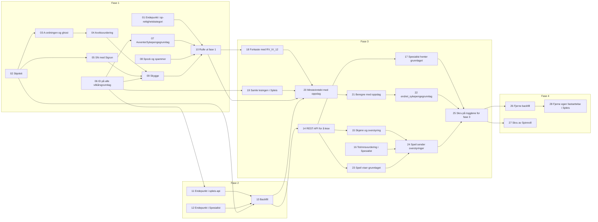

# Tickets: avklare sykepengegrunnlag

Tickets for [Avklare sykepengegrunnlag i sp-sykepengegrunnlag](../../specs/avklare-sykepengegrunnlag.md). Statusen står i hver ticket og i tabellen under. Ferdige tickets er grønne i diagrammet. Fasene står i specen. Hver fase rulles ut i dev før prod.

Ticketene forutsetter at [ticketene for rettighetskategori](../avklare-rettighetskategori/index.md) er ferdige, og at spill-av-im er skrudd av.

| # | Ticket | Fase | Repo | Blokkeres av | Status |
|---|---|---|---|---|---|
| 01 | [Endepunkt for én rettighetskategori i sp-rettighetskategori](01-endepunkt-for-rettighetskategori.md) | 1 | sp-rettighetskategori | Ingen | klar |
| 02 | [Skjelett for sp-sykepengegrunnlag som svarer på behov](02-skjelett-sp-sykepengegrunnlag.md) | 1 | sp-sykepengegrunnlag | Ingen | klar |
| 03 | [A-ordningen, ghost-arbeidsforhold og flere arbeidsgivere](03-a-ordningen-ghost-og-flere-arbeidsgivere.md) | 1 | sp-sykepengegrunnlag | 02 | klar |
| 04 | [Avviksvurdering for arbeidstaker](04-avviksvurdering.md) | 1 | sp-sykepengegrunnlag | 03 | klar |
| 05 | [Selvstendig næringsdrivende med pensjonsgivende inntekt fra Sigrun](05-selvstendig-naeringsdrivende-med-sigrun.md) | 1 | sp-sykepengegrunnlag | 02 | klar |
| 06 | [Sykepengegrunnlag-ID på alle vilkårsgrunnlag i Spleis](06-sykepengegrunnlag-id-pa-alle-vilkarsgrunnlag.md) | 1 | spleis | Ingen | klar |
| 07 | [`AvventerSykepengegrunnlag` i Spleis bak toggle](07-spleis-avventer-sykepengegrunnlag.md) | 1 | spleis | 06 | klar |
| 08 | [`AVVENTER_SYKEPENGEGRUNNLAG` i Spock og spammer](08-tilstanden-i-spock-og-spammer.md) | 1 | spock, spammer | Ingen | klar |
| 09 | [Skygge mot Spleis og Spinnvill](09-skygge-mot-spleis-og-spinnvill.md) | 1 | sp-sykepengegrunnlag | 04, 05, 06 | klar |
| 10 | [Rulle ut fase 1](10-rulle-ut-fase-1.md) | 1 | spleis, sp-sykepengegrunnlag | 01, 07, 08, 09 | klar |
| 11 | [Endepunkt for sykepengegrunnlag i spleis-api](11-spleis-api-sykepengegrunnlag.md) | 2 | spleis | 06 | klar |
| 12 | [Endepunkt for avviksvurderinger i Spesialist](12-spesialist-avviksvurderinger.md) | 2 | spesialist | Ingen | klar |
| 13 | [Backfill av historikken i sp-sykepengegrunnlag](13-backfill-i-sp-sykepengegrunnlag.md) | 2 | sp-sykepengegrunnlag | 02, 11, 12 | klar |
| 14 | [REST-API for å lese sykepengegrunnlaget](14-rest-api-for-a-lese.md) | 3 | sp-sykepengegrunnlag | 13 | klar |
| 15 | [Skjønnsfastsettelse og overstyring i sp-sykepengegrunnlag](15-skjonnsfastsettelse-og-overstyring.md) | 3 | sp-sykepengegrunnlag | 14 | klar |
| 16 | [Totrinnsvurdering for overstyringer fra sp-sykepengegrunnlag i Spesialist](16-spesialist-totrinnsvurdering.md) | 3 | spesialist | Ingen | klar |
| 17 | [Spesialist henter sykepengegrunnlaget fra sp-sykepengegrunnlag](17-spesialist-henter-sykepengegrunnlaget.md) | 3 | spesialist | 14 | klar |
| 18 | [Forkaste med RV_IV_12 i `AvventerSykepengegrunnlag`](18-forkaste-med-rv-iv-12.md) | 3 | spleis | 10 | klar |
| 19 | [Kartlegge og samle lesingen av inntektsgrunnlaget i Spleis](19-samle-lesingen-av-inntektsgrunnlaget.md) | 3 | spleis | 06 | klar |
| 20 | [Minsteinntekt med sykepengegrunnlaget fra oppslaget](20-minsteinntekt-med-oppslag.md) | 3 | spleis | 10, 13, 18, 19 | klar |
| 21 | [Beregne med beløpene fra oppslaget i `AvventerHistorikk`](21-beregne-med-oppslag.md) | 3 | spleis | 20 | klar |
| 22 | [`endret_sykepengegrunnlag` og refusjon alene i Spleis](22-endret-sykepengegrunnlag-i-spleis.md) | 3 | spleis | 21 | klar |
| 23 | [Speil viser sykepengegrunnlaget fra sp-sykepengegrunnlag](23-speil-viser-sykepengegrunnlaget.md) | 3 | speil | 14 | klar |
| 24 | [Speil sender skjønnsfastsettelse og overstyring til sp-sykepengegrunnlag](24-speil-sender-overstyringer.md) | 3 | speil | 15, 16, 23 | klar |
| 25 | [Skru på togglene for fase 3](25-skru-pa-togglene-for-fase-3.md) | 3 | spleis, speil, sp-sykepengegrunnlag | 17, 22, 24 | klar |
| 26 | [Fjerne backfill](26-fjerne-backfill.md) | 4 | sp-sykepengegrunnlag, spleis, spesialist | 25 | klar |
| 27 | [Skru av Spinnvill og fjerne avvik og skjønn i Spesialist](27-skru-av-spinnvill.md) | 4 | spinnvill, spesialist | 25 | klar |
| 28 | [Fjerne Spleis' egen fastsettelse av inntekt](28-fjerne-egen-fastsettelse-i-spleis.md) | 4 | spleis | 26 | klar |

