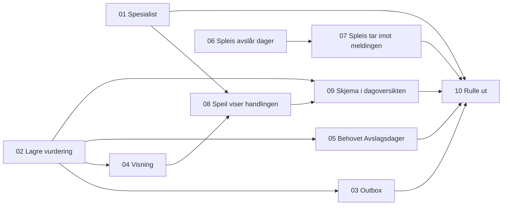

# Tickets: avslå dager etter oppholdskravet

Tickets for [Avslå dager etter oppholdskravet i sp-avslagsdager](../../specs/avslagsdager-oppholdskrav.md). Statusen står i hver ticket og i tabellen under.

| # | Ticket | Repo | Blokkeres av | Status |
|---|---|---|---|---|
| 01 | [Spesialist kjenner `AVSLAGSDAGER_ENDRET` og begrunnelsen `Oppholdskrav`](01-spesialist-avslagsdager-endret-og-oppholdskrav.md) | spesialist | Ingen | ferdig |
| 02 | [Saksbehandler kan lagre en vurdering av oppholdskravet](02-lagre-vurdering-av-oppholdskravet.md) | sp-avslagsdager | Ingen | klar |
| 03 | [Vurderingen publiseres til spesialist og Spleis via outbox](03-publisere-via-outbox.md) | sp-avslagsdager | 02 | klar |
| 04 | [Visning av vurderingen](04-visning-av-vurderingen.md) | sp-avslagsdager | 02 | klar |
| 05 | [sp-avslagsdager svarer på behovet `Avslagsdager`](05-svare-pa-behovet-avslagsdager.md) | sp-avslagsdager | 02 | klar |
| 06 | [Spleis avslår dager med `Oppholdskrav` fra behovet](06-spleis-avslar-dager-med-oppholdskrav.md) | spleis | Ingen | klar |
| 07 | [Spleis tar imot `avslagsdager_endret` og revurderer](07-spleis-revurderer-ved-avslagsdager-endret.md) | spleis | 06 | klar |
| 08 | [Speil viser handlingen og `Oppholdskrav`](08-speil-viser-handlingen-og-oppholdskrav.md) | speil | 01, 04 | klar |
| 09 | [Skjema for avslag i dagoversikten](09-speil-skjema-for-avslag.md) | speil | 02, 08 | klar |
| 10 | [Rulle ut i dev og prod](10-rulle-ut.md) | alle | 01, 03, 05, 07, 09 | klar |

