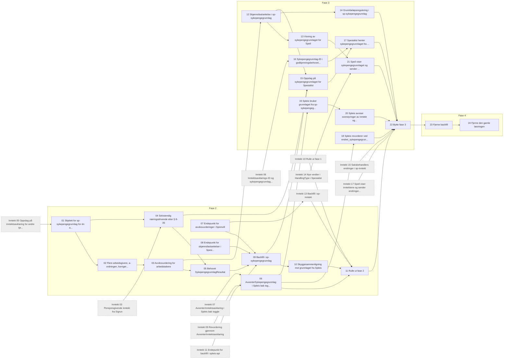

# Tickets: fastsette sykepengegrunnlag

Tickets for [Fastsette sykepengegrunnlag i sp-sykepengegrunnlag](../../specs/fastsette-sykepengegrunnlag.md). Statusen står i hver ticket og i tabellen under. Fasene står i specen og er felles med [tickets: avklare inntekt](../avklare-inntekt/index.md). Grå bokser i diagrammet er tickets derfra. Hver fase rulles ut i dev før prod.

Tickets som gjelder begge specene, ligger der de først trengs. Byttet og opprydningen (22–24) ligger her.

| # | Ticket | Fase | Repo | Blokkeres av | Status |
|---|---|---|---|---|---|
| 01 | [Skjelett for sp-sykepengegrunnlag for én arbeidstaker](01-skjelett-sp-sykepengegrunnlag.md) | 2 | sp-sykepengegrunnlag | inntekt 05 | klar |
| 02 | [Flere arbeidsgivere, a-ordningen, korrigerte inntekter og deaktiverte arbeidsforhold](02-flere-arbeidsgivere-korrigert-og-deaktivert.md) | 2 | sp-sykepengegrunnlag | 01 | klar |
| 03 | [Avviksvurdering for arbeidstakere](03-avviksvurdering.md) | 2 | sp-sykepengegrunnlag | 02 | klar |
| 04 | [Selvstendig næringsdrivende etter § 8-35](04-selvstendig-naeringsdrivende.md) | 2 | sp-sykepengegrunnlag | 01, inntekt 03 | klar |
| 05 | [Behovet `SykepengegrunnlagResultat`](05-sykepengegrunnlag-resultat.md) | 2 | sp-sykepengegrunnlag | 03, 04 | klar |
| 06 | [`AvventerSykepengegrunnlag` i Spleis bak toggle for skyggekjøring](06-spleis-avventer-sykepengegrunnlag.md) | 2 | spleis | inntekt 07, inntekt 09 | klar |
| 07 | [Endepunkt for avviksvurderinger i Spinnvill](07-spinnvill-avviksvurderinger.md) | 2 | spinnvill | Ingen | klar |
| 08 | [Endepunkt for skjønnsfastsettelser i Spesialist](08-spesialist-skjonnsfastsettelser.md) | 2 | spesialist | Ingen | klar |
| 09 | [Backfill i sp-sykepengegrunnlag](09-backfill-i-sp-sykepengegrunnlag.md) | 2 | sp-sykepengegrunnlag | 05, 07, 08, inntekt 11 | klar |
| 10 | [Skyggesammenligning mot grunnlaget fra Spleis](10-skyggesammenligning.md) | 2 | sp-sykepengegrunnlag | 09 | klar |
| 11 | [Rulle ut fase 2](11-rulle-ut-fase-2.md) | 2 | spleis, sp-inntekt, sp-sykepengegrunnlag | 06, 10, inntekt 10, inntekt 13 | klar |
| 12 | [Skjønnsfastsettelse i sp-sykepengegrunnlag](12-skjonnsfastsettelse.md) | 3 | sp-sykepengegrunnlag | 03 | klar |
| 13 | [Visning av sykepengegrunnlaget for Speil](13-visning-av-sykepengegrunnlaget.md) | 3 | sp-sykepengegrunnlag | 12 | klar |
| 14 | [Grunnbeløpsregulering i sp-sykepengegrunnlag](14-grunnbelopsregulering.md) | 3 | sp-sykepengegrunnlag | 12 | klar |
| 15 | [Oppslag på sykepengegrunnlaget for Spesialist](15-oppslag-for-spesialist.md) | 3 | sp-sykepengegrunnlag | 04, 09, 12 | klar |
| 16 | [Sykepengegrunnlag-ID i godkjenningsbehovet og `avsluttet_med_vedtak`](16-id-i-godkjenning-og-avsluttet-med-vedtak.md) | 3 | spleis | inntekt 06 | klar |
| 17 | [Spesialist henter sykepengegrunnlaget fra sp-sykepengegrunnlag bak toggle](17-spesialist-henter-sykepengegrunnlaget.md) | 3 | spesialist | 15, 16 | klar |
| 18 | [Spleis revurderer ved `endret_sykepengegrunnlag`](18-spleis-revurderer-ved-endret-sykepengegrunnlag.md) | 3 | spleis | 06 | klar |
| 19 | [Spleis bruker grunnlaget fra sp-sykepengegrunnlag bak bytte-togglen](19-spleis-bruker-grunnlaget-fra-tjenesten.md) | 3 | spleis | 06 | klar |
| 20 | [Spleis avviser overstyringer av inntekt og grunnlag etter byttet](20-spleis-avviser-overstyringer.md) | 3 | spleis | 19 | klar |
| 21 | [Speil viser sykepengegrunnlaget og sender skjønnsfastsettelser til sp-sykepengegrunnlag bak toggle](21-speil-sykepengegrunnlag-mot-tjenesten.md) | 3 | speil | 13, inntekt 14 | klar |
| 22 | [Bytte (fase 3)](22-bytte.md) | 3 | spleis, spesialist, speil, sp-inntekt, sp-sykepengegrunnlag, spregulering | 11, 14, 17, 18, 20, 21, inntekt 15, inntekt 17 | klar |
| 23 | [Fjerne backfill](23-fjerne-backfill.md) | 4 | sp-inntekt, sp-sykepengegrunnlag, spleis, spinnvill, spesialist | 22 | klar |
| 24 | [Fjerne den gamle løsningen](24-fjerne-den-gamle-losningen.md) | 4 | spleis, spesialist, spinnvill, spregulering | 23 | klar |

