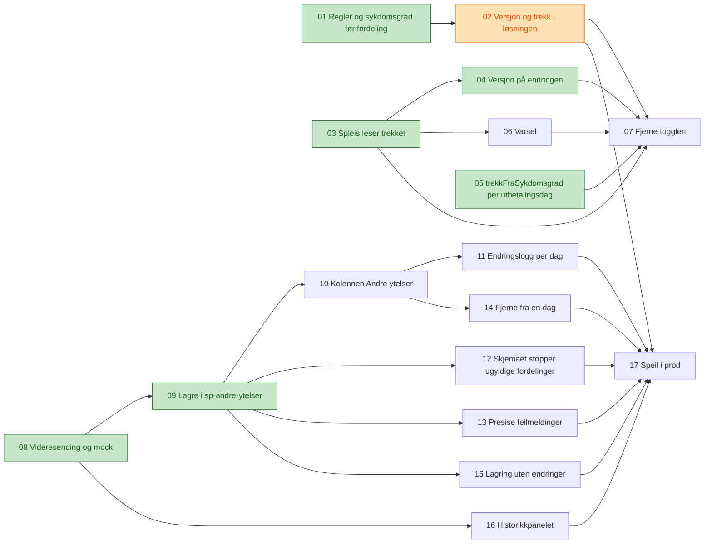

# Tickets: graderte andre ytelser

Tickets for [Graderte andre ytelser fra saksbehandler](../../specs/graderte-andre-ytelser.md). Statusen står i hver ticket og i tabellen under. Ferdige tickets er grønne og tickets som pågår er oransje i diagrammet.

| # | Ticket | Repo | Blokkeres av | Status |
|---|---|---|---|---|
| 01 | [sp-andre-ytelser lagrer sykdomsgraden før fordeling og håndhever reglene](01-sykdomsgrad-for-fordeling-og-regler.md) | sp-andre-ytelser | Ingen | ferdig |
| 02 | [sp-andre-ytelser svarer med versjon og trekk fra sykdomsgrad](02-versjon-og-trekk-i-losningen.md) | sp-andre-ytelser | 01 | pågår |
| 03 | [Spleis leser løsningen fra sp-andre-ytelser og bruker trekket](03-spleis-leser-trekket.md) | spleis | Ingen | ferdig |
| 04 | [Spleis lagrer versjonen på endringen i behandlingen](04-spleis-lagrer-versjoner.md) | spleis | 03 | ferdig |
| 05 | [Spleis lagrer `trekkFraSykdomsgrad` per utbetalingsdag](05-spleis-lagrer-trekk-fra-sykdomsgrad.md) | spleis | Ingen | ferdig |
| 06 | [Spleis varsler når sykdomsgraden er endret etter fordelingen](06-spleis-varsler-ved-endret-sykdomsgrad.md) | spleis | 03 | klar |
| 07 | [Fjerne togglen for graderte andre ytelser i Spleis](07-fjerne-togglen.md) | spleis | 02, 03, 04, 05, 06 | klar |
| 08 | [Speil videresender og mocker API-et til sp-andre-ytelser](08-speil-videresender-og-mocker-api-et.md) | speil | Ingen | ferdig |
| 09 | [Speil lagrer fordelingene i sp-andre-ytelser med sykdomsgraden før fordeling](09-speil-lagrer-fordelinger-i-sp-andre-ytelser.md) | speil | 08 | ferdig |
| 10 | [Dagoversikten får kolonnen «Andre ytelser» med fordelingen for hver dag](10-visning-av-fordelingen-per-dag.md) | speil | 09 | klar |
| 11 | [Saksbehandler og beslutter ser endringsloggen for fordelingen per dag](11-endringslogg-for-fordelingen-per-dag.md) | speil | 10 | klar |
| 12 | [Skjemaet stopper fordelinger som bryter reglene](12-skjemaet-stopper-ugyldige-fordelinger.md) | speil | 09 | klar |
| 13 | [Saksbehandler får presise feilmeldinger fra sp-andre-ytelser](13-presise-feilmeldinger.md) | speil | 09 | klar |
| 14 | [Saksbehandler kan fjerne graderte andre ytelser fra en dag](14-fjerne-graderte-andre-ytelser-fra-en-dag.md) | speil | 10 | klar |
| 15 | [Lagring uten reelle endringer venter ikke på oppdatering](15-lagring-uten-endringer-venter-ikke.md) | speil | 09 | klar |
| 16 | [Beslutter ser endringer av fordelingene i historikkpanelet](16-historikk-i-historikkpanelet.md) | speil | 08 | klar |
| 17 | [Graderte andre ytelser i Speil i prod](17-speil-i-prod.md) | speil | 02, 08–16 | klar |

