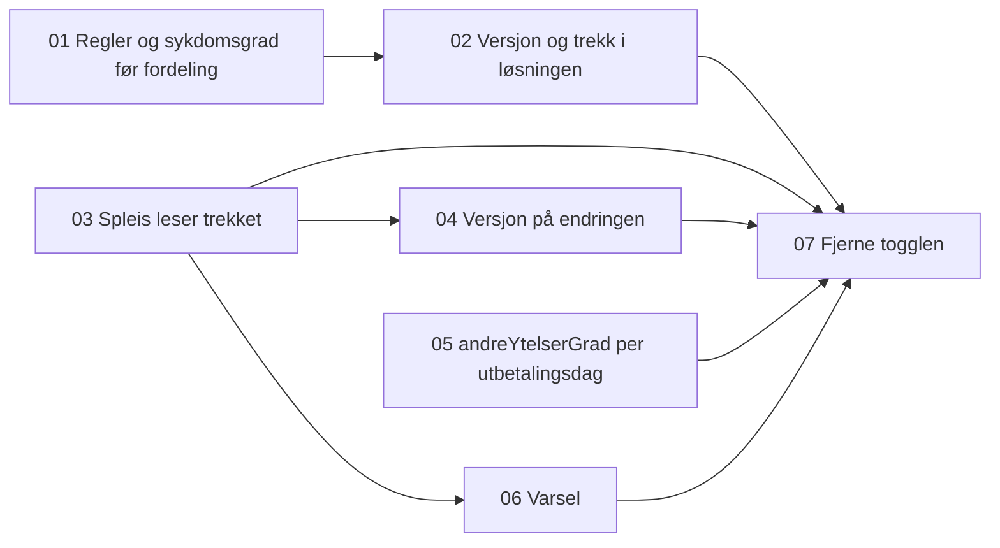

# Tickets: graderte andre ytelser

Tickets for [Graderte andre ytelser fra saksbehandler](../../specs/graderte-andre-ytelser.md). Statusen står i hver ticket og i tabellen under. Speil-teamet lager skjemaet og visningen i Speil selv.

| # | Ticket | Repo | Blokkeres av | Status |
|---|---|---|---|---|
| 01 | [sp-andre-ytelser lagrer sykdomsgraden før fordeling og håndhever reglene](01-sykdomsgrad-for-fordeling-og-regler.md) | sp-andre-ytelser | Ingen | ferdig |
| 02 | [sp-andre-ytelser svarer med versjon og trekk fra sykdomsgrad](02-versjon-og-trekk-i-losningen.md) | sp-andre-ytelser | 01 | pågår |
| 03 | [Spleis leser løsningen fra sp-andre-ytelser og bruker trekket](03-spleis-leser-trekket.md) | spleis | Ingen | ferdig |
| 04 | [Spleis lagrer versjonen på endringen i behandlingen](04-spleis-lagrer-versjoner.md) | spleis | 03 | klar |
| 05 | [Spleis lagrer `andreYtelserGrad` per utbetalingsdag](05-spleis-lagrer-andre-ytelser-grad.md) | spleis | Ingen | klar |
| 06 | [Spleis varsler når sykdomsgraden er endret etter fordelingen](06-spleis-varsler-ved-endret-sykdomsgrad.md) | spleis | 03 | klar |
| 07 | [Fjerne togglen for graderte andre ytelser i Spleis](07-fjerne-togglen.md) | spleis | 02, 03, 04, 05, 06 | klar |

